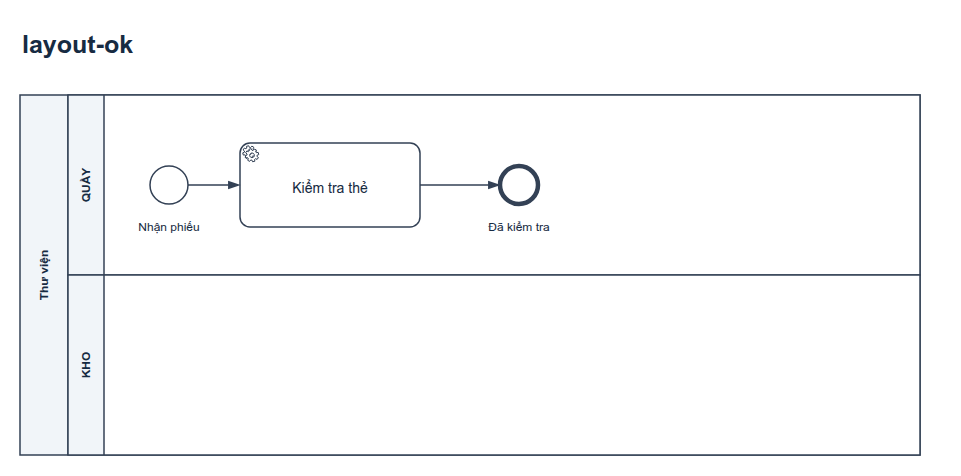
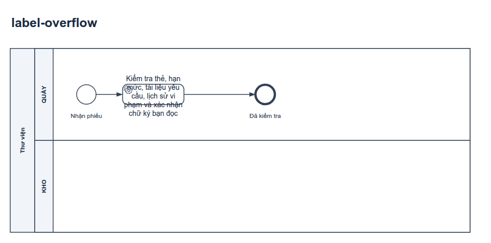
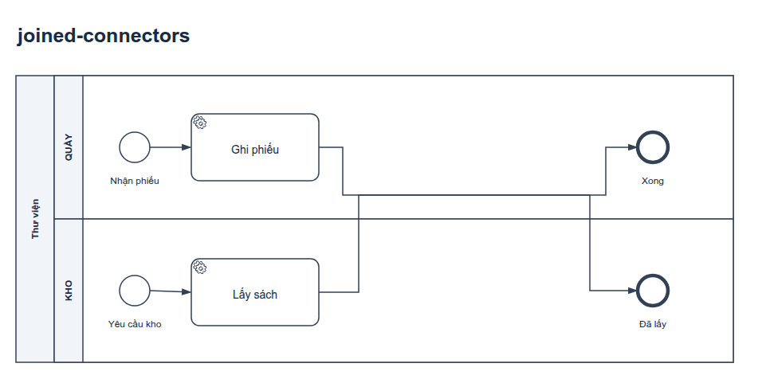
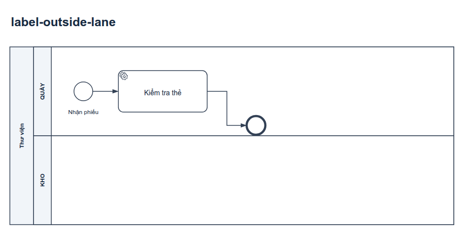
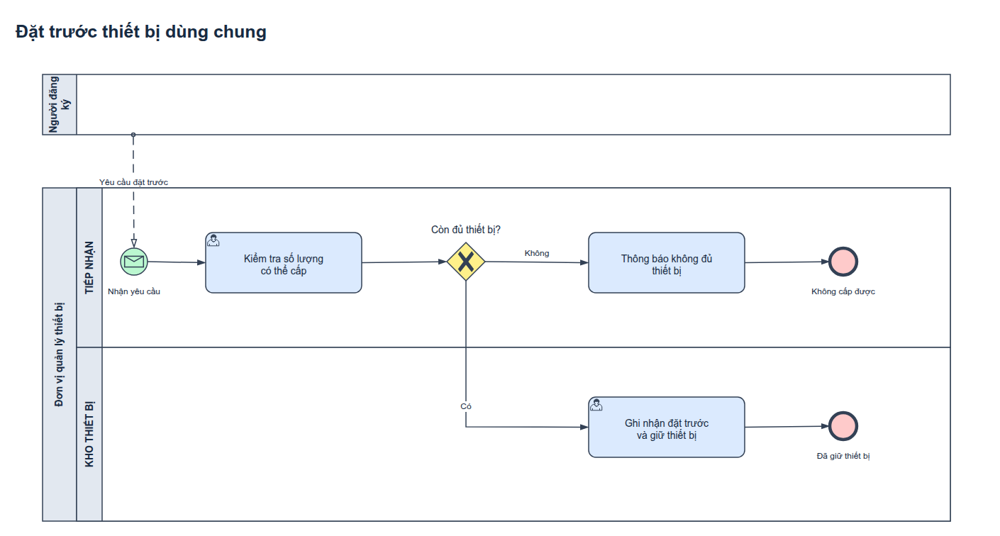

# Hướng dẫn sử dụng bpmn-drawio

Dành cho người dùng AI agent để vẽ hoặc rà soát sơ đồ BPMN trong draw.io: sinh viên, người làm phân tích nghiệp vụ, người viết tài liệu quy trình. Phiên bản: `1.0.0-rc.2`.

## Mục lục

1. [Skill làm gì, không làm gì](#1-skill-làm-gì-không-làm-gì)
2. [Cài đặt](#2-cài-đặt)
3. [Dùng qua agent](#3-dùng-qua-agent)
4. [Tự chạy công cụ](#4-tự-chạy-công-cụ)
5. [Đọc báo cáo kiểm tra](#5-đọc-báo-cáo-kiểm-tra)
6. [Các lỗi bố cục được phát hiện](#6-các-lỗi-bố-cục-được-phát-hiện)
7. [Màu và theme](#7-màu-và-theme)
8. [Sự cố thường gặp](#8-sự-cố-thường-gặp)

## 1. Skill làm gì, không làm gì

Skill hướng dẫn agent đi theo thứ tự **nghiệp vụ → ký pháp BPMN 2.0.2 → bố cục → màu**. Agent:

- lập bảng yêu cầu → phần tử (ai làm, trigger, dữ liệu, điều kiện, ngoại lệ, kết quả), tách dữ kiện với giả định;
- chọn ký pháp theo chuẩn OMG (pool/lane, event theo vị trí, gateway, message flow, boundary…);
- vẽ bằng hình BPMN gốc của draw.io, dựng ảnh bằng renderer thật của draw.io và đọc lại ảnh;
- chạy bộ kiểm tra cấu trúc, ký pháp, màu và bố cục;
- bàn giao mặc định: hai file `.drawio` (thường và có màu, cùng mô hình), PNG/SVG của cả hai, và một file Markdown giải thích.

Skill **không** chứng nhận sơ đồ đúng chuẩn OMG, không chạy quy trình như BPMN engine, không tự xác nhận nghiệp vụ. Kiểm tra đạt chỉ nghĩa là không thấy các lỗi mà công cụ biết tìm. Choreography, Conversation, xuất BPMN XML thực thi và tự bố trí hoàn toàn chưa được hỗ trợ — xem [phạm vi hỗ trợ](../skills/bpmn-drawio/references/coverage.md).

## 2. Cài đặt

1. Tải ZIP ở mục **Releases**, đối chiếu SHA-256 với file `.sha256` đi kèm, giải nén giữ nguyên thư mục `bpmn-drawio/`.
2. Đặt vào nơi agent đọc skill. Với Claude Code: `~/.claude/skills/bpmn-drawio/` (mọi dự án) hoặc `.claude/skills/bpmn-drawio/` (một dự án).
3. Chuẩn bị mã nguồn draw.io (cần để dựng ảnh; skill không tự tải):

   ```bash
   git clone --filter=blob:none https://github.com/jgraph/drawio.git
   git -C drawio checkout 17b367b91dbab91804f852645788d7ffb46dcb79
   ```

4. Kiểm tra môi trường (Python 3.10+, Chrome/Chromium, viewer draw.io, quyền ghi, font):

   ```bash
   python3 bpmn-drawio/scripts/doctor.py --drawio-root drawio --output-dir output
   ```

5. Kiểm tra gói:

   ```bash
   python3 -B bpmn-drawio/scripts/smoke_package.py bpmn-drawio-1.0.0-rc.2-candidate.zip --drawio-root drawio --report smoke.json
   ```

## 3. Dùng qua agent

Skill tự được dùng khi yêu cầu liên quan đến BPMN/draw.io. Nói rõ đường dẫn mã nguồn draw.io và thư mục đầu ra để agent không phải đoán.

**Tạo mới từ đề bài:**

> Đọc đề trong `de-bai/quy-trinh-tuyen-dung.pdf`, vẽ sơ đồ BPMN bằng draw.io vào thư mục `bai-lam/`. Mã nguồn draw.io ở `~/tools/drawio`. Cần bản thường, bản màu, ảnh và file giải thích.

**Sửa sơ đồ có sẵn:**

> Trong `quy-trinh.drawio`, thêm nhánh: nếu khách không phản hồi sau 3 ngày thì hủy đơn. Giữ nguyên bố cục các phần khác, xuất lại ảnh và bản màu.

**Chỉ rà soát, không sửa:**

> Rà soát `bai-lam/BPMN.drawio` theo chuẩn BPMN 2.0.2 và đề bài: chỉ báo lỗi và đề xuất, không sửa file.

Agent hỏi lại khi thiếu thông tin làm thay đổi kết quả (ví dụ hạn chờ, ai phê duyệt); các lựa chọn thông thường nó tự quyết và ghi thành giả định. Hãy đọc phần giả định trong file giải thích — đó là chỗ dễ sai nghiệp vụ nhất.

## 4. Tự chạy công cụ

Chạy từ thư mục cha của `bpmn-drawio/` (thay `drawio` bằng đường dẫn mã nguồn thật).

```bash
# Ví dụ tổng hợp: tạo Demo.drawio, Demo_Co_mau.drawio và README giải thích
python3 bpmn-drawio/scripts/create_demo.py --output-dir output/demo

# Tạo bản thường và bản màu từ một file bất kỳ
python3 bpmn-drawio/scripts/colorize_drawio.py nguon.drawio thuong.drawio --theme monochrome
python3 bpmn-drawio/scripts/colorize_drawio.py thuong.drawio mau.drawio --theme bizagi-inspired

# Dựng SVG/PNG (và PDF) bằng viewer draw.io + Chrome; mỗi bản một thư mục riêng
python3 bpmn-drawio/scripts/render_drawio.py thuong.drawio --drawio-root drawio --output-dir output/thuong --text-mode plain --pdf
python3 bpmn-drawio/scripts/render_drawio.py mau.drawio --drawio-root drawio --output-dir output/mau --text-mode plain --pdf

# Kiểm tra; bản màu so với bản thường để chắc chỉ khác màu
python3 bpmn-drawio/scripts/audit_drawio.py thuong.drawio --render-dir output/thuong --palette monochrome --strict-layout --require-supported --report output/kiem-tra-thuong.json
python3 bpmn-drawio/scripts/audit_drawio.py mau.drawio --render-dir output/mau --compare thuong.drawio --palette bizagi-inspired --strict-layout --require-supported --report output/kiem-tra-mau.json
```

Vẽ bằng code: `scripts/bpmn_builder.py` cung cấp `Diagram` (pool, lane, task, event, gateway, boundary, edge) với tọa độ tuyệt đối và `save_pair(diagrams, path, normal_theme="monochrome", color_theme="bizagi-inspired")` để ghi hai bản. Builder không tự bố trí; bạn chọn tọa độ và tuyến đường. Xem `create_demo.py` và [ví dụ liên thư viện](../examples/bpmn/muon-sach-lien-thu-vien/README.md).

## 5. Đọc báo cáo kiểm tra

`audit_drawio.py` ghi JSON và thoát mã 1 nếu có lỗi trong các nhóm được yêu cầu. Các trường quan trọng:

| Trường | Ý nghĩa | Phải làm gì |
|---|---|---|
| `errors` | Vi phạm cấu trúc/ký pháp được hỗ trợ: sequence vượt pool, event sai loại theo vị trí, message flow sai chiều catch/throw, boundary thiếu đường ra, Link không ghép cặp, gateway không tách/gộp, nét/mũi tên sai… Có `--strict-layout` thì lỗi bố cục cũng vào đây | Sửa trước khi bàn giao |
| `palette_errors` | Màu không khớp theme đã chọn (`--palette`) | Tô lại bằng `colorize_drawio.py` |
| `layout_issues` | Lỗi bố cục trên số đo render (mục 6) | Sửa, hoặc giải thích nếu là ngoại lệ có chủ đích |
| `pages[].manual_review` | Điều công cụ không tự quyết được: điều kiện gateway, đồng bộ inclusive, transaction, Call Activity… | Người hoặc agent phải xem và ghi kết luận |
| `unsupported_elements` | Loại phần tử/biến thể chưa có bộ luật | Rà riêng; `--require-supported` biến thành lỗi |
| `only_color_differs` | Có `--compare`: hai bản chỉ khác giá trị màu | Phải là `true` |
| `sourceSha256`, `tool` | Hash file nguồn và phiên bản/hash công cụ | Ảnh cũ hơn nguồn sẽ bị báo “stale” |

`passed_all_requested_checks: true` **không** có nghĩa sơ đồ đúng nghiệp vụ. Luôn mở ảnh và đi thử các kịch bản (luồng chính, ngoại lệ, hết hạn, hủy).

## 6. Các lỗi bố cục được phát hiện

Có `--render-dir`, auditor dùng hộp nhãn và tuyến đường thật do draw.io tính để tìm: nhãn chồng hình hoặc chồng nhãn khác; chữ tràn khỏi task/pool của chính nó; nhãn event/gateway ra ngoài lane/pool; nhãn vắt qua đường biên container; connector cắt ngang nhãn; hai connector không chung đầu mút chạy chồng lên nhau; hình nằm ngoài container. Chạm ≤ 2 px được bỏ qua.

Bốn trang dưới đây được dựng thật từ bộ test của skill. **Trang 2–4 cố ý sai** để minh họa, không phải mẫu để chép.

| Trang | Ảnh |
|---|---|
| 1 — Sạch: không có phát hiện |  |
| 2 — Cố ý sai: chữ tràn khỏi task, đè lên marker và viền |  |
| 3 — Cố ý sai: hai đường không liên quan chạy chồng, trông như nhập nhánh |  |
| 4 — Cố ý sai: nhãn End ra ngoài lane và **bị lane bên dưới che mất** |  |

Trang 4 cho thấy nhãn ra ngoài lane không chỉ là lỗi thẩm mỹ: lane vẽ sau có nền trắng nên che mất chữ. Các giao cắt vuông góc giữa hai đường không bị coi là lỗi; vẫn nên xem ảnh để chắc người đọc không hiểu nhầm.

## 7. Màu và theme



- `monochrome`: nền trắng, nét và chữ gần đen — bản thường, in đen trắng.
- `bizagi-inspired`: start xanh lá, **mọi** end đỏ (kể cả kết thúc thành công), event trung gian/boundary và gateway vàng, activity xanh dương. Màu chọn theo loại phần tử, không theo chữ trong nhãn. Đây là profile cục bộ lấy cảm hứng trình bày, không phải màu chính thức của Bizagi hay quy định của OMG.
- `tool-convention`: profile cũ, giữ để tái tạo kết quả trước đây.
- Theme riêng: file JSON cùng cấu trúc trong `skills/bpmn-drawio/assets/themes/`, truyền đường dẫn vào `--theme`/`--palette`. Chỉ khai báo được màu; độ tương phản chữ ≥ 4.5:1 và nét ≥ 3:1 được kiểm khi nạp. Xem [themes.md](../skills/bpmn-drawio/references/themes.md).

Tô màu không được đổi ký pháp: nét liền/đứt, mũi tên, số vòng và độ dày viền event, marker catch/throw giữ nguyên. Ẩn nét/chữ (`none`) hoặc tô nền trùng màu nét ở event có marker bị báo lỗi.

## 8. Sự cố thường gặp

| Thông báo | Nguyên nhân và cách xử lý |
|---|---|
| `Chrome/Chromium not found; supply --chrome PATH` | Cài Chrome/Chromium hoặc chỉ đường dẫn bằng `--chrome` |
| `Missing official viewer: …viewer-static.min.js` | `--drawio-root` không trỏ tới gốc mã nguồn draw.io |
| `Source archive requires --source-manifest with commit and viewer_sha256` | Mã nguồn không có `.git` (tải dạng archive); thêm `--source-manifest bpmn-drawio/assets/drawio-source.json` nếu đúng commit đã khóa |
| `Viewer digest differs from provenance manifest` | Bản draw.io khác commit trong manifest; dùng đúng commit hoặc bỏ manifest khi dùng Git checkout |
| `Rendered evidence is stale for this input digest` | Đã sửa `.drawio` sau khi dựng; dựng lại vào thư mục sạch |
| `Multiple render reports for the same page…` | Thư mục dựng lẫn nhiều lần chạy; dùng thư mục riêng cho mỗi bản |
| `PDF export requires portable SVG; rerun with --text-mode plain` | Thêm `--text-mode plain` khi dùng `--pdf` |
| Manual note `Render evidence was produced by a different skill tool version` | Ảnh dựng bằng phiên bản công cụ khác; dựng lại trước khi kết luận |
| Chữ tiếng Việt hiển thị sai | Cài font có đủ dấu (Arial hoặc Liberation Sans); xem `font_substitution` trong báo cáo `doctor.py` |

Đã thử trên Linux; chưa kiểm chứng trên Windows/macOS. Báo lỗi theo [hướng dẫn đóng góp](../CONTRIBUTING.md#báo-lỗi).
