# Bộ ví dụ BPMN 2.0.2 độc lập

Mười tình huống tự đặt để học và kiểm tra cách mô hình hóa; không nhập hay sao chép mô hình gọi đồ ăn. Mỗi tình huống là một biểu đồ độc lập, đặt ở một tab riêng để tiện xem. Không có yêu cầu một đề mới phải dùng cả mười trang này.

Mở [bản thường](bpmn-patterns.drawio) hoặc [bản màu](bpmn-patterns-color.drawio) bằng draw.io. Hai file cùng nội dung và bố cục. Trong VS Code dùng Markdown Preview để xem các ảnh dưới đây; SVG cùng thư mục để phóng to.

## Mục lục

- [V01 — Duyệt đề nghị mua thiết bị](#v01)
- [V02 — Tiếp nhận nhân sự với hai việc song song](#v02)
- [V03 — Phát hành tài liệu theo các kênh được chọn](#v03)
- [V04 — Xin báo giá và chờ phản hồi hoặc hết hạn](#v04)
- [V05 — Nhắc yêu cầu hỗ trợ mà không ngắt xử lý](#v05)
- [V06 — Bắt lỗi phát hành chứng từ](#v06)
- [V07 — Event Sub-Process nhận yêu cầu hủy lịch tư vấn](#v07)
- [V08 — Transaction ghi danh và bù trừ suất đã giữ](#v08)
- [V09 — Multi-instance trên một bộ ba tệp](#v09)
- [V10 — Terminate chỉ dừng subprocess hiện tại](#v10)
<a id="v01"></a>

## V01 — Duyệt đề nghị mua thiết bị

**Đề tự đặt:** Nhân viên lập đề nghị mua thiết bị trên ứng dụng. Quản lý đánh giá rồi chọn đúng một trong ba kết quả: duyệt, yêu cầu sửa, từ chối. Nếu sửa, nhân viên cập nhật cùng đề nghị rồi quản lý đánh giá lại. Nếu duyệt hoặc từ chối, hệ thống lưu kết quả tương ứng và kết thúc. Chỉ xét đề nghị có đủ dữ liệu đầu vào; không mô hình hóa đặt hàng hay thanh toán.

**Đối chiếu chuẩn:** §8.4.13 tr.95–97; §9.3 tr.111–119; §10.6.2 tr.287–290. Trang in của đặc tả, cộng 30 để ra số trang trình đọc PDF.

**Yêu cầu → phần tử và cách dùng:**

- P là công ty; L1/L2 là hai vai trò nội bộ, không phải hai participant độc lập.
- T1 tạo/cập nhật dữ liệu đề nghị. D1 là data association chấm nhỏ tới DATA, không truyền token.
- T2 tạo decision thuộc tập APPROVE / REWORK / REJECT; G chỉ đọc kết quả đó.
- YES và REWORK có điều kiện; NO là mặc định có dấu gạch chéo. Điều kiện từ gateway không có hình thoi nhỏ đầu đường.
- REWORK quay về T1, không quay về Start. Các đường qua lane thuộc container chung để không bị cắt hình.

**Đi thử nghiệp vụ:**

1. APPROVE: S → T1 → T2 → G → TA → EA; không chạy TR.
2. REJECT: S → T1 → T2 → G → TR → ER; không chạy TA.
3. REWORK rồi APPROVE: T1 và T2 mỗi việc chạy hai lần; TA chạy một lần. Việc sửa có thể lặp tiếp nếu quản lý lại yêu cầu sửa.

**Phạm vi / giả định:** Nhánh mặc định có nghĩa REJECT vì miền dữ liệu đã giới hạn ba giá trị; giá trị không hợp lệ phải bị chặn trước khi G được kích hoạt. Vòng lặp không tự bảo đảm người dùng cuối cùng sẽ sửa đúng.

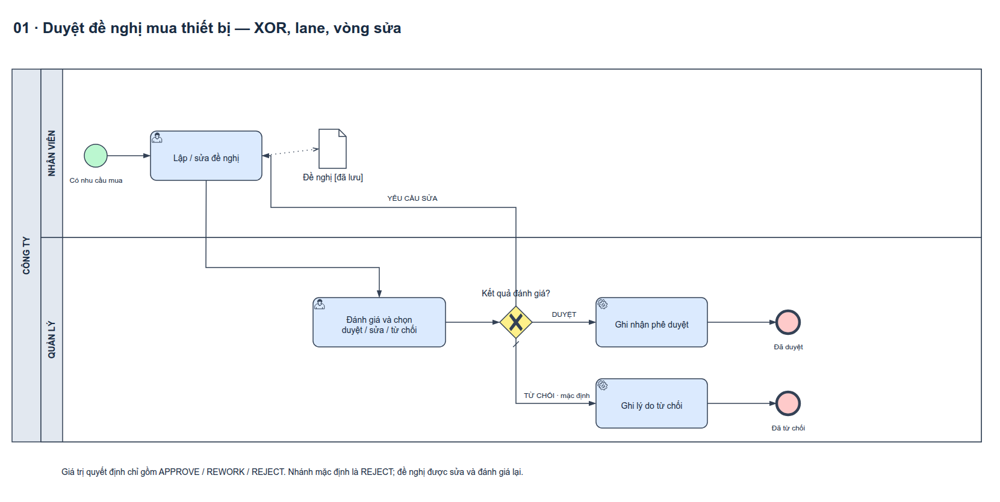

[SVG để phóng to](color/01-01-duyet-de-nghi-mua-thiet-bi-xor-lane-vong-sua.svg)

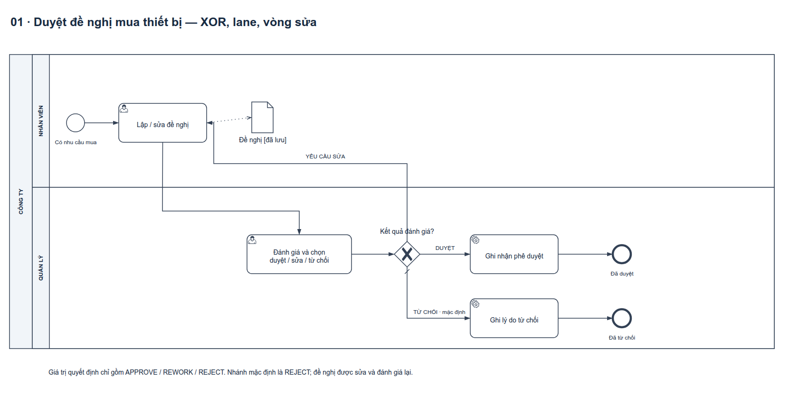

[SVG để phóng to](normal/01-01-duyet-de-nghi-mua-thiet-bi-xor-lane-vong-sua.svg)

<a id="v02"></a>

## V02 — Tiếp nhận nhân sự với hai việc song song

**Đề tự đặt:** Khi có nhân sự mới, bộ phận Nhân sự chuẩn bị hồ sơ nhận việc, đồng thời CNTT cấp tài khoản và quyền ban đầu. Cả hai việc đều bắt buộc. Chỉ sau khi cả hai hoàn tất, Nhân sự mới xác nhận sẵn sàng tiếp nhận. Trong tình huống này các tác vụ hoàn tất thành công; lỗi cấp tài khoản nằm ngoài đề tự đặt.

**Đối chiếu chuẩn:** §9.3 tr.111–119; §10.6.4 tr.292–294. Trang in của đặc tả, cộng 30 để ra số trang trình đọc PDF.

**Yêu cầu → phần tử và cách dùng:**

- Một pool công ty, hai lane HR/IT. Sequence được qua lane.
- SPLIT là AND: phát token cho A và B, không chọn một nhánh.
- JOIN là AND: chờ một token ở mỗi đầu vào AJ/BJ rồi phát đúng một token sang DONE.
- DONE là User Task vì người Nhân sự xác nhận trên ứng dụng; B là Service Task vì hệ thống cấp tài khoản.

**Đi thử nghiệp vụ:**

1. A xong trước: JOIN chờ B; DONE chưa được chạy.
2. B xong trước: JOIN chờ A; DONE chưa được chạy.
3. Cả hai đã xong: DONE và E mỗi phần tử được thực hiện một lần.

**Phạm vi / giả định:** Thay JOIN bằng XOR có thể làm DONE chạy hai lần. Thay SPLIT bằng XOR nhưng giữ AND JOIN sẽ gây chờ một nhánh không bao giờ được kích hoạt.

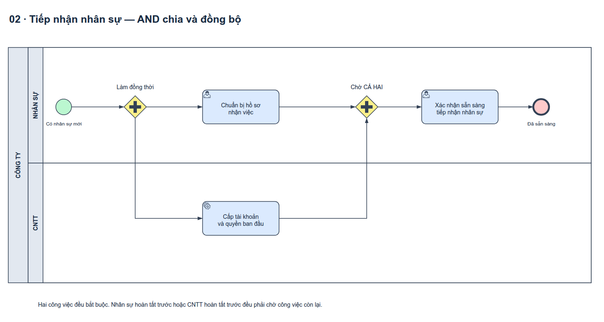

[SVG để phóng to](color/02-02-tiep-nhan-nhan-su-and-chia-va-dong-bo.svg)

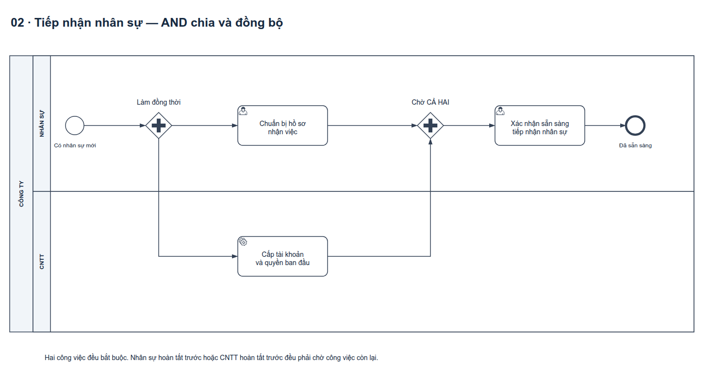

[SVG để phóng to](normal/02-02-tiep-nhan-nhan-su-and-chia-va-dong-bo.svg)

<a id="v03"></a>

## V03 — Phát hành tài liệu theo các kênh được chọn

**Đề tự đặt:** Với một bản tài liệu đã duyệt, người yêu cầu có thể chọn email, bản giấy, cả hai hoặc không chọn kênh nào. Hệ thống đọc lựa chọn. Nếu email được chọn thì gửi bản điện tử; nếu bản giấy được chọn thì nhân viên in và bàn giao. Sau khi mọi kênh được chọn hoàn thành, ghi nhận kết quả. Không chọn kênh thì chỉ ghi nhận lựa chọn không phát hành.

**Đối chiếu chuẩn:** §8.4.13 tr.95–97; §10.6.3 tr.290–292. Trang in của đặc tả, cộng 30 để ra số trang trình đọc PDF.

**Yêu cầu → phần tử và cách dùng:**

- SPLIT/JOIN có vòng tròn Inclusive, không phải XOR hoặc AND.
- SA có điều kiện email; SB có điều kiện paper. Cả hai có thể đúng đồng thời.
- NONE là nhánh mặc định chỉ được chọn khi cả email và paper đều false.
- JOIN chỉ chờ các nhánh đang hoạt động trong cấu trúc khép kín này.
- B là Manual Task vì in/bàn giao là công việc thực tế; A là Send Task. Bên nhận được lược khỏi góc nhìn process nội bộ, nên không vẽ message nội pool.

**Đi thử nghiệp vụ:**

1. email=false, paper=false: chỉ đi NONE, không chạy A/B.
2. email=true, paper=false: chỉ chạy A, JOIN không chờ B.
3. email=false, paper=true: chỉ chạy B, JOIN không chờ A.
4. Cả hai true: A/B có thể hoàn tất theo hai thứ tự; DONE vẫn chỉ chạy một lần.

**Phạm vi / giả định:** Đây là vùng split/join có cấu trúc và không có vòng lặp. Không suy rộng kiểm tra này thành bằng chứng cho mọi inclusive join có nhiều đường quay lại.

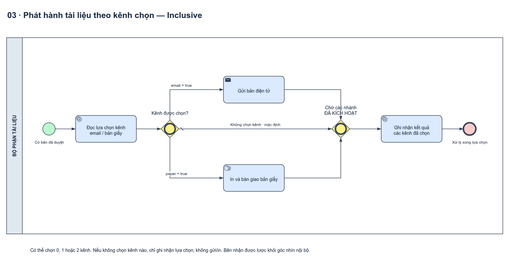

[SVG để phóng to](color/03-03-phat-hanh-tai-lieu-theo-kenh-chon-inclusive.svg)

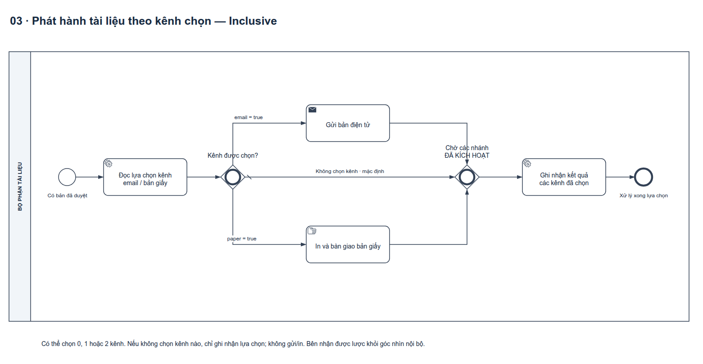

[SVG để phóng to](normal/03-03-phat-hanh-tai-lieu-theo-kenh-chon-inclusive.svg)

<a id="v04"></a>

## V04 — Xin báo giá và chờ phản hồi hoặc hết hạn

**Đề tự đặt:** Bên mua gửi một yêu cầu báo giá cho nhà cung cấp. Sau khi gửi, chờ phản hồi đầu tiên theo mã yêu cầu hoặc hết một ngày kể từ lúc bắt đầu chờ. Nếu nhận được báo giá trước, người mua đánh giá rồi kết thúc. Nếu hết hạn trước, đóng yêu cầu vì không có phản hồi. Phản hồi trễ được lưu đối chiếu và không tự mở lại yêu cầu.

**Đối chiếu chuẩn:** §9.4 tr.119–122; §10.5.4 tr.249–258; §10.6.5 tr.295–299. Trang in của đặc tả, cộng 30 để ra số trang trình đọc PDF.

**Yêu cầu → phần tử và cách dùng:**

- SUP là participant bên ngoài dạng black box; P là quy trình bên mua.
- M1/M2 là message flow nét đứt, vòng tròn gửi rỗng, đầu nhận không tô. Sequence không vượt pool.
- RACE là event-based gateway, hai vòng tròn có ngũ giác trong hình thoi.
- Hai phần tử ngay sau RACE là Message Catch và Timer Catch. Các đường RM/RT không có điều kiện hay nhánh mặc định.
- TIME có duration P1D, tính từ lúc cấu hình chờ tại RACE được kích hoạt.

**Đi thử nghiệp vụ:**

1. Nhận báo giá trước: MSG thắng, timer bị vô hiệu; REVIEW → E1, CLOSE không chạy.
2. Hết hạn trước: TIME thắng, chờ MSG bị vô hiệu; CLOSE → E2, REVIEW không chạy.
3. Phản hồi đến sau E2 không kích hoạt lại REVIEW của instance đã đóng.

**Phạm vi / giả định:** Khi hai sự kiện được xử lý cùng thời điểm, chỉ một sự kiện thắng theo cơ chế xử lý sự kiện của hệ thống; đề không quy định ưu tiên. Giả định có lưu/tương quan message đến sớm bằng mã yêu cầu. Kiểm thử token của bộ này không mô phỏng broker hay đồng hồ.

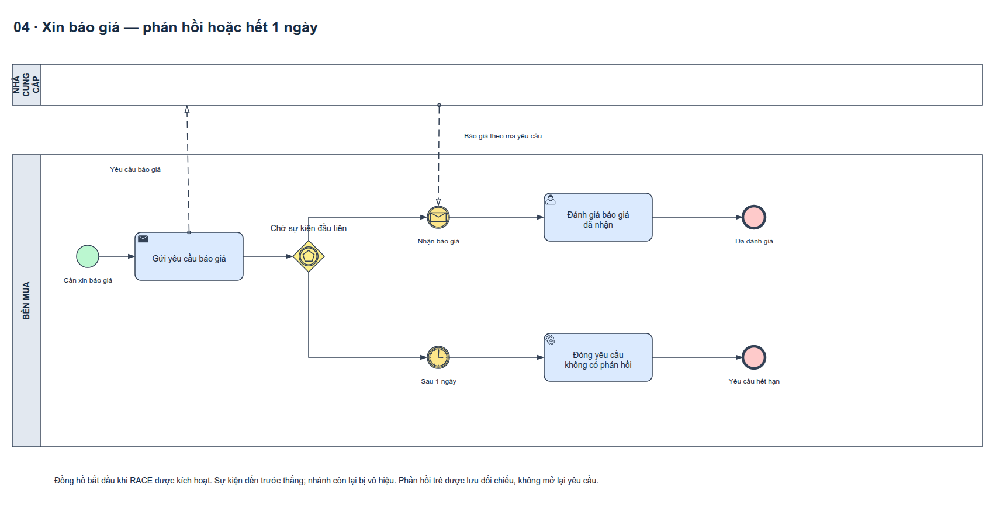

[SVG để phóng to](color/04-04-xin-bao-gia-phan-hoi-hoac-het-1-ngay.svg)

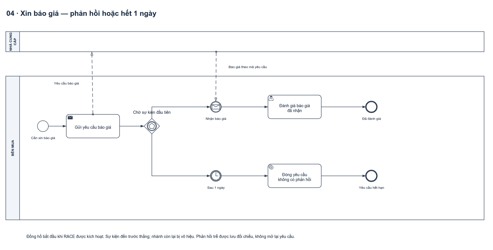

[SVG để phóng to](normal/04-04-xin-bao-gia-phan-hoi-hoac-het-1-ngay.svg)

<a id="v05"></a>

## V05 — Nhắc yêu cầu hỗ trợ mà không ngắt xử lý

**Đề tự đặt:** Người phụ trách phân tích và xử lý yêu cầu hỗ trợ trên ứng dụng. Nếu sau hai giờ tác vụ vẫn hoạt động, hệ thống tạo đúng một nhắc việc cho người phụ trách và tiếp tục xử lý chính. Khi người phụ trách hoàn tất, lưu kết quả xử lý. Nếu hoàn tất trước hai giờ thì không tạo nhắc việc.

**Đối chiếu chuẩn:** §10.5.4 tr.252–255; §10.5.6 tr.276–279. Trang in của đặc tả, cộng 30 để ra số trang trình đọc PDF.

**Yêu cầu → phần tử và cách dùng:**

- REM gắn trên biên WORK và có hai vòng nét đứt: boundary timer không ngắt.
- Duration PT2H là một lần, không phải timeCycle lặp.
- Nhánh REM → PING → ER sinh thêm token; WORK vẫn tiếp tục.
- ER là None End riêng của nhánh nhắc; không dùng Terminate End.
- Nếu WORK hoàn tất, đăng ký timer của WORK bị gỡ. Instance còn hoạt động nếu một nhánh nhắc đã phát vẫn chưa xong.

**Đi thử nghiệp vụ:**

1. WORK xong trước 2 giờ: LOG → E; không PING/ER.
2. Timer nổ khi WORK đang chạy: PING được kích hoạt, WORK không bị hủy.
3. PING xong trước WORK hoặc sau WORK đều hợp lệ; process chỉ xong khi không còn token hoạt động.

**Phạm vi / giả định:** Hai vòng đứt nói về không ngắt, không phải đường message. Compensation boundary là ngoại lệ khác: luôn viền liền, không diễn giải bằng quy tắc timer này.

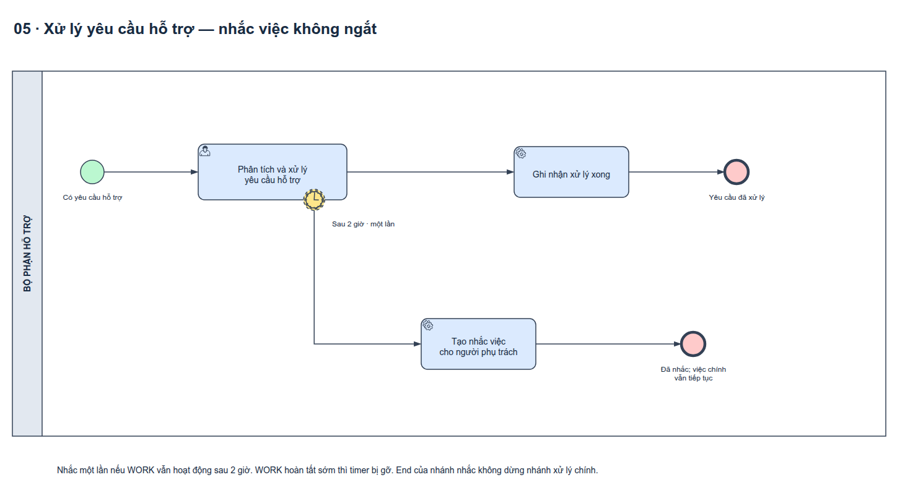

[SVG để phóng to](color/05-05-xu-ly-yeu-cau-ho-tro-nhac-viec-khong-ngat.svg)

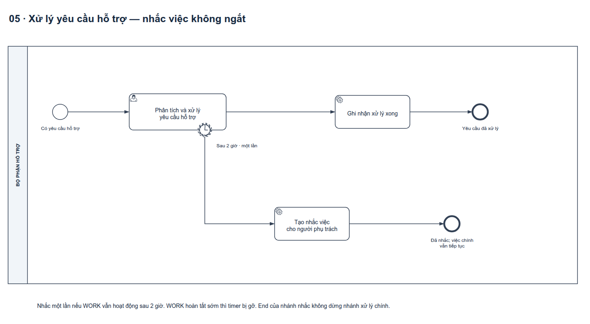

[SVG để phóng to](normal/05-05-xu-ly-yeu-cau-ho-tro-nhac-viec-khong-ngat.svg)

<a id="v06"></a>

## V06 — Bắt lỗi phát hành chứng từ

**Đề tự đặt:** Khi dữ liệu đủ, hệ thống phát hành chứng từ. Nếu thành công thì lưu mã đã phát hành và kết thúc thành công. Nếu hoạt động phát ra lỗi E_ISSUE thì ngắt hoạt động, người phụ trách kiểm tra và chuyển hồ sơ vào hàng chờ xử lý thủ công. Kết thúc nhánh lỗi có nghĩa đã bàn giao hàng chờ, chưa có nghĩa chứng từ được phát hành thành công.

**Đối chiếu chuẩn:** §10.5.4 tr.254; §10.5.6 tr.274–279. Trang in của đặc tả, cộng 30 để ra số trang trình đọc PDF.

**Yêu cầu → phần tử và cách dùng:**

- ISSUE là Service Task; ERR là Boundary Error bắt E_ISSUE.
- Error boundary luôn ngắt và có hai vòng liền, marker tia sét không tô.
- ERR → FIX thay đường hoàn thành bình thường của ISSUE; LOG không chạy ở nhánh lỗi.
- FIX là User Task. EF ghi kết quả bàn giao đúng phạm vi, tránh nhãn chung chung “Hoàn tất”.

**Đi thử nghiệp vụ:**

1. Thành công: ISSUE → LOG → E; không FIX.
2. E_ISSUE: ISSUE bị ngắt → FIX → EF; không LOG/E.
3. Lỗi khác không được tự nhận là đã xử lý bằng E_ISSUE nếu hợp đồng bắt lỗi không bao gồm nó.

**Phạm vi / giả định:** E_ISSUE là Error được hoạt động chủ động phát ra theo hợp đồng, không đồng nghĩa mọi exception lập trình đều tự trở thành BPMN Error. Chi tiết khắc phục sau hàng chờ nằm ngoài tình huống.

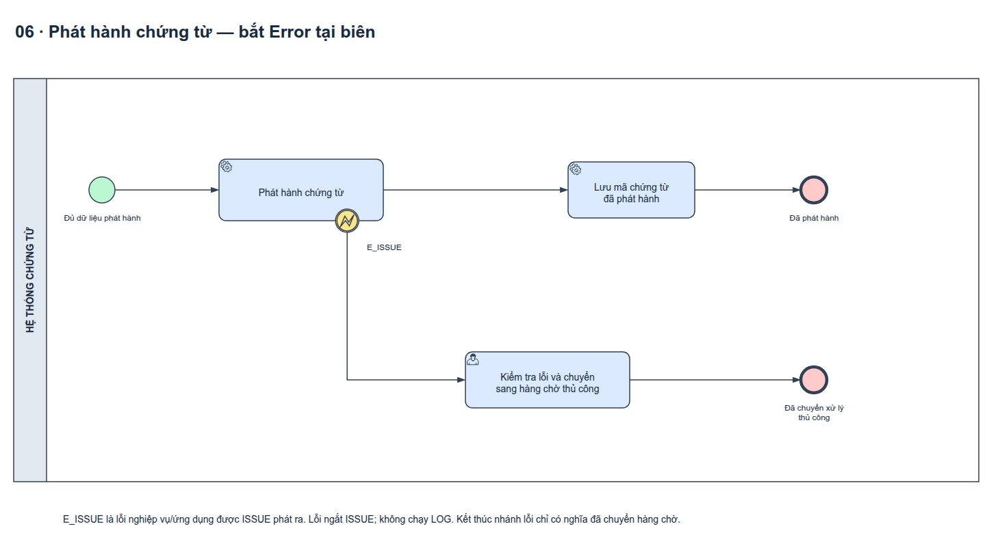

[SVG để phóng to](color/06-06-phat-hanh-chung-tu-bat-error-tai-bien.svg)

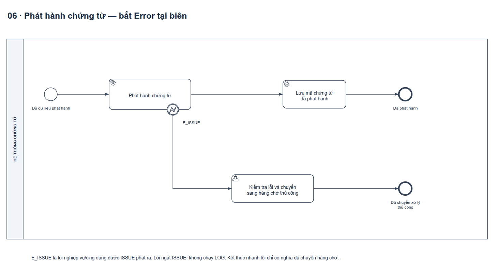

[SVG để phóng to](normal/06-06-phat-hanh-chung-tu-bat-error-tai-bien.svg)

<a id="v07"></a>

## V07 — Event Sub-Process nhận yêu cầu hủy lịch tư vấn

**Đề tự đặt:** Bộ phận tư vấn xử lý yêu cầu lịch: trao đổi với khách, xác nhận và lưu lịch. Trong khi instance còn hoạt động, khách được hủy bằng message chứa mã yêu cầu. Khi nhận hủy, ngắt luồng thường, ghi trạng thái hủy rồi kết thúc. Đây là quản lý trạng thái yêu cầu lịch; không bao gồm giữ suất có thu phí hoặc hoàn tiền.

**Đối chiếu chuẩn:** §10.3.5 tr.174–176; §10.5.2 tr.237–244; §10.5.6 tr.274–279. Trang in của đặc tả, cộng 30 để ra số trang trình đọc PDF.

**Yêu cầu → phần tử và cách dùng:**

- ESP là Event Sub-Process: khung đứt, không có sequence vào/ra khung.
- CS là Message Start ngắt, một vòng liền và phong bì không tô. Khung ESP đứt không có nghĩa CS không ngắt.
- MC từ CUSTOMER đến CS là message liên participant, có thể đi qua biên ESP để vào sự kiện đúng scope.
- CS ngắt các công việc thường còn hoạt động trong P; CANCEL → CE ghi kết quả hủy.
- CE là None End. Hủy nghiệp vụ này không phải Cancel End của transaction.

**Đi thử nghiệp vụ:**

1. Không nhận hủy: S → WAIT → SAVE → E.
2. Nhận hủy khi WAIT đang hoạt động: WAIT bị ngắt, CANCEL → CE; không đi tiếp SAVE.
3. Nếu có cập nhật đã hoàn tất trước khi nhận hủy, nó không tự được undo; CANCEL phải ghi trạng thái cuối là đã hủy.
4. Message khi instance đã kết thúc được tiếp nhận ở ngoài quy trình này; không tạo instance mới từ CS.

**Phạm vi / giả định:** Giả định các cập nhật trạng thái được tuần tự hóa theo cùng mã yêu cầu để tránh ghi đè trạng thái hủy; BPMN không tự triển khai khóa dữ liệu. Hủy được cho phép suốt thời gian instance còn hoạt động, không chỉ khi WAIT đang chạy.

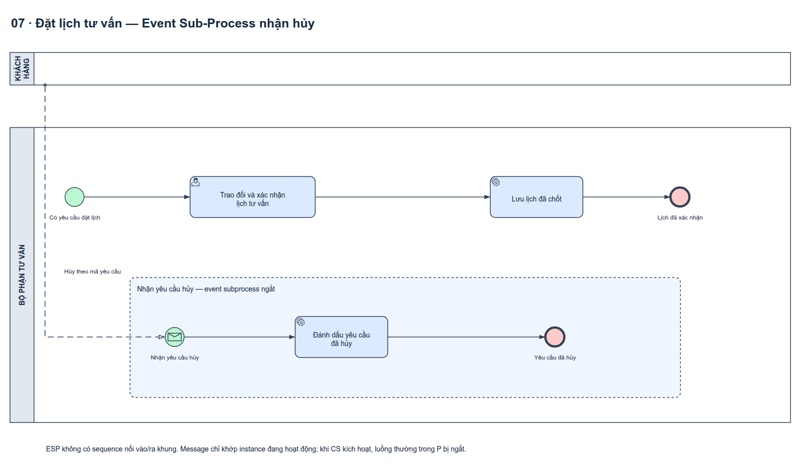

[SVG để phóng to](color/07-07-dat-lich-tu-van-event-sub-process-nhan-huy.svg)

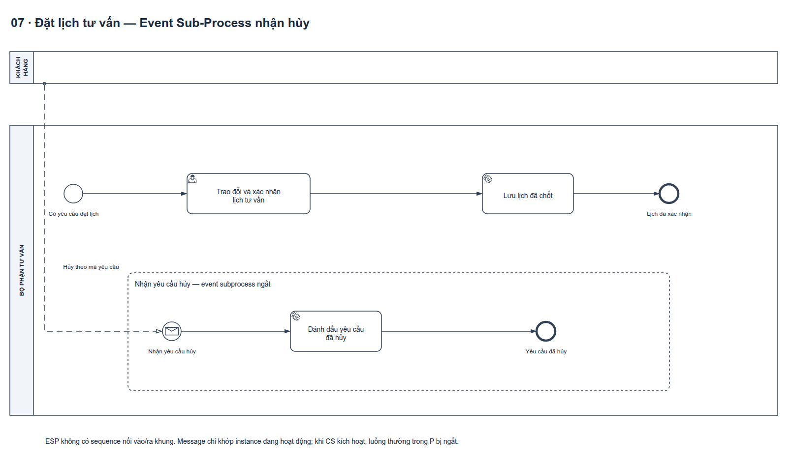

[SVG để phóng to](normal/07-07-dat-lich-tu-van-event-sub-process-nhan-huy.svg)

<a id="v08"></a>

## V08 — Transaction ghi danh và bù trừ suất đã giữ

**Đề tự đặt:** Ban tổ chức thực hiện một transaction ghi danh. Trước hết giữ một suất, sau đó người dùng xác nhận tiếp tục hay hủy. Tiếp tục thì hoàn tất transaction và ghi nhận ghi danh thành công. Nếu hủy, transaction phải trả lại suất đã giữ bằng compensation, sau đó mới ghi nhận ghi danh đã hủy. Tình huống giả định có suất, thao tác giữ/trả suất và transaction protocol thành công; chưa xét hazard hoặc lỗi bù trừ.

**Đối chiếu chuẩn:** §10.3.5 tr.176–178; §10.5.4 tr.254; §10.7 tr.301–305. Trang in của đặc tả, cộng 30 để ra số trang trình đọc PDF.

**Yêu cầu → phần tử và cách dùng:**

- TX có khung đôi; không phải subprocess thường hay khung event subprocess.
- BOOK hoàn thành thì mới có thể được bù trừ. COMP là boundary compensation, hai vòng liền, marker không tô.
- COMP nối UNDO bằng association chấm nhỏ, mũi tên mở; không phải sequence flow.
- UNDO có marker compensation và isForCompensation=true, nằm ngoài sequence thường.
- TC là Cancel End nằm bên trong TX. BC là Cancel Boundary gắn chính TX.
- BC chỉ phát luồng ra FAIL khi rollback/compensation xong. Chỉ khi hoàn tất transaction bình thường mới đi DONE.

**Đi thử nghiệp vụ:**

1. Tiếp tục: BOOK → CONFIRM → G → TE; transaction commit xong → DONE → E; UNDO không chạy.
2. Hủy sau khi BOOK xong: TC hủy transaction, COMP kích hoạt UNDO; trả suất xong mới BC → FAIL → EF.
3. COMP không ngắt BOOK đang chạy: bù trừ áp dụng cho công việc đã hoàn tất. Khái niệm ngắt/không ngắt không áp dụng cho compensation boundary.

**Phạm vi / giả định:** Đây là mô hình BPMN transaction ở mức nghiệp vụ. Việc chạy được trên engine đòi hỏi protocol và cấu hình thực thi. Boundary Error/Timer không tự có tác dụng bù trừ như Cancel của transaction.

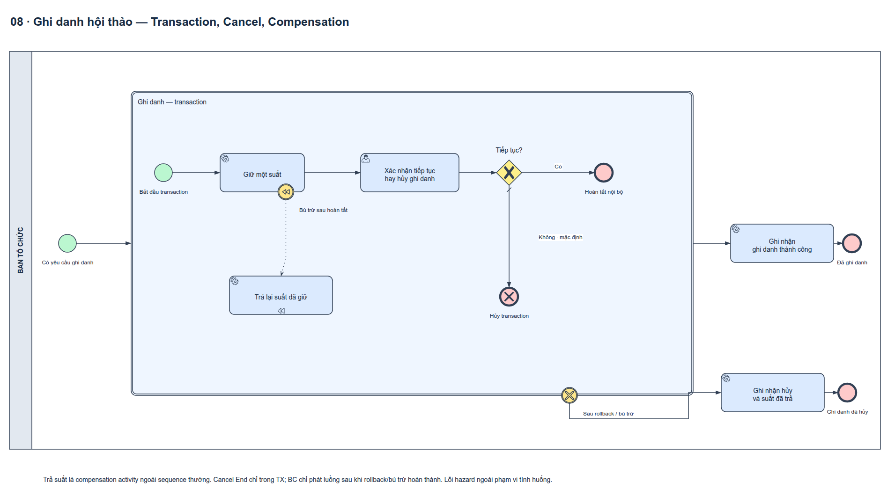

[SVG để phóng to](color/08-08-ghi-danh-hoi-thao-transaction-cancel-compensation.svg)

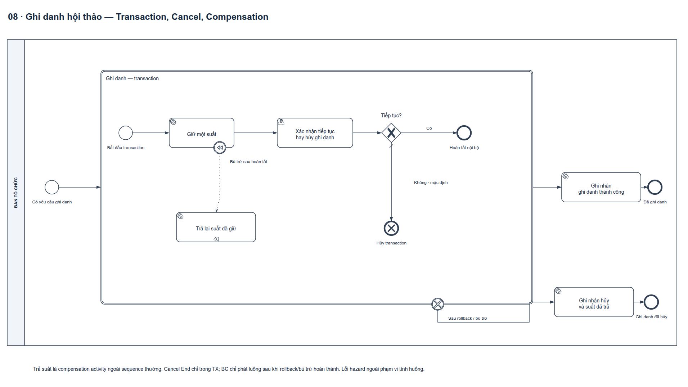

[SVG để phóng to](normal/08-08-ghi-danh-hoi-thao-transaction-cancel-compensation.svg)

<a id="v09"></a>

## V09 — Multi-instance trên một bộ ba tệp

**Đề tự đặt:** Mỗi lần nhận đúng ba tệp. Trước hết chuẩn hóa ba tệp lần lượt. Khi chuẩn hóa cả ba xong, cho phép người kiểm tra đối chiếu ba tệp đồng thời. Chỉ khi đủ ba kết quả đối chiếu mới tổng hợp và kết thúc. Không có điều kiện kết thúc sớm, không xét danh sách rỗng hoặc lỗi từng tệp.

**Đối chiếu chuẩn:** §10.3.8 tr.188–195. Trang in của đặc tả, cộng 30 để ra số trang trình đọc PDF.

**Yêu cầu → phần tử và cách dùng:**

- NORMALIZE có ba vạch ngang: Multi-Instance Sequential, ba lần thực hiện lần lượt.
- REVIEW có ba vạch dọc: Multi-Instance Parallel, ba instance được phép cùng hoạt động.
- loopCardinality=3 là metadata giải thích trong draw.io, không phải cấu hình engine có thể thực thi.
- Mỗi node activity hoàn thành một lần ở cấp luồng ngoài sau khi đủ ba instance bên trong.
- MERGE không được kích hoạt chỉ vì một REVIEW instance đã xong.

**Đi thử nghiệp vụ:**

1. Chuẩn hóa tệp 1, rồi 2, rồi 3; chưa sang REVIEW khi mới chuẩn hóa xong một hoặc hai tệp.
2. REVIEW 3 có thể xong trước REVIEW 1/2; MERGE vẫn chờ đủ ba.
3. Đủ ba REVIEW: MERGE chạy một lần, E một lần.

**Phạm vi / giả định:** Multi-instance không giống Standard Loop trên cùng một activity instance, và không có nghĩa nhân bản toàn bộ process. Collection/item mapping và lỗi từng instance cần thiết kế thêm nếu đề yêu cầu thực thi.

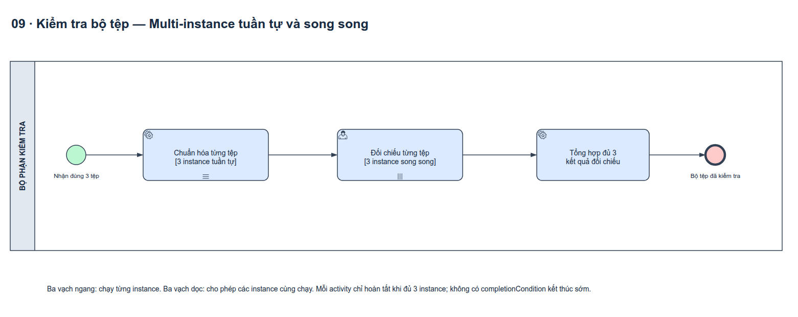

[SVG để phóng to](color/09-09-kiem-tra-bo-tep-multi-instance-tuan-tu-va-song-song.svg)

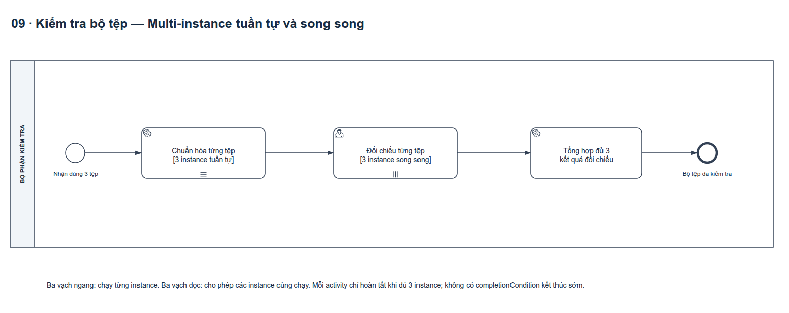

[SVG để phóng to](normal/09-09-kiem-tra-bo-tep-multi-instance-tuan-tu-va-song-song.svg)

<a id="v10"></a>

## V10 — Terminate chỉ dừng subprocess hiện tại

**Đề tự đặt:** Trong subprocess rà soát đăng ký, đồng thời đánh giá chi tiết và kiểm tra tiêu chí cấm. Nếu bị cấm thì ghi trạng thái bị chặn và dừng mọi việc còn hoạt động trong subprocess. Nếu không bị cấm thì chờ các nhánh kết thúc bình thường. Khi subprocess đã kết thúc theo một trong hai cách, process cha vẫn ghi nhận kết quả, kể cả kết quả bị chặn.

**Đối chiếu chuẩn:** §10.5.3 tr.245–248; §10.5.6 tr.279; §13 về thực thi. Trang in của đặc tả, cộng 30 để ra số trang trình đọc PDF.

**Yêu cầu → phần tử và cách dùng:**

- SP là subprocess thường mở rộng, khung liền. SS là None Start bên trong.
- SPLIT là AND, tạo hai công việc độc lập A và B.
- AE/BE là None End: mỗi end chỉ tiêu thụ token đến nó; SP chưa hoàn tất khi còn nhánh khác.
- STOP là Terminate End có hình tròn đặc. Nó dừng các token/hoạt động còn lại trong SP.
- LOG ở process cha P vẫn chạy sau SP; Terminate trong SP không phải lệnh dừng mọi pool hay dừng cả P.

**Đi thử nghiệp vụ:**

1. Không bị chặn: A → AE và B → G → BE theo bất kỳ thứ tự; sau cả hai mới LOG.
2. B phát hiện bị chặn khi A đang chạy: FLAG → STOP dừng A; SP kết thúc, P → LOG → E.
3. A đã hoàn tất trước STOP: không undo A; STOP chỉ dừng công việc còn hoạt động trong scope.
4. Nếu đặt STOP trực tiếp trong P thì phạm vi dừng thay đổi; không di chuyển event ra ngoài SP chỉ để chỉnh bố cục.

**Phạm vi / giả định:** blocked được khởi tạo false và FLAG ghi true trước STOP. Kết quả đánh giá chi tiết chỉ là dữ liệu nội bộ, chưa phát hành quyết định ra ngoài; LOG ghi đúng trạng thái cuối.

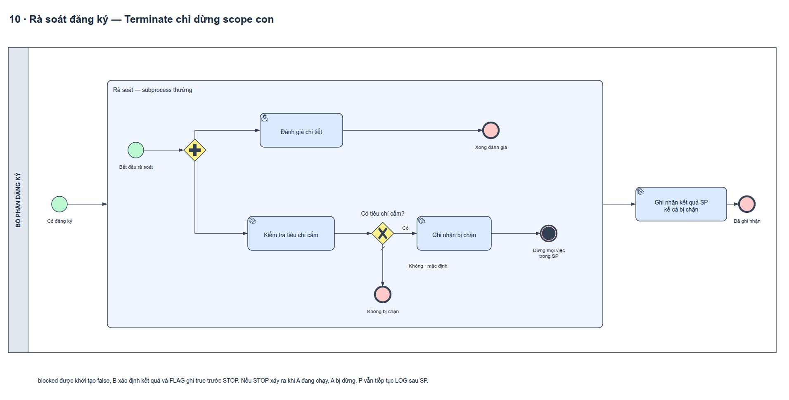

[SVG để phóng to](color/10-10-ra-soat-dang-ky-terminate-chi-dung-scope-con.svg)

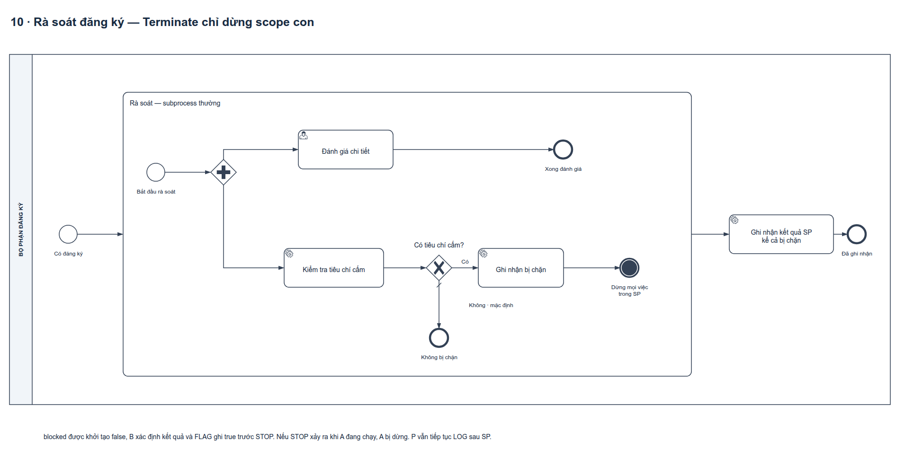

[SVG để phóng to](normal/10-10-ra-soat-dang-ky-terminate-chi-dung-scope-con.svg)

## Cách tự vẽ lại và áp dụng cho đề mới

1. Đọc đoạn đề của tình huống, xác định phạm vi và kết quả trước khi mở draw.io.
2. Đặt pool/lane đúng trách nhiệm; chọn task theo người/hệ thống/công việc vật lý.
3. Đặt đúng event/gateway; nối sequence trước rồi thêm message/data/association nếu cần.
4. Với gateway, ghi dữ liệu và điều kiện nhánh; với event, ghi trigger và scope. Với subprocess, phân biệt hoàn thành, ngắt và bù trừ.
5. Đi thử các kịch bản đã ghi; kiểm tra việc bắt buộc, việc bị cấm và trạng thái cuối.
6. Canh hàng và chỉnh waypoint; không chuyển loại ký hiệu để sửa lỗi bố cục. Tạo bản màu chỉ bằng thay thuộc tính màu.
7. Xuất ảnh, xem từng trang và kiểm tra trên chính file cuối. Dùng ký pháp phù hợp đề mới; không bê thời hạn, số instance hoặc chính sách của ví dụ sang đề khác.

## Bằng chứng và chạy lại

Kiểm tra bản thường · Kiểm tra màu/đồng nhất · Kiểm thử quy tắc và token. Các render JSON và roundtrip XML cạnh ảnh ghi hash nguồn cùng commit draw.io.

```bash
python3 -B bo-vi-du-bpmn/tao_vi_du.py
python3 -B skills/bpmn-drawio/scripts/render_drawio.py bo-vi-du-bpmn/bpmn-patterns.drawio --drawio-root vendor/drawio --output-dir bo-vi-du-bpmn/anh-thuong
python3 -B skills/bpmn-drawio/scripts/render_drawio.py bo-vi-du-bpmn/bpmn-patterns-color.drawio --drawio-root vendor/drawio --output-dir bo-vi-du-bpmn/anh-mau
python3 -B skills/bpmn-drawio/scripts/audit_drawio.py bo-vi-du-bpmn/bpmn-patterns.drawio --render-dir bo-vi-du-bpmn/anh-thuong --report bo-vi-du-bpmn/audit-normal.json
python3 -B skills/bpmn-drawio/scripts/audit_drawio.py bo-vi-du-bpmn/bpmn-patterns-color.drawio --render-dir bo-vi-du-bpmn/anh-mau --compare bo-vi-du-bpmn/bpmn-patterns.drawio --palette tool-convention --report bo-vi-du-bpmn/audit-color.json
python3 -B bo-vi-du-bpmn/kiem_thu.py
python3 -B bo-vi-du-bpmn/tao_tai_lieu.py
```

Kiểm thử token tự động chỉ áp dụng V01–V03 với lựa chọn nhánh đã khai báo và giới hạn hữu hạn. Có đối chứng cố ý đổi AND JOIN thành XOR làm lặp hoàn tất, và đổi AND SPLIT thành XOR gây kẹt. V04–V10 có kiểm tra ký pháp/ảnh và walkthrough được ghi ở trên; không gọi đó là mô phỏng đồng hồ, message, transaction hay multi-instance thực.

Các tình huống có yêu cầu/giả định cụ thể để review cách dùng ký pháp. Đây không phải chứng nhận OMG và không phải toàn bộ 532 trang đặc tả. Khi đề có Signal, Escalation, Link, Call Activity, Ad-hoc, Choreography hoặc Conversation, phải tra đúng phần tương ứng và bổ sung mô hình/kịch bản; không đổi chúng thành ký hiệu gần giống.

Nguồn: [OMG BPMN 2.0.2](https://www.omg.org/spec/BPMN/2.0.2/PDF). Draw.io dùng commit `17b367b91dbab91804f852645788d7ffb46dcb79`.

Bằng chứng rà ảnh thủ công lưu hash của hai file nguồn và 20 PNG đã xem. Khi sửa sơ đồ hoặc dựng lại ảnh, cần xem lại ảnh và cập nhật bằng chứng; không dùng bản ghi cũ để xác nhận bản mới.
