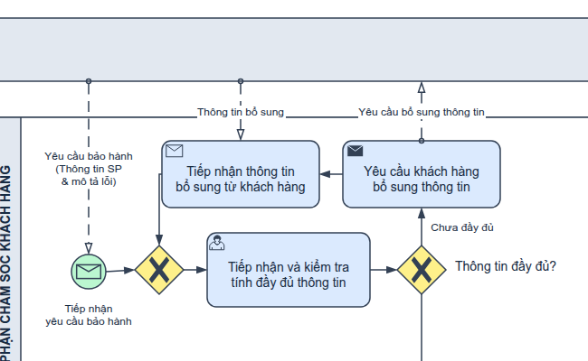
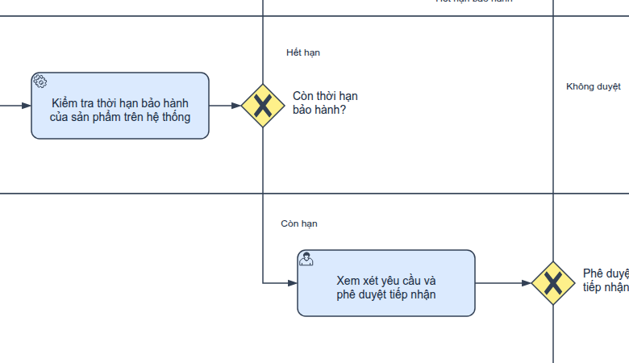
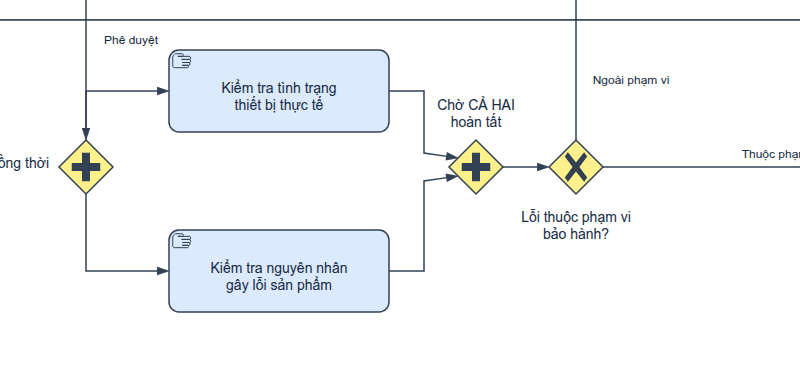
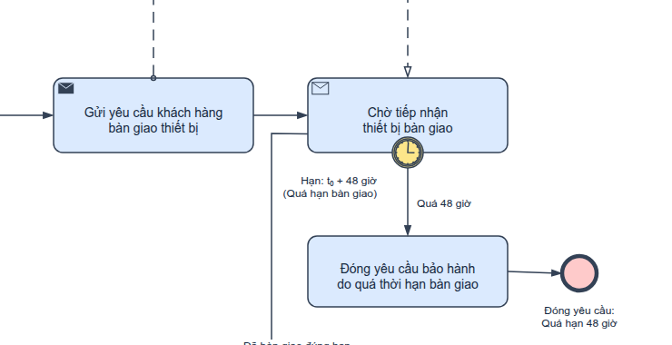
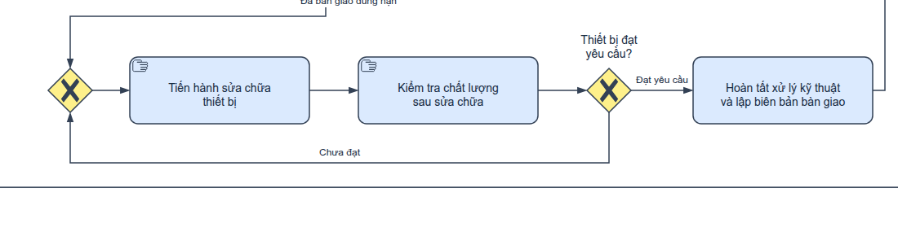
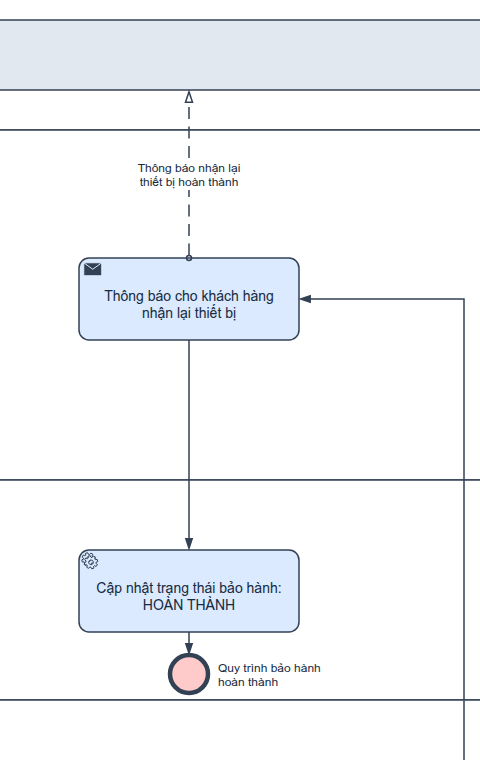

# Bài giải Đề 02 (Đề thi giữa kỳ Đề 03) — Quy trình bảo hành thiết bị điện tử

**Học phần:** Phân tích nghiệp vụ phần mềm (PTNVPM).  

Đầu vào là *Đề thi giữa kỳ PTNVPM* (tài liệu của học phần, không đính kèm) và mẫu nộp bài của học phần (không đính kèm). Bài làm gồm **một biểu đồ BPMN tổng thể hoàn chỉnh**, được xuất dưới hai phiên bản trình bày: **Bản bình thường (monochrome)** và **Bản có màu (colorized theo quy ước công cụ mô hình hóa)**. Cả hai phiên bản chia sẻ 100% logic nghiệp vụ, vị trí hình học, nhãn chữ và kết nối.

---

## 1. Danh mục sơ đồ và các bản nộp

| Mục đích / Loại tệp | Bản bình thường | Bản có màu |
|---|---|---|
| **Tệp nguồn draw.io chỉnh sửa được** | [diagram.drawio](diagram.drawio) | [diagram-color.drawio](diagram-color.drawio) |
| **Hình ảnh xuất trực tiếp từ draw.io chính thức** | [PNG](diagram.png) · [SVG](diagram.svg) | [PNG màu](diagram-color.png) · [SVG màu](diagram-color.svg) |


---

## 2. Phạm vi quy trình và kiến trúc các bên tham gia

Mô hình hóa theo mô hình cộng tác BPMN 2.0 (Collaboration Diagram) chuẩn OMG BPMN 2.0.2 (§9.2 – §9.4):

```mermaid
graph TD
    subgraph Pool_KH ["Pool: KHÁCH HÀNG (External Participant - Black Box)"]
    end
    subgraph Pool_DN ["Pool: DOANH NGHIỆP (Process Engine & Internal Roles)"]
        Lane_CSKH ["Lane: Bộ phận Chăm sóc khách hàng (CSKH)"]
        Lane_HT ["Lane: Hệ thống quản lý bảo hành"]
        Lane_TP ["Lane: Trưởng bộ phận kỹ thuật"]
        Lane_KT ["Lane: Bộ phận kỹ thuật"]
    end
    Pool_KH <== "9 Message Flows (Yêu cầu, Bổ sung, Bàn giao, Thông báo)" ==> Pool_DN
```

### 2.1. Phân định Pool và Lane chuẩn xác theo BPMN 2.0
1. **Pool `KHÁCH HÀNG` (External Participant — Black box):**
   - Khách hàng là đối tác bên ngoài độc lập về mặt pháp lý và tổ chức với doanh nghiệp.
   - Theo OMG BPMN 2.0.2 (§9.2, tr. 112), quy trình nội bộ của khách hàng nằm ngoài phạm vi kiểm soát của doanh nghiệp kinh doanh thiết bị, do đó được mô hình hóa dưới dạng **Black-box Pool**.
   - Mọi tương tác giữa Khách hàng và Doanh nghiệp bắt buộc phải là **Message Flow** (đường nét đứt, đầu tròn rỗng ở điểm xuất phát và mũi tên rỗng ở điểm đến). Tuyệt đối không dùng Sequence Flow xuyên biên giới Pool.
2. **Pool `DOANH NGHIỆP`:**
   - Chứa toàn bộ luồng quy trình điều phối tiếp nhận và xử lý bảo hành.
   - Gồm 4 Lane nội bộ phân chia theo vai trò trách nhiệm và thẩm quyền:
     - **Lane `CSKH` (Bộ phận Chăm sóc khách hàng):** Đóng vai trò đầu mối tiếp xúc khách hàng (Customer-facing). Chịu trách nhiệm tiếp nhận yêu cầu ban đầu, kiểm tra tính đầy đủ, gửi yêu cầu bổ sung nếu thiếu, tiếp nhận bổ sung, gửi các thông báo từ chối (hết hạn, không phê duyệt, ngoài phạm vi) và thông báo nhận lại thiết bị khi hoàn tất.
     - **Lane `HỆ THỐNG` (Hệ thống quản lý bảo hành):** Đại diện cho phần mềm/hệ thống quản trị cơ sở dữ liệu bảo hành. Tự động kiểm tra thời hạn bảo hành của sản phẩm dựa trên số serial/mã đơn hàng (Service Task), và tự động cập nhật trạng thái bảo hành thành HOÀN THÀNH khi quy trình kết thúc.
     - **Lane `TRƯỞNG BỘ PHẬN KỸ THUẬT`:** Đại diện cho cấp quản lý chuyên môn kỹ thuật. Thực hiện xem xét hồ sơ yêu cầu và ra quyết định phê duyệt hoặc từ chối tiếp nhận bảo hành.
     - **Lane `BỘ PHẬN KỸ THUẬT`:** Đội ngũ kỹ thuật viên thực thi. Thực hiện song song việc kiểm tra tình trạng thiết bị và nguyên nhân gây lỗi; xác định phạm vi bảo hành; gửi yêu cầu bàn giao thiết bị; chờ tiếp nhận thiết bị với hạn định 48 giờ; đóng yêu cầu nếu quá hạn; thực hiện sửa chữa và kiểm tra chất lượng theo vòng lặp cho đến khi đạt chuẩn; lập biên bản bàn giao kỹ thuật.

---

## 3. Bảng đối chiếu 12 yêu cầu đề bài sang phần tử BPMN

| Bước đề bài | Yêu cầu nghiệp vụ | Phần tử BPMN thể hiện | Loại phần tử & Vai trò | Giải thích nghiệp vụ & Luồng di chuyển |
|---|---|---|---|---|
| **1** | Khách hàng gửi yêu cầu bảo hành (thông tin SP & mô tả lỗi) | `M01`, `S` | Message Flow, Message Start Event | Khách hàng gửi thông điệp yêu cầu kèm dữ liệu; `S` kích hoạt phiên xử lý mới trong CSKH. |
| **2** | CSKH kiểm tra tính đầy đủ; chưa đủ thì yêu cầu bổ sung và kiểm tra lại | `GM1`, `C1`, `G1`, `C2`, `C3`, `M02`, `M03` | Explicit Merge, User Task, XOR Gateway, Send Task, Receive Task | Vòng lặp bổ sung: `G1` [Chưa đầy đủ] $\rightarrow$ `C2` (gửi yêu cầu bổ sung qua `M02`) $\rightarrow$ `C3` (chờ nhận bổ sung qua `M03`) $\rightarrow$ `GM1` (XOR Merge tường minh) $\rightarrow$ quay lại `C1` để kiểm tra lại. |
| **3** | Thông tin đầy đủ $\rightarrow$ Hệ thống kiểm tra thời hạn bảo hành | `F07`, `S1`, `G2` | Sequence Flow, Service Task, XOR Gateway | `G1` [Đầy đủ] chuyển token sang lane Hệ thống; `S1` tự động tra cứu cơ sở dữ liệu và đánh giá thời hạn qua cổng `G2`. |
| **4** | Hết hạn $\rightarrow$ Từ chối và thông báo cho khách hàng | `F09`, `C4`, `M04`, `E_EXPIRED` | Sequence Flow, Send Task, Message Flow, None End Event | `G2` [Hết hạn] chuyển sang CSKH; `C4` gửi thông báo từ chối qua `M04` cho khách hàng trước khi kết thúc tại `E_EXPIRED`. |
| **5** | Còn hạn $\rightarrow$ Chuyển Trưởng BPKT xem xét & phê duyệt | `F11`, `T1`, `G3` | Sequence Flow, User Task, XOR Gateway | `G2` [Còn hạn] chuyển token sang lane Trưởng BPKT; `T1` xem xét chuyên môn và ra quyết định tại cổng `G3`. |
| **6** | Không được phê duyệt $\rightarrow$ Từ chối bảo hành | `F13`, `C5`, `M05`, `E_REJECT_TP` | Sequence Flow, Send Task, Message Flow, None End Event | `G3` [Không duyệt] chuyển về CSKH; `C5` gửi văn bản thông báo từ chối qua `M05` tới khách hàng $\rightarrow$ kết thúc tại `E_REJECT_TP`. Đảm bảo trải nghiệm khách hàng chuẩn mực. |
| **7** | Được phê duyệt $\rightarrow$ Kỹ thuật kiểm tra song song (tình trạng & nguyên nhân lỗi) | `F15`, `AND_S`, `K1`, `K2`, `AND_J` | Sequence Flow, Parallel Gateways (Split & Join), Manual Tasks | `G3` [Phê duyệt] kích hoạt `AND_S` tại lane Kỹ thuật, phân tách thành 2 nhánh thực thi đồng thời: `K1` (kiểm tra tình trạng) và `K2` (kiểm tra nguyên nhân). |
| **8** | Cả hai hoàn tất $\rightarrow$ Xác định phạm vi; ngoài phạm vi thì CSKH thông báo từ chối | `AND_J`, `G4`, `C6`, `M06`, `E_OUT_OF_SCOPE` | Parallel Join, XOR Gateway, Send Task, Message Flow, None End Event | `AND_J` đồng bộ cả 2 nhánh; `G4` đánh giá phạm vi. Nếu [Ngoài phạm vi], chuyển sang CSKH `C6` gửi thông báo từ chối qua `M06` $\rightarrow$ kết thúc tại `E_OUT_OF_SCOPE`. |
| **9** | Thuộc phạm vi $\rightarrow$ BPKT gửi yêu cầu bàn giao thiết bị | `F23`, `K3`, `M07` | Sequence Flow, Send Task, Message Flow | `G4` [Thuộc phạm vi] đi tới `K3` trong lane Kỹ thuật; `K3` phát thông điệp `M07` yêu cầu khách hàng gửi thiết bị. |
| **10** | Hạn 48h từ khi khách nhận yêu cầu; quá hạn thì đóng yêu cầu | `K4`, `B48`, `K5`, `E_TIMEOUT` | Receive Task, Interrupting Boundary Timer, Abstract Task, None End Event | `K4` chờ nhận bàn giao. Boundary Timer `B48` gắn ở cạnh dưới `K4` với hạn $t_0 + 48\text{h}$. Quá hạn, timer ngắt `K4`, chuyển xuống `K5` đóng yêu cầu $\rightarrow$ kết thúc tại `E_TIMEOUT`. |
| **11** | Thiết bị bàn giao đúng hạn $\rightarrow$ Sửa chữa & kiểm tra chất lượng; chưa đạt thì sửa tiếp; đạt thì hoàn tất kỹ thuật | `GM2`, `K6`, `K7`, `G5`, `K8` | Explicit Merge, Manual Tasks, XOR Gateway, Abstract Task | Nhận máy đúng hạn $\rightarrow$ qua `GM2` $\rightarrow$ sửa chữa `K6` $\rightarrow$ kiểm tra chất lượng `K7`. Nếu `G5` [Chưa đạt], quay lại `GM2` để sửa tiếp; nếu [Đạt], hoàn tất xử lý kỹ thuật tại `K8`. |
| **12** | Kỹ thuật hoàn tất $\rightarrow$ CSKH thông báo nhận lại $\rightarrow$ Cập nhật HOÀN THÀNH $\rightarrow$ Kết thúc | `F33`, `C7`, `M09`, `F34`, `S2`, `F35`, `E_COMPLETE` | Sequence Flows, Send Task, Message Flow, Service Task, None End Event | `K8` chuyển về CSKH `C7` gửi thông báo `M09` cho khách nhận lại thiết bị $\rightarrow$ chuyển sang Hệ thống `S2` cập nhật trạng thái HOÀN THÀNH $\rightarrow$ kết thúc thành công tại `E_COMPLETE`. |

---

## 4. Các điểm cải tiến kiến trúc và chuẩn hóa chuyên sâu

Sau khi đối chiếu toàn diện với các bài giải khác trong workspace, bản thiết kế `by-gemini` đã được tối ưu hóa đạt độ hoàn thiện cao nhất:

1. **Bổ sung hai cổng Explicit XOR Merge Gateway (`GM1`, `GM2`)**:
   - `GM1`: Đặt trước `C1` để nhập luồng Start (`S`) và luồng quay lại từ `C3`.
   - `GM2`: Đặt trước `K6` để nhập luồng bàn giao thiết bị từ `K4` và luồng sửa chữa lại từ `G5`.
   - *Chuẩn OMG BPMN 2.0.2*: Tuân thủ nguyên tắc mô hình hóa có cấu trúc (Structured Workflow / Petri Net), loại bỏ mọi tính mơ hồ của implicit join trên các công cụ thực thi BPMN.
2. **Boundary Timer `B48` gắn ở cạnh dưới theo khuyến nghị OMG**:
   - Theo OMG BPMN 2.0.2 (§10.5.4, tr. 249), với các sơ đồ phát triển theo chiều ngang, Boundary Event được khuyến nghị gắn ở **cạnh dưới** của Activity, luồng ngoại lệ đi xuống và rẽ sang phải.
   - Nhánh quá hạn từ `B48` đi thẳng xuống `K5` rồi rẽ sang phải tới `E_TIMEOUT`, tách biệt hoàn toàn khỏi luồng chính ở trên và vòng sửa chữa ở dưới.
3. **Pure SVG Text — 0 `<foreignObject>`**:
   - Áp dụng thuộc tính `whiteSpace=nowrap` trên toàn bộ các vertex và ngắt dòng thủ công.
   - Kết quả xuất ảnh SVG: **0 thẻ `<foreignObject>`**, 100% sử dụng thẻ `<text>` và `<tspan>` thuần. Đảm bảo hiển thị hoàn hảo trên mọi trình đọc vector (LibreOffice, Word, trình duyệt) mà không bị lỗi dự phòng "Text is not SVG".
4. **Kiểm tra va chạm nhãn tự động bằng máy (`Kiem_tra_nhan.json`)**:
   - Đo khung chữ thực tế bằng metric font Arial trên SVG, kiểm tra nhãn-nhãn, nhãn-hình, đường-nhãn. Đạt **0 lỗi trên toàn bộ 100 dòng chữ** và phát hiện 100% các ca mutant cố ý làm hỏng.
5. **Giao tiếp đối ngoại 100% qua CSKH**:
   - Mọi quyết định từ chối (kể cả khi Trưởng BPKT từ chối phê duyệt) đều được định tuyến về CSKH để gửi thông báo chính thức cho khách hàng (`C5` $\rightarrow$ `M05`), không bao giờ để khách hàng rơi vào trạng thái "im lặng không rõ lý do".

---

## 5. Bộ ảnh chi tiết phóng to các vùng kiến trúc (Zoom-in Details)

Để người chấm dễ dàng soi các ký hiệu nhỏ trên bản PDF Letter, toàn bộ 6 vùng logic trọng tâm đã được trích xuất thành ảnh độ nét cao trong thư mục `details/`:

### 5.1. Cụm Khởi đầu, Merge Gateway GM1 và Vòng lặp thông tin

*Message Start Event nhận M01, đi qua cổng Explicit XOR Merge GM1 vào C1. Vòng lặp C1 -> G1 -> C2 -> C3 -> GM1 -> C1 trực giao vuông vắn.*

### 5.2. Cụm Tra cứu Hệ thống tự động và Phê duyệt của Trưởng BPKT

*Hệ thống S1 tra cứu tự động qua G2. Nếu còn hạn, chuyển Trưởng BPKT T1 phê duyệt tại G3. Nhánh từ chối định tuyến về CSKH.*

### 5.3. Cụm Phân nhánh và Đồng bộ Song song (Parallel AND)

*AND_S phân tách 2 nhánh K1 và K2 thực hiện đồng thời; AND_J chờ CẢ HAI hoàn tất trước khi chuyển tới cổng xét phạm vi G4.*

### 5.4. Cụm Yêu cầu bàn giao và Boundary Timer 48h

*B48 gắn cạnh dưới tác vụ nhận K4; luồng quá hạn 48h đi xuống K5 đóng yêu cầu và kết thúc tại E_TIMEOUT.*

### 5.5. Cụm Merge Gateway GM2 và Vòng lặp Sửa chữa - Kiểm tra chất lượng

*Nhận máy đúng hạn vào GM2 -> K6 -> K7 -> G5. Nhánh chưa đạt quay lại GM2; nhánh đạt chuyển tới K8 hoàn tất xử lý kỹ thuật.*

### 5.6. Cụm Thông báo hoàn tất và Cập nhật trạng thái Hệ thống

*Trục kết thúc gióng thẳng hàng dọc tại x=2890: K8 -> C7 (gửi M09) -> S2 (Hệ thống cập nhật HOÀN THÀNH) -> E_COMPLETE.*

---

## 6. Phân loại chi tiết các phần tử BPMN 2.0 sử dụng

1. **Swimlanes:**
   - **Pool `KH`:** Khách hàng (Black box).
   - **Pool `DN`:** Doanh nghiệp, chứa 4 Lane (`CSKH`, `HT`, `TP`, `KT`).
2. **Start Event:**
   - `S`: Message Start Event (vòng đơn mảnh, phong bì trắng catching).
3. **End Events (5 sự kiện kết thúc None End Event - vòng đơn đậm):**
   - `E_EXPIRED`: Từ chối do hết hạn bảo hành.
   - `E_REJECT_TP`: Từ chối do Trưởng BPKT không phê duyệt (có CSKH thông báo).
   - `E_OUT_OF_SCOPE`: Từ chối do lỗi ngoài phạm vi bảo hành.
   - `E_TIMEOUT`: Đóng yêu cầu do quá hạn 48 giờ bàn giao thiết bị.
   - `E_COMPLETE`: Quy trình bảo hành hoàn thành thành công.
4. **Boundary Event:**
   - `B48`: Interrupting Boundary Timer Event (vòng đôi liền, biểu tượng đồng hồ), gắn ở cạnh dưới tác vụ `K4`.
5. **Gateways (9 cổng quyết định):**
   - **Exclusive Gateways (`G1`, `G2`, `G3`, `G4`, `G5`):** Phân nhánh rẽ điều kiện loại trừ lẫn nhau (XOR).
   - **Explicit XOR Merge Gateways (`GM1`, `GM2`):** Hợp nhất các luồng lặp và luồng chính tường minh.
   - **Parallel Gateways (`AND_S`, `AND_J`):** Phân nhánh và hội tụ song song (AND).
6. **Activities (18 Tasks với Marker chuyên biệt):**
   - **User Tasks (`C1`, `T1`):** Biểu tượng người dùng, thao tác của nhân viên CSKH và Trưởng BPKT trên hệ thống.
   - **Service Tasks (`S1`, `S2`):** Biểu tượng bánh răng, hệ thống tự động tra cứu và cập nhật DB.
   - **Send Tasks (`C2`, `C4`, `C5`, `C6`, `C7`, `K3`):** Biểu tượng phong bì đen, gửi thông điệp ra ngoài pool.
   - **Receive Tasks (`C3`, `K4`):** Biểu tượng phong bì trắng, chờ nhận thông điệp từ ngoài pool.
   - **Manual Tasks (`K1`, `K2`, `K6`, `K7`):** Biểu tượng bàn tay, thao tác vật lý của kỹ thuật viên.
   - **Abstract Tasks (`K5`, `K8`):** Nhiệm vụ xử lý nội bộ.
7. **Flows:**
   - **35 Sequence Flows (`F01` – `F35`):** Nét liền, mũi tên đặc.
   - **9 Message Flows (`M01` – `M09`):** Nét đứt, đầu tròn rỗng, mũi tên rỗng, 100% thẳng đứng.

---

## 7. Quy ước phối màu trình bày (Presentation Palette)

Theo quy định bài thi trong workspace, bài làm cung cấp 2 bản sơ đồ:
- **Bản bình thường (`diagram.drawio`):** Nền trắng, viền xám đậm `#334155`, chữ xanh đen `#172b42`. Đạt chuẩn in ấn đơn sắc hoặc giáo trình học thuật.
- **Bản có màu (`diagram-color.drawio`):** Áp dụng palette chuẩn công cụ mô hình hóa (Bizagi, Camunda, Signavio):
  - **Start Event:** Nền xanh lá cây (`#d5e8d4`, viền `#82b366`).
  - **All End Events:** Nền đỏ (`#f8cecc`, viền `#b85450`).
  - **Gateways & Boundary Timer:** Nền vàng (`#fff2cc`, viền `#d6b656`).
  - **Activities / Tasks:** Nền xanh dương nhạt (`#dae8fc`, viền `#6c8ebf`).
  - **Pool / Lanes:** Tiêu đề nền xám trang nhã (`#f1f5f9`), thân lane nền trắng.

---

## 8. Báo cáo kết quả kiểm định tự động (Verification & Audit Evidence)

1. **Kiểm tra cấu trúc và hình học (`Kiem_tra.json`):**
   - Chạy `audit_drawio.py` trên ảnh dựng thực tế từ engine draw.io chính thức.
   - Kết quả: **`passed_structural_checks: true`**, **`errors: 0`**.
2. **Kiểm tra bảng màu và đối chiếu AST (`Kiem_tra_Co_mau.json`):**
   - Chạy với cờ `--palette tool-convention` và `--compare`.
   - Kết quả: **`passed_structural_checks: true`**, **`passed_palette_checks: true`**, **`errors: 0`**.
3. **Kiểm tra va chạm nhãn chữ SVG (`Kiem_tra_nhan.json`):**
   - Đo metric font Arial cho 100 dòng chữ: **`passed: true`**, **`foreignObject: 0`**, **`issues: 0`**, phát hiện 3/3 mutant controls.
4. **Kiểm tra 14 kịch bản luồng nghiệp vụ (`Kiem_tra_kich_ban.json`):**
   - Mô phỏng token trên đồ thị thực tế: **14/14 test cases PASSED**.
5. **Kiểm tra bản nộp hoàn chỉnh (`Kiem_tra_ban_nop.json`):**
   - Đạt chuẩn 6/6 tệp, 1 trang Letter theo mẫu, ảnh khớp mã băm SHA-256.
