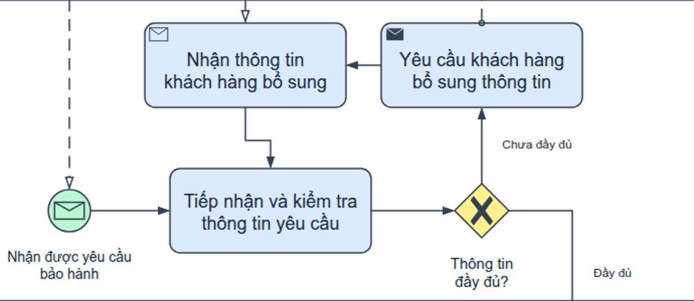
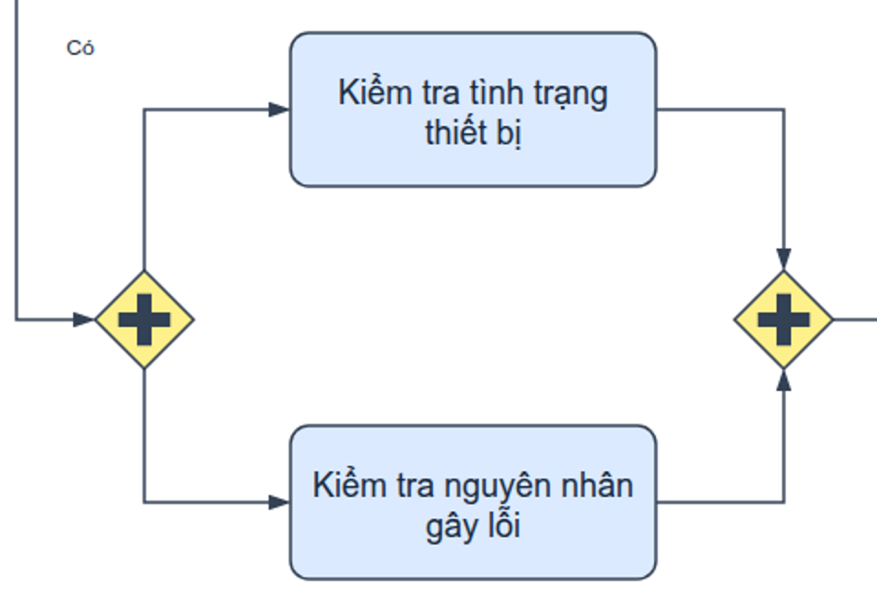
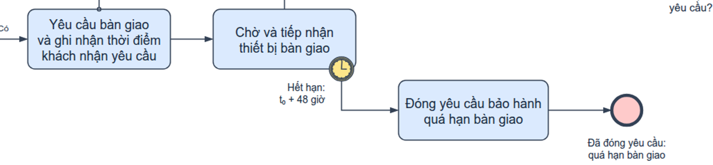
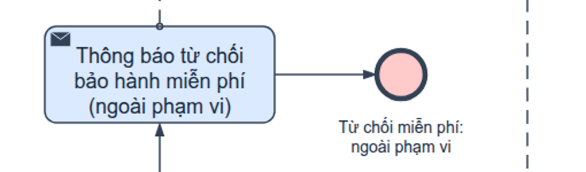

# Tự rà soát bản cải tiến theo OMG BPMN và draw.io

**Phạm vi:** bài GPT trong `by-gpt/`, theo ĐỀ 03 bảo hành thiết bị điện tử hiện lưu tại `de-03-bao-hanh-thiet-bi` (trước đây là `de-02`). Một mô hình, hai phiên bản bình thường/có màu. Các bài của công cụ khác được giữ nguyên.

**Kết luận:** đã cải thiện bố cục, cách ghi nhãn, SVG và PDF; giữ các ràng buộc nghiệp vụ của đề. Hai giả định về đánh giá trước bàn giao và nguồn thời điểm khách nhận vẫn được công khai. Không phát hiện lỗi còn lại trong phạm vi cấu trúc, kịch bản và ảnh đã rà.

## 1. Nguồn đối chiếu

- *Đề thi giữa kỳ PTNVPM* (tài liệu của học phần, không đính kèm) và *Đề thi giữa kỳ PTNVPM* (tài liệu của học phần, không đính kèm): 12 yêu cầu nghiệp vụ.
- [OMG BPMN 2.0.2](https://www.omg.org/spec/BPMN/2.0.2/PDF): §7.5–7.6, §9.3–9.4, §10.3, §10.5–10.6. Trang PDF phần thân chênh +30 so với trang in.
- Mã ký hiệu draw.io, commit `17b367b91dbab91804f852645788d7ffb46dcb79`: start/end, timer biên, gateway và marker task.
- Viewer đã dựng hình: SVG/PNG, dữ liệu hình học và roundtrip của chính hai nguồn hiện tại.

## 2. Những cải tiến đã thực hiện

| Phần | Bản cải tiến |
|---|---|
| Hướng đọc | Sau bàn giao, sửa chữa → QA → quyết định chất lượng → hoàn tất đi sang phải; FIN đi thẳng lên CSKH |
| Vòng bổ sung | Nhận bổ sung quay xuống C1 ngay trong vùng đầu, không cắt nhánh đi xuống Hệ thống |
| Phân vùng | Hai kiểm tra ở hai hàng trái; chờ bàn giao ở hàng giữa; sửa chữa phía trên phải; timeout xuống hàng dưới |
| Nhãn | Tên pool gọn; ngắt dòng có chủ ý; nhãn message nằm giữa hai pool; các nhánh XOR tránh đường biên lane |
| Timer | Vẫn hai vòng liền, ngắt WAIT; dời sang phần viền trống để không chạm chữ |
| SVG | Chữ SVG thuần, không có `foreignObject`; không phụ thuộc phần HTML dự phòng để hiện nhãn |
| PDF theo mẫu | Giữ template Letter ngang và thông tin sinh viên, xuất sơ đồ vector từ bản DOCX tạm chứa SVG |
| DOCX bàn giao | Giữ ảnh PNG hiện tại; bản DOCX tạm chứa SVG chỉ phục vụ xuất PDF, không phải một lời giải khác |

Không thêm chính sách, kết quả phê duyệt, kênh vận chuyển hoặc bước chờ khách lấy lại máy. Các ID, loại flow object, endpoint, điều kiện nhánh, hợp đồng K4/WAIT và deadline được giữ. Nhãn và tọa độ thay đổi để trình bày rõ hơn.

## 3. Các điểm nghiệp vụ và ký pháp được giữ đúng

| Hạng mục | Cách thể hiện và căn cứ |
|---|---|
| Pool/lane | KH là pool bên ngoài để rỗng; doanh nghiệp có bốn lane CS, Hệ thống, Trưởng kỹ thuật, Kỹ thuật; sequence được qua lane cùng process |
| Start | Message Start nhận yêu cầu gồm thông tin sản phẩm và mô tả lỗi; một vòng mảnh, phong bì nhận rỗng, không incoming sequence |
| End | Năm None End, một vòng đậm, không outgoing sequence; mọi end đỏ ở bản màu |
| Sequence/message | 33 sequence nét liền/mũi tên đặc; 7 message nét đứt/tròn gửi rỗng/mũi tên nhận rỗng, nối hai participant |
| Thông tin và phê duyệt | C1 kiểm tra trước GI; SYS kiểm tra trước GW; T1 ra quyết định trước GA |
| Song song | AND_S phát hai nhánh K1/K2; AND_J chờ đủ cả hai trước K3/GS |
| Phạm vi bảo hành | Còn hạn và được duyệt chưa đủ để sửa: phải thuộc phạm vi sau hai kiểm tra |
| Hạn | K4 ghi nhận lúc KH nhận yêu cầu; WAIT áp hạn tuyệt đối t₀ + 48 giờ; không đếm từ lúc gửi hoặc reset lúc vào WAIT |
| Bàn giao | WAIT hoàn thành khi đã nhận thiết bị thực tế đúng hạn; không dùng thông tin hứa bàn giao làm thay thế |
| Quá hạn | Boundary B48 ngắt WAIT, chuyển CLOSE rồi E_TIME; không tiếp tục vào sửa |
| Vòng sửa | Mỗi lần REPAIR đều qua QA; chưa đạt quay về sửa; đạt mới FIN |
| Hoàn thành | FIN → CS thông báo nhận lại → CS cập nhật HOÀN THÀNH → End; không thêm điều kiện KH đã lấy lại máy |
| Màu | Start xanh, end đỏ, gateway/timer vàng, activity xanh là profile trình bày cục bộ; OMG không bắt buộc palette này |
| Hai phiên bản | Cùng nhãn, logic, vị trí, endpoint, marker, nét và đầu mũi tên; chỉ khác màu |

### Làm rõ K4 và nguồn thời điểm nhận

K4 có nhãn “Yêu cầu bàn giao và ghi nhận thời điểm khách nhận yêu cầu”, dùng Task thường. Hợp đồng hoàn thành yêu cầu `t_customer_received_request` đã có, do kênh giao tiếp cung cấp. Nếu chưa có mốc nhận thì K4 còn chờ; WAIT và hạn 48 giờ chưa bắt đầu.

Theo OMG §10.3.3 trang in 157, Send Task hoàn tất khi gửi. Vì K4 gồm cả ghi nhận nhận thực tế nên dùng Task thường phù hợp hơn; Activity thường được phép làm nguồn message flow (§10.3, trang in 151). Không đặt thêm một nghĩa vụ KH phải đồng ý hoặc gửi ACK riêng mà đề không yêu cầu.

WAIT là Task thường nhận thiết bị vật lý. B48 dùng `cancelActivity=true`, `timeDate=t_customer_received_request + PT48H`, gắn đúng WAIT. Nếu WAIT bắt đầu muộn vẫn giữ hạn gốc. Thông tin bàn giao sớm cần được lưu theo mã yêu cầu, tránh buộc khách giao lần nữa.

## 4. Kiểm tra thực tế và giới hạn

- Kiem_tra.json, Kiem_tra_Co_mau.json: cấu trúc, ký pháp và hình học của bản dựng; palette đạt, so sánh hai bản chỉ khác màu.
- Kiem_tra_nghiep_vu.json: **28 kiểm tra đạt** — 14 kịch bản kết thúc, 1 tình huống đang chờ khách nhận, 4 kiểm tra hợp đồng/message/hình học, 3 bộ dữ liệu deadline và 6 đối chứng.
- Kiem_tra_trinh_bay.json: **102 dòng chữ trong mỗi SVG**, xét nhãn–nhãn, nhãn–hình/đường, chữ trong task, phần tử/caption trong lane và viewport; **0 foreignObject, 0 lỗi phát hiện** ở hai bản.
- Năm đối chứng trình bày đều bị bắt: nhãn End đè task, chữ task quá dài, nhãn End đè đường khác, SVG có foreignObject và End vượt biên lane. Các biến đổi này chỉ trong bộ nhớ, không phải sơ đồ bàn giao.
- Kiem_tra_ban_nop.json: sáu tệp DOCX/PDF đạt; bốn PDF một trang, đúng Đề số **03**, đúng sinh viên; tìm được chữ nghiệp vụ vector và **0 ảnh raster** trong mỗi PDF.
- Ra_soat_truc_quan.json: những ảnh cuối đã đọc và hash nguồn/ảnh. DANH_MUC_SHA256.json ràng buộc các tệp bàn giao.

Bộ đo nhãn tham khảo kỹ thuật trong bài Claude ở workspace, được đưa thành script riêng của GPT và bổ sung kiểm tra biên lane/đối chứng. Phép đo font có dung sai 1 px; ảnh thực được đọc bổ sung. Không dùng số kiểm tra để thay xác nhận nghiệp vụ.

Kịch bản token khai báo lựa chọn XOR và kết quả bàn giao/timeout. Kiểm tra thời gian dùng dữ liệu ngày giờ để phân biệt mốc gửi, mốc nhận và lúc WAIT bắt đầu; không chạy đồng hồ, vận chuyển hay BPMN engine. Trường hợp bàn giao đúng khoảnh khắc deadline chưa được đề quy định ưu tiên, nên bài không tự đặt chính sách xử lý hòa.

## 5. Hai giả định cần giữ công khai

**Đánh giá trước bàn giao:** đề đặt K1/K2 trước yêu cầu bàn giao để sửa. Bài giữ thứ tự và giả định có đủ thông tin/khả năng tiếp cận để đánh giá ban đầu. Phương thức chưa được đề nêu; không khẳng định doanh nghiệp đã giữ máy. Nếu yêu cầu tháo kiểm tra tại trung tâm sau tiếp nhận thì thứ tự của mô tả cần được làm rõ.

**Biết lúc khách nhận:** kênh giao tiếp có thể cung cấp thời điểm nhận thực tế, gắn mã yêu cầu. K4 chỉ kết thúc sau khi mốc này được ghi. Khi triển khai thật phải chọn cơ chế thu thập; một nhãn trên sơ đồ không tự tạo ra dữ liệu mà doanh nghiệp không có.

Theo bảng 10.101 trang in 273, timeDate thực thi phải trả về ngày giờ ISO-8601. Chuỗi trong `.drawio` ở đây là metadata mô tả quy tắc; `.roundtrip.xml` là mxGraph, không phải BPMN 2.0 XML có thể đưa lên engine.

## 6. Xem các vùng hình cuối

Start và message yêu cầu:

Vòng bổ sung quay lại kiểm tra, marker Send/Receive và hướng mũi tên:

Hai nhánh AND và điểm chờ đủ hai kết quả:

Ghi nhận lúc nhận yêu cầu, bàn giao thực tế, timer và nhánh đóng:

Từ chối ngoài phạm vi, End và khoảng cách với message:

## 7. Chốt ảnh và bản cuối

Đã đọc hai PNG toàn sơ đồ, năm vùng chi tiết trên và bốn preview PDF của chính nguồn cải tiến. Không phát hiện chữ bị cắt, nhãn đè lên hình/đường khác hay event vượt biên lane trong các ảnh này. Bản PDF Letter vẫn có chữ nhỏ khi nhìn toàn trang; có thể phóng to trực tiếp vì sơ đồ đã là vector, hoặc dùng A3/SVG.

- [Draw.io thường](diagram.drawio) · [Draw.io màu](diagram-color.drawio).
- [Giải thích đủ 12 yêu cầu và cách tự vẽ](explanation.md) · [Phụ lục phần tử/luồng](element-inventory.md).
- [README và ZIP trọn bộ](README.md).

Đây là bản bài tập đã rà theo đề và các giả định trên, không phải chứng nhận bao phủ mọi điều khoản OMG hoặc kết quả chạy một BPMN engine.
