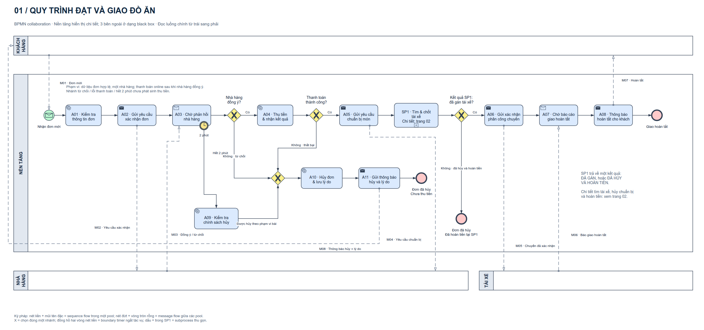

# Practice — Food ordering app (Thực hành — Ứng dụng gọi đồ ăn)

> **Reference solution, not an official answer.** Built by an AI agent with the bpmn-drawio skill under the author's direction; not reviewed by the course lecturer. Student name/ID and submissions removed. The exercise itself is cited by name only.
>
> Lời giải tham khảo cho *BPMN — Ứng dụng gọi đồ ăn* (đề thực hành của học phần, không đính kèm). Không phải đáp án chính thức, **chưa được giảng viên xác nhận**; đã lược bỏ tên, mã sinh viên và bài nộp. Tài liệu giữ văn bản gốc tiếng Việt; chữ “workspace” trong đó chỉ thư mục làm bài ban đầu. The 5-minute driver search is an assumption of this solution, not a general rule.

| Variant | Editable source | Images |
|---|---|---|
| Normal (`monochrome`) | [diagram.drawio](diagram.drawio) | [page-01-overview.png](page-01-overview.png) · [page-02-no-driver-found.png](page-02-no-driver-found.png) · [page-03-preparation-and-delivery.png](page-03-preparation-and-delivery.png) · [page-01-overview.svg](page-01-overview.svg) · [page-02-no-driver-found.svg](page-02-no-driver-found.svg) · [page-03-preparation-and-delivery.svg](page-03-preparation-and-delivery.svg) |
| Colour (`bizagi-inspired`) | [diagram-color.drawio](diagram-color.drawio) | [page-01-overview-color.png](page-01-overview-color.png) · [page-02-no-driver-found-color.png](page-02-no-driver-found-color.png) · [page-03-preparation-and-delivery-color.png](page-03-preparation-and-delivery-color.png) · [page-01-overview-color.svg](page-01-overview-color.svg) · [page-02-no-driver-found-color.svg](page-02-no-driver-found-color.svg) · [page-03-preparation-and-delivery-color.svg](page-03-preparation-and-delivery-color.svg) |

## Documents (Vietnamese)

- [explanation.md](explanation.md)
- [notation-review.md](notation-review.md)

Tool checks (2026-10-22, skill 1.0.0-rc.2): no supported structural/notation errors, colour variant differs only in colour, no layout findings. This is not a business validation. — Kiểm tra công cụ, không phải xác nhận nghiệp vụ.
