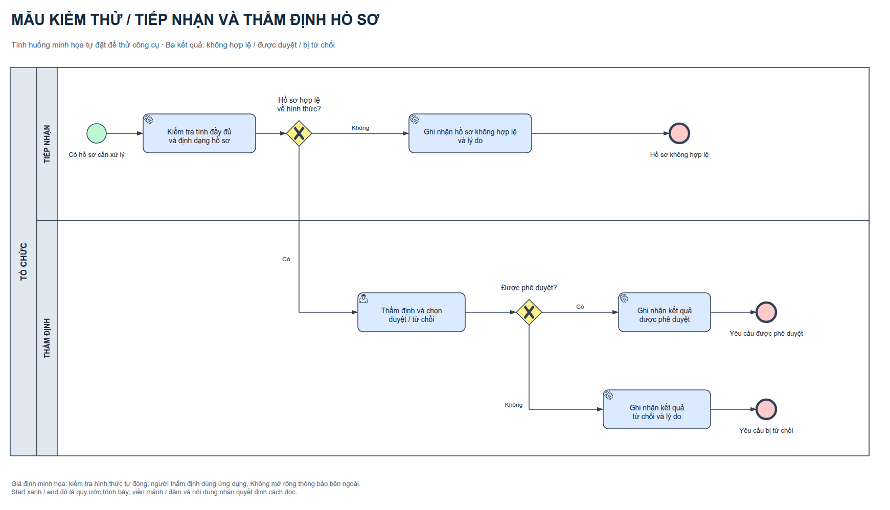

# Kiểm tra và thẩm định hồ sơ

Ví dụ tự đặt: hệ thống kiểm tra hình thức hồ sơ. Không hợp lệ thì ghi lý do và kết thúc. Hợp lệ thì người thẩm định dùng ứng dụng chọn duyệt hoặc từ chối; hệ thống ghi kết quả tương ứng. Hợp lệ hình thức không đồng nghĩa chắc chắn được duyệt.

| Bản | Nguồn chỉnh sửa | Ảnh |
|---|---|---|
| Thường | [Mau_ho_so.drawio](Mau_ho_so.drawio) | [01-mot-bieu-do-hai-lane.png](normal/01-mot-bieu-do-hai-lane.png) · [01-mot-bieu-do-hai-lane.svg](normal/01-mot-bieu-do-hai-lane.svg) |
| Màu | [Mau_ho_so_Co_mau.drawio](Mau_ho_so_Co_mau.drawio) | [01-mot-bieu-do-hai-lane.png](color/01-mot-bieu-do-hai-lane.png) · [01-mot-bieu-do-hai-lane.svg](color/01-mot-bieu-do-hai-lane.svg) |

**Đi thử:** S → T1 → G1 [Không] → TI → EI; hoặc G1 [Có] → T2 → G2 [Có] → TA → EA; hoặc G2 [Không] → TR → ER. T1 tạo kết quả kiểm tra, T2 tạo quyết định; hai gateway chỉ đọc dữ liệu đã có, không tự thẩm định.
