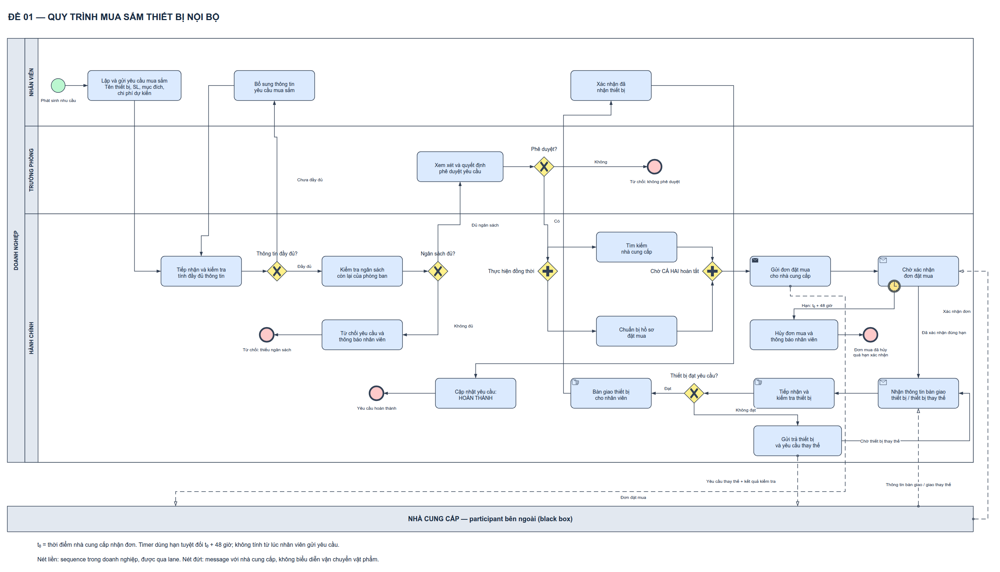

# Bài giải Đề 01 — Quy trình mua sắm thiết bị nội bộ

Đầu vào là *Đề thi giữa kỳ PTNVPM* (tài liệu của học phần, không đính kèm) và mẫu nộp bài của học phần (không đính kèm). Bài gồm **một biểu đồ tổng thể**, có hai cách trình bày cùng một mô hình. Bản PDF chính được xuất từ bản sao mẫu gốc đã điền thông tin, chèn sơ đồ và bỏ phần tô đỏ nhắc điền thông tin. Không sửa tài liệu đầu vào.

## 1. Xem sơ đồ và bản nộp

- [Draw.io bình thường](BPMN_De_01.drawio) và [Draw.io có màu](BPMN_De_01_Co_mau.drawio).

[SVG có màu để xem chi tiết](BPMN_De_01_Co_mau.svg). Bản màu dùng xanh cho start, đỏ cho mọi end, vàng cho gateway/timer và xanh dương cho activity. Đây là quy ước trình bày của bộ skill, không phải màu bắt buộc của OMG.

## 2. Phạm vi và các bên tham gia

| Phần tử | Nội dung | Lý do mô hình hóa |
|---|---|---|
| Pool DN | Doanh nghiệp | Chứa toàn bộ luồng xử lý yêu cầu mua sắm nội bộ |
| Lane NV | Nhân viên | Lập yêu cầu, bổ sung, xác nhận đã nhận thiết bị |
| Lane TP | Trưởng phòng | Xem xét và đưa ra quyết định phê duyệt |
| Lane HC | Hành chính | Kiểm tra, tổ chức mua, xử lý hết hạn, kiểm tra và bàn giao |
| Pool NCC | Nhà cung cấp | Participant bên ngoài, trình bày dạng black box |

Ba vai trò nội bộ cùng một doanh nghiệp được đặt vào ba lane. Sequence flow giữa họ có thể đi qua lane trưởng phòng dù không thực hiện tác vụ ở lane đó. Không dùng message flow để chuyển yêu cầu giữa các lane này.

Nhà cung cấp là participant riêng. Đề không yêu cầu mô tả tổ chức hay các bước nội bộ của họ; dùng black box giúp biểu diễn đúng các điểm giao tiếp: nhận đơn, xác nhận đơn, cung cấp thông tin giao nhận và nhận yêu cầu thay thế. Hoạt động giao thiết bị thể hiện ở hợp đồng với participant bên ngoài và bước tiếp nhận/kiểm tra vật lý của hành chính. Các thao tác đóng gói, kho, vận chuyển bên nhà cung cấp không được tự thêm vào. Bản này là góc nhìn toàn bộ quy trình **của doanh nghiệp có tương tác bên ngoài**, không phải một quy trình thực thi nội bộ nhà cung cấp.

Phạm vi bắt đầu khi nhân viên phát sinh nhu cầu. Bốn kết quả kết thúc của doanh nghiệp là: từ chối vì ngân sách, từ chối do không phê duyệt, đơn mua bị hủy vì quá hạn xác nhận, hoặc yêu cầu hoàn thành.

## 3. Đối chiếu đủ 12 yêu cầu của đề

| Mục đề | Điều phải thể hiện | Phần tử và đường đi trong bài |
|---|---|---|
| 1 | Nhân viên gửi tên thiết bị, số lượng, mục đích, chi phí dự kiến | S → N1; nhãn N1 viết tắt SL = số lượng; dữ liệu được giải thích tại mục 4 |
| 2 | Kiểm tra đủ thông tin; thiếu thì bổ sung và kiểm tra lại | H1 → G1; nhánh chưa đầy đủ → N2 → H1 |
| 3 | Chỉ khi thông tin hợp lệ mới kiểm tra ngân sách | G1 nhánh đầy đủ → H2 |
| 4 | Không đủ ngân sách thì từ chối, thông báo nhân viên | G2 nhánh không đủ → R1 → ER1 |
| 5 | Đủ ngân sách mới chuyển trưởng phòng | G2 nhánh đủ ngân sách → T1 |
| 6 | Trưởng phòng có quyết định duyệt/không duyệt | T1 → G3; không → ER2, có → AND_S |
| 7 | Tìm nhà cung cấp và chuẩn bị hồ sơ đồng thời | AND_S phân hai token tới H3 và H4 |
| 8 | Chờ cả hai xong mới gửi đơn mua | H3/H4 → AND_J → H5; H5 phát thông điệp M01 |
| 9 | Hạn xác nhận 48 giờ từ lúc NCC nhận đơn; quá hạn hủy, thông báo | H6 chờ M02; boundary B48 có hạn tuyệt đối t₀ + 48 giờ → CANCEL → EC |
| 10 | Xác nhận đúng hạn rồi giao thiết bị | H6 hoàn tất → H7 nhận thông tin bàn giao → H8 tiếp nhận/kiểm tra thiết bị; NCC là bên giao |
| 11a | Không đạt thì trả, thay thế và kiểm tra lại thiết bị thay thế | G4 không đạt → H9; gửi M04; quay H7 → H8 → G4 |
| 11b | Đạt thì bàn giao nhân viên | G4 đạt → H10 |
| 12 | Nhân viên xác nhận nhận, sau đó hành chính cập nhật hoàn thành | H10 → N3 → H11 → E |

Không thêm thanh toán, hóa đơn, đặt cọc, nhập kho, trừ/giữ ngân sách, ngưỡng duyệt theo tiền, hủy tự nguyện hay số lần thay thế tối đa. Đề không nêu những chính sách này.

## 4. Dữ liệu và điều kiện rẽ nhánh

N1 tạo hồ sơ yêu cầu gồm bốn trường của đề: **tên thiết bị, số lượng, mục đích sử dụng, chi phí dự kiến**. Dữ liệu hồ sơ đi theo cùng trường hợp mua sắm trong doanh nghiệp; không cần một pool hay mũi tên message riêng cho từng trường.

| Điểm quyết định | Nguồn dữ liệu | Nhánh loại trừ nhau |
|---|---|---|
| G1 — Thông tin đầy đủ? | Kết quả kiểm tra tại H1 | Đầy đủ / Chưa đầy đủ |
| G2 — Ngân sách đủ? | Chi phí dự kiến trong hồ sơ và ngân sách còn lại được H2 kiểm tra | Đủ ngân sách / Không đủ |
| G3 — Phê duyệt? | Quyết định thực tế của trưởng phòng sau T1 | Có / Không |
| G4 — Thiết bị đạt yêu cầu? | Kết quả tiếp nhận và kiểm tra tại H8 | Đạt / Không đạt |

H1 kiểm tra tính đầy đủ theo mô tả đề, không tự đặt bộ tiêu chí pháp lý/kỹ thuật mới. Thông tin đủ không đồng nghĩa được phê duyệt. Ngân sách đủ cũng không đồng nghĩa trưởng phòng phải duyệt. T1 là hành động xem xét; G3 chỉ định tuyến theo kết quả T1, không thay thế việc xem xét.

Điều kiện ngân sách được hiểu ở mức đề bài: ngân sách còn lại đáp ứng chi phí dự kiến. Không mô hình hóa cạnh tranh ngân sách giữa các yêu cầu, do đề không cung cấp cơ chế đó. H8 tạo kết quả kiểm tra cho từng lần nhận thiết bị, kể cả thiết bị thay thế.

## 5. Đi từng luồng nghiệp vụ

### 5.1. Luồng thành công

1. S kích hoạt khi nhân viên có nhu cầu. N1 lập và gửi yêu cầu.
2. H1 nhận, kiểm tra đủ dữ liệu; G1 chọn nhánh đầy đủ.
3. H2 kiểm tra ngân sách; G2 chọn nhánh đủ ngân sách.
4. T1 xem xét, ghi nhận quyết định. G3 chọn Có.
5. AND_S tạo hai nhánh: H3 tìm nhà cung cấp và H4 chuẩn bị hồ sơ. Hai việc không cần xong theo một thứ tự cố định.
6. AND_J chờ cả hai nhánh. H5 chỉ được gửi đơn sau điểm đồng bộ; M01 chuyển thông tin đơn mua sang NCC.
7. H6 đợi xác nhận M02. Nếu xác nhận trong hạn, H6 hoàn tất và boundary timer không còn chờ trên tác vụ này.
8. Nhà cung cấp giao thiết bị. H7 nhận thông tin bàn giao; H8 tiếp nhận vật phẩm thực tế và kiểm tra. H8 chỉ hoàn tất khi đã có thiết bị để kiểm tra.
9. G4 chọn Đạt. H10 bàn giao vật lý cho nhân viên.
10. N3 ghi nhận nhân viên đã nhận. Sau đó H11 cập nhật trạng thái yêu cầu thành HOÀN THÀNH, mới đi tới E.

### 5.2. Thông tin chưa đầy đủ

H1 → G1 → N2 → H1. Nhánh từ G1 về N2 có nghĩa trả yêu cầu để bổ sung. N2 hoàn tất khi nhân viên đã bổ sung và chuyển lại hồ sơ; H1 phải kiểm tra lại. Có thể lặp nhiều lần. Không quay về start để tạo một yêu cầu mua sắm mới, không đi thẳng từ N2 tới ngân sách khi chưa kiểm tra lại.

### 5.3. Không đủ ngân sách

H2 → G2 → R1 → ER1. R1 bao gồm cả quyết định từ chối và thông báo cho nhân viên đúng mục 4 của đề. Nhánh này không tới trưởng phòng, không tìm NCC và không gửi đơn mua.

### 5.4. Trưởng phòng không phê duyệt

T1 → G3 → ER2. Đây là kết quả khác với thiếu ngân sách. Không cần bổ sung tác vụ thông báo mà đề không yêu cầu riêng ở nhánh này. Nếu giảng viên muốn thể hiện thông báo cho cả hai loại từ chối, có thể thêm một tác vụ nội bộ sau nhánh Không; đó là mức chi tiết bổ sung, không phải bước bắt buộc hiện được nêu trong đề.

### 5.5. Quá hạn xác nhận

Trong khi H6 đang chờ, nếu đến hạn t₀ + 48 giờ mà chưa nhận xác nhận, B48 ngắt H6, chuyển sang CANCEL rồi EC. CANCEL hoàn thành việc hủy đơn mua và thông báo cho nhân viên. Luồng này không được tiếp tục xuống nhận hàng, bàn giao hoặc cập nhật hoàn thành.

B48 có hai vòng **nét liền** và biểu tượng đồng hồ, vì đây là interrupting boundary timer. Nếu dùng hai vòng đứt, H6 vẫn tiếp tục chờ song song với việc hủy, sai ý nghĩa đề.

Timer chỉ ngắt tác vụ H6 trong pool doanh nghiệp. Nó không tự động cưỡng chế dừng một quy trình ẩn ở pool NCC; việc hủy đơn là nghiệp vụ tại CANCEL. Đề không yêu cầu thêm thông điệp hủy gửi NCC nên bài không tự thêm một chính sách giao tiếp mới.

### 5.6. Thiết bị không đạt, giao thay thế

H8 → G4 → H9 → H7 → H8 → G4. H9 bao gồm gửi trả thiết bị và yêu cầu NCC thay thế. M04 mang yêu cầu thay thế cùng kết quả kiểm tra. Sau đó phải chờ thông tin giao thiết bị thay thế và tiếp nhận thiết bị mới để kiểm tra lại.

Vòng lặp không quay thẳng về G4 để đánh giá lại dữ liệu kiểm tra cũ; không bàn giao khi chưa đạt. Đề không giới hạn số lần lặp. Không gửi lại đơn mua mới, không xin lại phê duyệt và không tự áp lại timer xác nhận đơn 48 giờ cho mỗi lần thay thế, vì đề không nêu các việc đó.

### 5.7. Chờ xác nhận của nhân viên

H10 bàn giao xong chưa có nghĩa yêu cầu đã hoàn thành. Phải qua N3, sau đó H11 mới được cập nhật hoàn thành. Khi nhân viên chưa xác nhận, quy trình ở trạng thái đang chờ hành động N3; đề không quy định thời hạn hoặc cách xử lý nhân viên không xác nhận, nên không bổ sung timer.

## 6. Cách hiểu chính xác mốc 48 giờ

Đặt **t₀ = thời điểm nhà cung cấp thực sự nhận đơn** và **hạn = t₀ + PT48H**. Không lấy lúc nhân viên gửi yêu cầu, lúc trưởng phòng duyệt hay lúc bắt đầu tìm nhà cung cấp làm mốc.

Trong biểu đồ, B48 sử dụng hạn tuyệt đối. Vì vậy nếu H6 được kích hoạt muộn hơn việc NCC nhận đơn, thời gian chờ còn lại không tự trở thành một khoảng 48 giờ mới. Giá trị `t_ncc_nhan + PT48H` lưu trong thuộc tính draw.io là cách diễn đạt quy tắc nghiệp vụ; đây không phải biểu thức thực thi có thể đưa nguyên vào engine. Trong triển khai thật, biểu thức timeDate phải trả về ngày giờ hợp lệ theo ISO-8601.

**Điều kiện kỹ thuật được công khai:** doanh nghiệp cần biết t₀ qua dữ liệu giao/nhận của kênh gửi đơn. Đây là thông tin nhận đơn, phân biệt với thông điệp NCC đồng ý/xác nhận đơn M02. Đề không nêu giao thức hay nền tảng, nên không vẽ thêm thủ tục ACK, API hoặc giả định rằng bấm gửi đồng nghĩa bên kia đã nhận. Nếu kênh thực tế không cung cấp t₀, khi triển khai phải bổ sung cách ghi nhận mốc này để áp chính sách đúng đề.

Kịch bản xác nhận đúng hạn và kịch bản không có xác nhận khi quá hạn là hai kết quả cuộc đua được xét. Đề không quy định ưu tiên khi đồng hồ và xác nhận được xử lý cùng một thời điểm, vì vậy bài không tự đặt quy tắc xử lý hòa. Xác nhận tới muộn sau khi H6 bị ngắt không làm sống lại token đã chuyển sang nhánh hủy. Xử lý thông điệp muộn ở hệ thống thật cần tương quan theo mã đơn và kiểm tra trạng thái; đề không mô tả sâu cơ chế đó.

## 7. Vì sao các ký hiệu và đường nối được chọn như vậy

### 7.1. Start và end

S là None Start Event: một vòng mảnh, không marker. Bài bắt đầu bởi nhu cầu nội bộ, không có căn cứ để dùng Message Start.

ER1, ER2, EC, E là None End Event: một vòng đậm, không marker. Nhãn phân biệt bốn kết quả. EC không dùng Cancel End Event: tên nghiệp vụ “hủy đơn” không biến quy trình thành BPMN Transaction. Không cần Terminate End vì tại các điểm kết thúc này không còn nhánh song song khác đang hoạt động; cặp AND đã đồng bộ trước khi đặt mua.

### 7.2. Task và marker

Task thường được dùng cho việc nghiệp vụ mà đề không quy định cụ thể là tự động, thao tác ứng dụng hay thao tác giấy. Không gắn bánh răng Service Task chỉ vì hành chính có thể dùng phần mềm, cũng không mặc định User Task khi đề chưa nói có hệ thống hỗ trợ thực thi.

H5 là Send Task vì gửi **thông tin đơn mua**. H6 và H7 là Receive Task vì nhận **thông tin xác nhận/bàn giao**. Marker phong bì gửi được tô tối; phong bì nhận không tô tối. H8 và H10 là Manual Task cho tiếp nhận/kiểm tra, bàn giao vật lý.

H9 là Task thường vì gộp một việc vật lý và yêu cầu thông tin ở cùng mức nghiệp vụ. H9 chỉ hoàn tất khi việc gửi trả và yêu cầu thay thế đã được thực hiện. Không dùng Send Task để gọi toàn bộ việc gửi trả thiết bị là gửi message.

### 7.3. XOR và AND

G1/G2/G3/G4 có dấu X: mỗi lần đánh giá đi một nhánh theo dữ liệu tương ứng. Các nhánh Có/Không hoặc Đạt/Không đạt có điều kiện rõ ràng.

AND_S và AND_J có dấu cộng. Split tạo cả hai nhánh H3, H4; join chờ cả hai token. Các cạnh đi ra AND không mang điều kiện. Thay join bằng XOR sẽ cho phép gửi đơn sớm hoặc gửi lặp. Thay split bằng XOR sẽ khiến chỉ một việc chạy và AND-join không thể đợi đủ hai.

### 7.4. Sequence, message và giao vật phẩm

**30 sequence flow:** nét liền, mũi tên đặc, cùng pool doanh nghiệp. Các đường đổi lane vẫn là sequence. Các đường cắt nhau không có dấu nối chỉ là giao hình học, không tạo gateway hoặc đồng bộ ngầm.

**4 message flow:** nét đứt, vòng tròn rỗng đầu gửi và mũi tên không tô đầu nhận. M01/M02/M03/M04 chỉ nối hai participant khác nhau. Với NCC black box, gắn message vào viền pool là hợp lệ.

| Message | Nguồn → đích | Nội dung |
|---|---|---|
| M01 | H5 → NCC | Đơn đặt mua |
| M02 | NCC → H6 | Xác nhận đơn đặt mua |
| M03 | NCC → H7 | Thông tin bàn giao thiết bị lần đầu hoặc thiết bị thay thế |
| M04 | H9 → NCC | Yêu cầu thay thế và kết quả kiểm tra không đạt |

Message không biểu diễn chiếc thiết bị đang được vận chuyển. H8 chờ có vật phẩm thật để tiếp nhận/kiểm tra; H9 thực hiện gửi trả; H10 bàn giao thật. Nhờ tách nhận thông tin H7 và kiểm tra vật lý H8, marker phong bì không bị dùng thay cho vận chuyển hàng hóa.

## 8. Cách tự vẽ lại trong draw.io

1. Mở More Shapes → Business → BPMN 2.0. Bật trang ngang, tạo một pool doanh nghiệp và ba lane theo thứ tự Nhân viên, Trưởng phòng, Hành chính. Thêm một pool NCC hộp đen phía dưới.
2. Đặt S và N1 ở lane nhân viên. Ở lane hành chính đặt H1, G1, H2, G2 theo chiều trái sang phải. Đặt N2 phía trên G1 để vòng bổ sung dễ theo dõi.
3. Đặt R1 và ER1 dưới nhánh ngân sách. Đặt T1, G3, ER2 trong lane trưởng phòng. Nối điều kiện đủ ngân sách lên T1 và nhánh duyệt xuống hành chính.
4. Dùng hai gateway dấu cộng: AND_S trước H3/H4, AND_J sau H3/H4. Xếp H3 và H4 thành hai hàng; không nối trực tiếp từ một nhánh tới H5.
5. Đặt H5, H6 bên phải điểm join. Gắn boundary timer vào viền H6, chọn interrupting, ghi rõ hạn t₀ + 48 giờ. Nối boundary xuống CANCEL và EC.
6. Từ H6 đi xuống H7. Hàng dưới đọc từ phải sang trái qua H8, G4, H10. Đặt H9 bên dưới H8, nối nhánh Không đạt rồi vòng về H7.
7. Từ H10 đi lên N3 ở lane nhân viên, rồi từ N3 về H11 trong hành chính và kết thúc E. Hai đường này cần hành lang riêng, không xuyên các task tìm NCC hoặc chuẩn bị hồ sơ.
8. Nối bốn message với NCC. Chọn đúng đầu tròn rỗng, nét đứt và mũi tên rỗng. Ghi tên thông điệp, không ghi “vận chuyển thiết bị” lên message.
9. Chỉnh góc vuông và waypoint; kiểm tra đầu nối thực sự bám phần tử. Ghi nhãn điều kiện bên cạnh cạnh tương ứng. Giữ vòng start mảnh, end đậm và hai vòng boundary đúng loại.
10. Lưu bản bình thường, nhân bản để phối màu. Không thay kiểu marker, loại đường hoặc đầu mũi tên khi đổi màu. Xuất hai bản, kiểm tra ảnh thực tế và đặt sơ đồ vào mẫu nộp.

## 9. Kết quả rà soát thực tế và giới hạn

- Đã đọc đề và đối chiếu từng mục tại bảng 12 yêu cầu.
- Đã dựng cả hai bản bằng viewer chính thức từ clone draw.io cục bộ, commit `17b367b91dbab91804f852645788d7ffb46dcb79`.
- Kiểm tra bản thường và bản màu đạt các kiểm tra cấu trúc/ký pháp/hình học được công cụ hỗ trợ. Bản màu đạt palette; so sánh cho thấy hai bản chỉ khác thuộc tính màu.
- Đã xem ảnh sơ đồ và ảnh trang PDF xuất ra, rà pool/lane, marker gửi/nhận, timer, start/end, nhãn và đường nối. Dữ liệu dựng ảnh có SHA-256 của file đầu vào trong kiem-chung/.
- 14 phép kiểm tra riêng của đề gồm 10 kịch bản nghiệp vụ hữu hạn, 2 đối chứng phát hiện sai thứ tự và 2 kiểm tra hình học. Kịch bản song song xét cả H3 xong trước H4 và H4 xong trước H3; kiểm tra không gửi đơn trước khi đủ hai, không hoàn thành trước xác nhận nhân viên, không nhận hàng sau nhánh timeout.
- Kiểm thử token dùng cạnh thật của sơ đồ, nhưng lựa chọn XOR và kết quả cuộc đua timer/xác nhận được khai báo trong test. Không chạy đồng hồ 48 giờ, không mô phỏng mạng hoặc xác nhận giao hàng thực tế.
- Đã sửa cảnh báo hình học sai của công cụ khi sequence đi qua lane trung gian trong cùng participant. Vật cản là task hoặc participant khác vẫn phải bị phát hiện; có đối chứng riêng. Bộ hồi quy cũ 34 trường hợp và 41 trường hợp bổ sung/8 kịch bản độc lập đã chạy lại đạt.
- Hai PDF theo mẫu giữ trang Letter ngang như mẫu, mỗi bản một trang. Vì sơ đồ tổng thể nhiều bước, chữ nhỏ khi in đúng cỡ này; PDF A3 vector bổ sung và SVG hỗ trợ phóng to. Không thay các trường thông tin nộp bài.

Đây là bài mô hình hóa theo đề, không phải chứng nhận đầy đủ mọi mục của OMG hoặc file BPMN 2.0 XML thực thi được. File roundtrip trong bằng chứng là XML của mxGraph/draw.io. Nhận định nghiệp vụ dựa trên đối chiếu đề và các kịch bản đã nêu, không dựa riêng vào số lượng test đạt.

## 10. Tài liệu chuẩn đã dùng

[OMG BPMN 2.0.2](https://www.omg.org/spec/BPMN/2.0.2/PDF), các mục liên quan trực tiếp:

| Mục | Áp dụng trong bài |
|---|---|
| 7.5 — Use of Text, Color, Size, and Lines | Màu hỗ trợ hiển thị, không đổi ý nghĩa ký pháp |
| 9.3 — Pool and Participant, trang in 111 | Pool black box, gắn message ở viền; sequence được qua lane, không được vượt pool |
| 9.4 — Message Flow | Giao tiếp giữa participant bằng message |
| 10.3 — Activities | Task thường, Send/Receive/Manual, không suy diễn tự động hóa |
| 10.5 — Events | None start/end, boundary timer |
| 10.5.5 — Event Definitions, bảng 10.101 trang in 273 | Hạn tuyệt đối bằng timeDate; biểu thức thực thi phải trả về ngày giờ ISO-8601 |
| 10.5.6 — Handling Events, trang in 276 | Boundary ngắt tác vụ và tạo nhánh xử lý ngoại lệ |
| 10.6.2 — Exclusive Gateway | Định tuyến theo quyết định hoặc kết quả kiểm tra |
| 10.6.4 — Parallel Gateway, trang in 292–293 | Phân nhánh và chờ tất cả nhánh tại AND-join |
| 10.8 — Lanes | Phân trách nhiệm trong cùng process |

Trang trong trình đọc PDF = trang in + 30 đối với phần thân tài liệu. Không cần tải thêm tài liệu mới để thay yêu cầu đề đã có.

## 11. Danh mục đầy đủ phần tử và đường nối

Xem [PHU_LUC_PHAN_TU_VA_LUONG.md](PHU_LUC_PHAN_TU_VA_LUONG.md): kiểm kê được trích từ chính bản draw.io, gồm ID, nhãn, loại, parent, mọi sequence/message và điều kiện. ID có thể xem trong Edit Data của draw.io; không cần hiển thị tất cả ID lên ảnh nộp.
