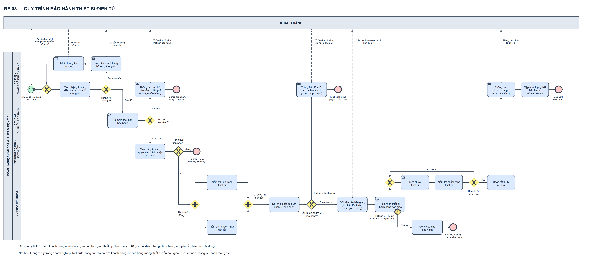

# Bài giải Đề 03 — Quy trình bảo hành thiết bị điện tử

Đầu vào là *Đề thi giữa kỳ PTNVPM* (tài liệu của học phần, không đính kèm) (*Đề thi giữa kỳ PTNVPM* (tài liệu của học phần, không đính kèm)) và mẫu nộp bài của học phần (không đính kèm). Bài gồm **một biểu đồ BPMN tổng thể**, trình bày thành hai phiên bản cùng một mô hình: bình thường và có màu. Không sửa tài liệu đầu vào.

Mẫu nộp được phát kèm vẫn mang tiêu đề và đề số của bài mẫu (“ĐỀ 01 – QUY TRÌNH MUA SẮM THIẾT BỊ NỘI BỘ”, “Đề số: 01”). Bản sao đã điền đổi các trường này thành **“ĐỀ 03 – QUY TRÌNH BẢO HÀNH THIẾT BỊ ĐIỆN TỬ”** và **“Đề số: 03”**, giữ nguyên khổ trang, kiểu chữ và bố cục mẫu.

## 1. Xem sơ đồ và bản nộp

- [Draw.io bình thường](BPMN_Bao_hanh_thiet_bi.drawio) · [Draw.io có màu](BPMN_Bao_hanh_thiet_bi_Co_mau.drawio).

[SVG có màu](BPMN_Bao_hanh_thiet_bi_Co_mau.svg) · [PNG bình thường](BPMN_Bao_hanh_thiet_bi.png) · [SVG bình thường](BPMN_Bao_hanh_thiet_bi.svg).

Bản màu dùng xanh lá cho start, đỏ cho **mọi** end (kể cả kết thúc thành công), vàng cho gateway/timer, xanh dương cho activity. Đây là quy ước trình bày quen thuộc của công cụ mô hình hóa mà workspace chọn, không phải màu bắt buộc của OMG (OMG §7.5, tr.39–40 coi màu là tùy chọn). Đỏ nghĩa là “kết thúc”, không có nghĩa “thất bại”. Hai bản có cùng ID, nhãn, tọa độ, loại event/gateway, marker, nét liền/đứt, đầu mũi tên và độ dày viền; chỉ khác màu.

## 2. Phạm vi và các bên tham gia

| Phần tử | Nội dung | Lý do mô hình hóa |
|---|---|---|
| Pool **KH** | Khách hàng | Participant bên ngoài doanh nghiệp, trình bày dạng **black box** |
| Pool **DN** | Doanh nghiệp kinh doanh thiết bị điện tử | Chủ sở hữu quy trình tiếp nhận và xử lý bảo hành |
| Lane **CSKH** | Bộ phận chăm sóc khách hàng | Tiếp nhận, kiểm tra đầy đủ, yêu cầu bổ sung, thông báo cho khách, cập nhật hoàn thành |
| Lane **HT** | Hệ thống quản lý bảo hành | Đề viết rõ “**hệ thống** kiểm tra thời hạn bảo hành” |
| Lane **TP** | Trưởng bộ phận kỹ thuật | Xem xét và quyết định phê duyệt tiếp nhận |
| Lane **KT** | Bộ phận kỹ thuật | Hai kiểm tra song song, yêu cầu bàn giao, tiếp nhận, sửa chữa, kiểm tra chất lượng, hoàn tất |

**Vì sao khách hàng là pool riêng?** Khách hàng không thuộc tổ chức thực hiện quy trình; giữa hai bên chỉ có trao đổi thông tin. Theo OMG §9.4 (tr.119), message flow phải nối hai pool khác nhau và không được nối hai phần tử trong cùng pool. Nếu đặt khách hàng thành một lane của doanh nghiệp thì việc “gửi yêu cầu”, “thông báo” sẽ thành sequence flow nội bộ — sai ranh giới participant.

**Vì sao black box?** Đề mô tả quy trình của doanh nghiệp, không mô tả quy trình nội bộ của khách hàng (khách quyết định thế nào, chuẩn bị ra sao). Pool rỗng là hợp lệ (OMG §9.3, tr.110–111) và message được gắn vào viền pool. Nếu vẽ chi tiết pool khách hàng thì phải tự bịa thêm quyết định “có bàn giao hay không”, cách khách chờ nhiều loại thông báo… — các bước không có trong đề.

**Vì sao “Hệ thống” là một lane?** OMG §10.8 (tr.305) nêu lane thường dùng cho vai trò nội bộ, **hệ thống** (ví dụ ứng dụng doanh nghiệp) hoặc phòng ban. Hệ thống là công cụ của chính doanh nghiệp nên là lane trong pool DN, không phải participant riêng.

**Phạm vi:** bắt đầu khi doanh nghiệp nhận được yêu cầu bảo hành của khách; kết thúc ở một trong **năm** kết quả: từ chối vì hết hạn bảo hành (E1), từ chối vì không được phê duyệt (E2), từ chối vì lỗi ngoài phạm vi (E3), yêu cầu bị đóng do quá hạn bàn giao (E4), bảo hành hoàn thành (E5).

## 3. Đối chiếu đủ 12 mục và các yêu cầu thể hiện của đề

| Mục đề | Điều phải thể hiện | Phần tử và đường đi trong sơ đồ |
|---|---|---|
| 1 | Khách gửi yêu cầu gồm thông tin sản phẩm và mô tả lỗi | M01 “Yêu cầu bảo hành (thông tin sản phẩm, mô tả lỗi)” từ KH → **S** (Message Start) |
| 2 | CSKH tiếp nhận, kiểm tra đầy đủ; thiếu thì yêu cầu bổ sung; bổ sung xong kiểm tra lại | S → GM1 → **CS1** → **G1**; “Chưa đầy đủ” → **CS2** (gửi M02) → **CS3** (nhận M03) → GM1 → CS1 |
| 3 | Thông tin hợp lệ thì hệ thống kiểm tra thời hạn bảo hành | G1 “Đầy đủ” → **HT1** (Service Task, lane Hệ thống) |
| 4 | Hết hạn: từ chối bảo hành miễn phí và thông báo khách | **G2** “Hết hạn” → **CS4** (gửi M04) → **E1** |
| 5 | Còn hạn: chuyển trưởng bộ phận kỹ thuật phê duyệt tiếp nhận | G2 “Còn hạn” → **TP1** (sequence flow đổi lane = chuyển hồ sơ) |
| 6 | Không phê duyệt thì từ chối; phê duyệt thì kỹ thuật xử lý tiếp | TP1 → **G3**; “Không” → **E2**; “Có” → AND_S |
| 7 | Kỹ thuật làm **đồng thời** kiểm tra tình trạng thiết bị và nguyên nhân lỗi | **AND_S** tạo hai token tới **KT1** và **KT2** |
| 8 | **Khi cả hai hoàn tất**: lỗi ngoài phạm vi thì CSKH thông báo từ chối miễn phí | KT1/KT2 → **AND_J** (chờ đủ hai) → **KTP** đối chiếu kết quả với phạm vi bảo hành → **G4** “Không thuộc phạm vi” → **CS5** (gửi M05) → **E3** |
| 9 | Lỗi thuộc phạm vi: kỹ thuật gửi yêu cầu khách bàn giao thiết bị | G4 “Thuộc phạm vi” → **KT3** gửi M06 và ghi nhận lúc khách nhận yêu cầu (t₀) |
| 10 | Bàn giao trong 48 giờ kể từ khi khách nhận yêu cầu; quá hạn thì đóng yêu cầu | t₀ có sẵn từ KT3 trước khi **KT4** bắt đầu chờ tiếp nhận thiết bị; **B48** — boundary timer **ngắt**, hạn tuyệt đối t₀ + 48 giờ → **KT5** → **E4** |
| 11 | Bàn giao đúng hạn: sửa chữa và kiểm tra chất lượng; chưa đạt thì sửa và kiểm tra lại; đạt thì hoàn tất | KT4 → **GM2** → **KT6** → **KT7** → **G5**; “Chưa đạt” → GM2 (vòng lặp); “Đạt” → **KT8** |
| 12 | CSKH thông báo khách nhận lại thiết bị, cập nhật trạng thái hoàn thành, kết thúc | KT8 → **CS6** (gửi M07) → **CS7** → **E5** |

| Yêu cầu thể hiện | Cách thể hiện |
|---|---|
| Các đối tượng tham gia | Pool Khách hàng; pool Doanh nghiệp với 4 lane CSKH, Hệ thống, Trưởng BPKT, BPKT |
| Điều kiện phê duyệt | G3 “Phê duyệt tiếp nhận?” sau tác vụ xem xét TP1; cùng các điều kiện dẫn tới phê duyệt: G1 (đầy đủ), G2 (còn hạn) |
| Xử lý song song | Cặp Parallel Gateway quanh KT1, KT2, mang nhãn “Thực hiện đồng thời” (AND_S) và “Chờ cả hai hoàn tất” (AND_J) |
| Vòng lặp | Vòng bổ sung thông tin (G1 → CS2 → CS3 → GM1 → CS1) và vòng sửa chữa (G5 → GM2 → KT6 → KT7 → G5) |
| Thời hạn bàn giao | Boundary timer B48 ngắt trên KT4, nhánh quá hạn KT5 → E4 |

Không thêm sửa chữa có phí, báo giá, phí vận chuyển, nhận hàng qua bưu điện, giới hạn số lần bổ sung/sửa, hạn bổ sung thông tin, hay thông báo ở những nhánh đề không yêu cầu. Xem mục 8.

## 4. Dữ liệu và điều kiện rẽ nhánh

Mỗi gateway chỉ **đọc** kết quả do một tác vụ trước đó tạo ra; gateway không tự “kiểm tra” hay “phê duyệt”.

| Gateway | Dữ liệu tạo điều kiện | Ai/tác vụ tạo dữ liệu | Nhánh (loại trừ nhau) |
|---|---|---|---|
| G1 — Thông tin đầy đủ? | Kết quả kiểm tra tính đầy đủ của yêu cầu | CS1 (CSKH) | Đầy đủ / Chưa đầy đủ |
| G2 — Còn hạn bảo hành? | Ngày hết hạn bảo hành của sản phẩm so với thời điểm kiểm tra | HT1 (Hệ thống) | Còn hạn / Hết hạn |
| G3 — Phê duyệt tiếp nhận? | Quyết định của trưởng bộ phận | TP1 (Trưởng BPKT) | Có / Không |
| G4 — Lỗi thuộc phạm vi bảo hành? | Kết luận `loi_thuoc_pham_vi` khi đối chiếu **cả hai** kết quả kiểm tra với phạm vi bảo hành | KTP (BPKT), sau AND_J | Thuộc phạm vi / Không thuộc phạm vi |
| G5 — Thiết bị đạt yêu cầu? | Kết quả kiểm tra chất lượng của **lần sửa gần nhất** | KT7 (BPKT) | Đạt / Chưa đạt |

Ba lớp quyết định được tách riêng như đề: **đầy đủ thông tin** (tính hợp lệ của đầu vào) khác **còn hạn bảo hành** (điều kiện hợp đồng), và cả hai khác **phê duyệt tiếp nhận** (quyết định quản lý). Thông tin đầy đủ và còn hạn không có nghĩa trưởng bộ phận buộc phải duyệt. Phê duyệt tiếp nhận cũng chưa có nghĩa được bảo hành miễn phí — phạm vi lỗi chỉ được kết luận sau hai kiểm tra kỹ thuật (G4).

Các cạnh ra của XOR có biểu thức điều kiện bổ sung lẫn nhau trong metadata (ví dụ `thong_tin_day_du` / `not thong_tin_day_du`), nên không cần nhánh default. Cạnh ra của AND không mang điều kiện.

## 5. Đi từng luồng nghiệp vụ

### 5.1. Luồng chính — bảo hành hoàn thành

1. Khách gửi M01. **S** kích hoạt một trường hợp bảo hành ở CSKH; GM1 chuyển tiếp tới **CS1**.
2. CS1 tiếp nhận và kiểm tra tính đầy đủ; **G1** chọn “Đầy đủ”.
3. **HT1** (hệ thống) kiểm tra thời hạn; **G2** chọn “Còn hạn”. Hồ sơ chuyển sang lane Trưởng BPKT.
4. **TP1** xem xét và ra quyết định; **G3** chọn “Có”.
5. **AND_S** tạo hai nhánh: **KT1** kiểm tra tình trạng thiết bị và **KT2** kiểm tra nguyên nhân lỗi. Hai việc độc lập, có thể xong theo thứ tự bất kỳ.
6. **AND_J** chỉ cho token đi tiếp khi **cả hai** đã xong. **KTP** đối chiếu hai kết quả với phạm vi bảo hành và ghi kết luận; **G4** đọc kết luận đó, chọn “Thuộc phạm vi”.
7. **KT3** gửi M06 yêu cầu khách bàn giao thiết bị và hoàn tất khi đã ghi nhận lúc khách **nhận** yêu cầu (t₀). **KT4** được kích hoạt: chờ và tiếp nhận thiết bị; boundary timer B48 canh hạn tuyệt đối t₀ + 48 giờ.
8. Khách mang thiết bị đến trước hạn → KT4 hoàn tất, timer B48 bị hủy cùng KT4. Token qua **GM2** tới **KT6** sửa chữa rồi **KT7** kiểm tra chất lượng; **G5** chọn “Đạt”.
9. **KT8** hoàn tất xử lý kỹ thuật. Token đi lên lane CSKH: **CS6** gửi M07 mời khách nhận lại thiết bị, **CS7** cập nhật trạng thái bảo hành = HOÀN THÀNH, kết thúc tại **E5**.

### 5.2. Thông tin chưa đầy đủ — vòng bổ sung

CS1 → G1 “Chưa đầy đủ” → **CS2** gửi M02 yêu cầu bổ sung → **CS3** chờ nhận M03 → **GM1** → CS1 kiểm tra **lại**. Có thể lặp nhiều lần. Không quay về Start (không tạo yêu cầu mới) và không đi thẳng từ CS3 sang kiểm tra thời hạn khi chưa kiểm tra lại. GM1 là XOR **merge**: vòng lặp hợp nhất với đường từ Start trước một tác vụ, mỗi lần chỉ có một token tới.

### 5.3. Sản phẩm hết hạn bảo hành

HT1 → G2 “Hết hạn” → **CS4** gửi M04 thông báo từ chối bảo hành miễn phí → **E1**. Không tới trưởng bộ phận, không kiểm tra kỹ thuật.

### 5.4. Trưởng bộ phận không phê duyệt

TP1 → G3 “Không” → **E2** “Từ chối: không phê duyệt tiếp nhận”. Đề chỉ viết “yêu cầu bị từ chối”, **không** nêu thông báo cho khách ở nhánh này (khác với mục 4 và mục 8 có nói rõ thông báo), nên không tự thêm tác vụ/message. Nếu giảng viên muốn, có thể chèn một Send Task “Thông báo từ chối” của CSKH trước E2 — đó là chi tiết mở rộng, không phải bước đề yêu cầu.

### 5.5. Lỗi không thuộc phạm vi bảo hành

Chỉ sau AND_J (đủ KT1 và KT2) và KTP (đã đối chiếu): G4 “Không thuộc phạm vi” → **CS5** (CSKH, đúng chủ thể ở mục 8) gửi M05 → **E3**. Không gửi yêu cầu bàn giao, không sửa chữa.

### 5.6. Quá 48 giờ chưa bàn giao

Trong khi KT4 đang chờ, nếu tới hạn t₀ + 48 giờ mà khách chưa bàn giao, **B48 ngắt KT4** và tạo token trên nhánh ngoại lệ → **KT5** đóng yêu cầu bảo hành → **E4**. Nhánh này không sửa chữa, không thông báo nhận lại, không cập nhật hoàn thành. Đề không nêu thông báo cho khách khi đóng nên không thêm.

### 5.7. Thiết bị chưa đạt — vòng sửa chữa

KT7 → G5 “Chưa đạt” → **GM2** → KT6 sửa tiếp → KT7 kiểm tra **lại**. Vòng quay về trước **sửa chữa** (đề: “tiếp tục sửa chữa và kiểm tra lại”), không quay về G5 để đánh giá lại kết quả cũ, không xin phê duyệt lại và không yêu cầu bàn giao lại. Timer 48 giờ không áp lại vì thiết bị đã ở doanh nghiệp. Đề không giới hạn số lần lặp.

### 5.8. Điều kiện kết thúc

| End | Khi nào tới | Trạng thái nghiệp vụ |
|---|---|---|
| E1 | G2 = hết hạn, sau khi CS4 đã gửi thông báo | Từ chối bảo hành miễn phí, khách đã được thông báo |
| E2 | G3 = không phê duyệt | Yêu cầu bị từ chối |
| E3 | G4 = ngoài phạm vi, sau khi CS5 đã gửi thông báo | Từ chối bảo hành miễn phí, khách đã được thông báo |
| E4 | B48 ngắt KT4, sau khi KT5 đóng yêu cầu | Yêu cầu bị đóng do quá hạn bàn giao |
| E5 | Sau CS6 (đã thông báo nhận lại) và CS7 (đã cập nhật) | Bảo hành hoàn thành |

Tại mọi End chỉ còn đúng một token: cặp AND đã đồng bộ trước G4, boundary timer là loại **ngắt** nên không để lại nhánh chạy song song. Vì vậy dùng None End là đủ, không cần Terminate End.

## 6. Cách hiểu chính xác mốc 48 giờ

Đề viết: “trong vòng 48 giờ **kể từ khi nhận được yêu cầu**”. Mốc t₀ là **thời điểm khách hàng nhận được yêu cầu bàn giao** (M06), không phải lúc gửi yêu cầu bảo hành, lúc phê duyệt hay lúc bắt đầu kiểm tra. Hạn = **t₀ + 48 giờ**.

- B48 lưu metadata `timeDate = t_kh_nhan_yeu_cau_ban_giao + PT48H` — một **hạn tuyệt đối**. Đây là cách diễn đạt quy tắc nghiệp vụ trong file draw.io, không phải biểu thức thực thi; trong triển khai thật, timeDate phải trả về thời điểm ISO-8601 (OMG Bảng 10.101, tr.273).
- **t₀ được tạo trước khi bắt đầu chờ.** KT3 “Gửi yêu cầu bàn giao, ghi nhận lúc khách nhận yêu cầu (t₀)” gửi M06 và chỉ hoàn tất khi đã có thời điểm khách nhận (ví dụ trạng thái đã giao/đã đọc của kênh thông báo); metadata `outputData = t_kh_nhan_yeu_cau_ban_giao` chính là biến mà timer dùng. Nhờ vậy khi KT4 bắt đầu, hạn đã xác định được. KT3 là **Task thường** chứ không phải Send Task, vì theo OMG §10.3.3 (tr.157) Send Task kết thúc ngay khi gửi, chưa chứng minh khách đã nhận. Đề không nêu kênh cụ thể nên bài không vẽ thêm thủ tục kỹ thuật của kênh.
- **“Bàn giao đúng hạn”** được hiểu là khách giao thiết bị trước hạn. KT4 hoàn tất tại thời điểm tiếp nhận thiết bị; thủ tục ghi nhận là một phần của KT4. Nếu doanh nghiệp muốn hạn chỉ áp lên việc khách **có mặt**, còn thủ tục nội bộ được phép kéo dài qua hạn, phải mô hình thêm một sự kiện “khách đến bàn giao” riêng — đề không yêu cầu mức chi tiết này.
- Đề không quy định trường hợp khách bàn giao **đúng khoảnh khắc** hết hạn; bài không tự đặt quy tắc xử lý hòa. Thiết bị mang tới **sau** khi B48 đã ngắt không làm sống lại token đã sang nhánh đóng; muốn bảo hành tiếp thì là một yêu cầu mới, ngoài phạm vi đề.

**Vì sao boundary timer ngắt (hai vòng nét liền) mà không phải không ngắt (hai vòng nét đứt)?** Đề: quá hạn thì yêu cầu **bị đóng** — việc chờ thiết bị phải dừng. Timer không ngắt sẽ để KT4 tiếp tục chờ song song với việc đóng yêu cầu, sai nghĩa (OMG §10.5.6, tr.276: boundary ngắt có `cancelActivity=true`, kết thúc activity và đi theo exception flow).

**Kiểm thử dữ liệu thời hạn.** Ngoài nhãn, định nghĩa `timeDate` trong file được áp lên các dòng thời gian giả lập (giờ tính từ lúc gửi yêu cầu bàn giao) và so với quy tắc của đề:

| Dòng thời gian | Theo đề | Theo định nghĩa trong file |
|---|---|---|
| Khách nhận ngay, bàn giao sau 47 giờ | Đúng hạn | Đúng hạn |
| Khách nhận trễ 24 giờ, bàn giao lúc 71 giờ 59 sau khi gửi | Đúng hạn | Đúng hạn |
| Khách nhận trễ 24 giờ, bàn giao lúc 72 giờ 30 sau khi gửi | Quá hạn | Quá hạn |
| Tác vụ chờ bắt đầu muộn 2 giờ, bàn giao 49 giờ sau khi khách nhận | Quá hạn | Quá hạn |

Hai cách hiểu sai được dùng làm đối chứng và đều cho kết quả khác đề: tính hạn từ **lúc gửi** (sai ở dòng 2) và đếm lại **48 giờ khi tác vụ chờ bắt đầu** (sai ở dòng 2 và 4). Các mốc thử cố ý tránh đúng thời khắc hết hạn vì đề không quy định bên thắng khi hòa.

**Vị trí timer.** OMG cho phép gắn boundary event ở bất kỳ điểm nào trên viền activity, nhưng **khuyến nghị** với sơ đồ đọc ngang thì gắn ở **cạnh dưới**, luồng ngoại lệ đi xuống rồi sang phải (§10.5.4, tr.249). B48 đặt đúng như vậy; luồng bình thường của KT4 đi lên vòng sửa chữa. Boundary timer chỉ là nơi bắt sự kiện: không có sequence đi vào, có đúng một exception flow không điều kiện đi ra (tr.257).

**Vì sao không dùng XOR “Bàn giao đúng hạn?”?** Gateway chỉ đọc dữ liệu tại thời điểm token tới. Nếu khách **không bao giờ** mang thiết bị đến thì token kẹt trước gateway, không có ai “quyết định” quá hạn. Timer là sự kiện thời gian thật sự xảy ra và ngắt việc chờ — đúng cách BPMN diễn đạt thời hạn.

**Vì sao không dùng event-based gateway?** Cấu hình đó cần một sự kiện bắt (thường là Message catch “Khách bàn giao thiết bị”) chạy đua với Timer catch. Việc mang thiết bị đến là hành động vật lý, không phải message, nên bài dùng Manual Task có boundary timer. Hai cách đều hợp lệ khi có sự kiện bàn giao dạng thông tin; ở đây cách boundary đọc gọn và đúng bản chất vật lý hơn.

**Vì sao không vẽ message cho việc bàn giao thiết bị?** Message flow biểu diễn **thông tin** trao đổi giữa hai participant. Mang thiết bị đến là việc vật lý, được thể hiện ở **Manual Task KT4** (marker bàn tay). Đây là quy ước của bộ hướng dẫn workspace để người đọc không hiểu message là món hàng. Chú thích ở chân sơ đồ ghi rõ điều này.

## 7. Vì sao các ký hiệu và đường nối được chọn như vậy

### 7.1. Start và end

**S** là **Message Start Event** (một vòng mảnh, phong bì không tô): quy trình doanh nghiệp được kích hoạt bởi yêu cầu của khách gửi tới, có message M01 đi vào. Năm End là **None End Event** (một vòng đậm, không marker); nhãn phân biệt kết quả. Không dùng Cancel End (chỉ dành cho Transaction Sub-Process), không dùng Terminate End (không còn nhánh song song cần dừng).

### 7.2. Task và marker

| Marker | Tác vụ | Lý do |
|---|---|---|
| Send (phong bì **tô đen**) | CS2, CS4, CS5, CS6 | Gửi thông tin tới khách; mỗi tác vụ có đúng một message đi ra |
| Receive (phong bì **rỗng**) | CS3 | Chờ thông tin bổ sung từ khách (M03 đi vào) |
| Service (bánh răng) | HT1 | Đề nói rõ **hệ thống** kiểm tra thời hạn |
| Manual (bàn tay) | KT4, KT6 | Tiếp nhận thiết bị và sửa chữa là thao tác vật lý |
| Task thường | CS1, TP1, KT1, KT2, KTP, KT3, KT5, KT7, KT8, CS7 | Đề không quy định là tự động, thao tác phần mềm hay thủ công; không suy đoán marker. KT3 vẫn có message M06 đi ra (task thường được phép làm nguồn message) nhưng không dùng marker Send vì còn phải chờ ghi nhận t₀ |

KT1 và KT2 diễn ra **trước** khi khách bàn giao thiết bị (mục 7–9 của đề). Bài giữ đúng thứ tự này: đây là đánh giá kỹ thuật dựa trên thông tin sản phẩm, mô tả lỗi và dữ liệu khách cung cấp, chưa phải thao tác trên thiết bị thật. Vì vậy hai tác vụ này để Task thường, không đánh dấu Manual. Không tự đảo thứ tự “bàn giao trước, kiểm tra sau”, vì như vậy sẽ thay đổi chính quy trình đề đã cho.

### 7.3. Gateway

- **XOR split** (G1–G5): mỗi lần đánh giá đi đúng **một** nhánh theo dữ liệu (mục 4).
- **XOR merge** (GM1, GM2): hợp nhất đường vào với đường vòng lặp ngay trước tác vụ được lặp. OMG cho phép nối nhiều sequence flow thẳng vào một activity (gọi là *uncontrolled flow*, §10.3, tr.151) và khuyến nghị hội tụ tại gateway khi cần kiểm soát; bài dùng merge tường minh để vòng lặp dễ đọc. Đây là lựa chọn trình bày, không phải bắt buộc của chuẩn.
- **AND** (AND_S, AND_J): split kích hoạt cả hai nhánh, join chờ **cả hai** (OMG §10.6.4, tr.292–293). Nếu thay join bằng XOR, G4 có thể chạy hai lần hoặc chạy khi mới có một kết quả — kiểm thử đối chứng ở mục 10 đã bắt được lỗi này. Hai gateway mang nhãn “Thực hiện đồng thời” và “Chờ cả hai hoàn tất”: đây là **tên** gateway để người đọc thấy ngay ý nghĩa tách/đồng bộ, không phải điều kiện; các nhánh ra của AND vẫn không ghi điều kiện.
- **Căn cứ của G4:** gateway không tự quyết định. Task **KTP** “Đối chiếu kết quả với phạm vi bảo hành” tạo kết luận `loi_thuoc_pham_vi` từ **cả hai** kết quả kiểm tra; điều kiện ở hai nhánh ra của G4 chỉ đọc biến này. Bước này suy ra trực tiếp từ mục 8 của đề (“khi cả hai công việc hoàn tất, nếu lỗi không thuộc phạm vi…”), không thêm thẩm quyền phê duyệt mới.

### 7.4. Sequence và message

**35 sequence flow:** nét liền, mũi tên đặc, đều nằm trong pool doanh nghiệp. Đường đổi lane (ví dụ G1 → HT1, G2 → TP1, G4 → CS5, KT8 → CS6) vẫn là sequence: lane chỉ phân trách nhiệm, không phải ranh giới participant. Đường cắt nhau không có điểm nối chỉ là giao hình học, không phải gateway.

**7 message flow:** nét đứt, vòng tròn rỗng ở đầu gửi, mũi tên rỗng ở đầu nhận, chỉ nối pool khách hàng với phần tử trong doanh nghiệp (OMG §9.4, tr.119).

> **Lưu ý khi tự vẽ bằng draw.io:** mẫu “Message Flow” trơn trong palette BPMN 2.0 của draw.io (clone commit `17b367b`, `Sidebar-BPMN.js` dòng 88) có **mũi tên tô đặc** (`endFill=1`) — không đúng OMG. Hãy dùng mẫu “Message Flow with Decorator” hoặc chỉnh *Line end* sang mũi tên **rỗng** (`endFill=0`). Tương tự, mẫu “End” của palette là **Terminate End** (chấm đen đặc bên trong); bài này cần **None End**, chọn mẫu end không marker.

| Message | Nguồn → đích | Nội dung |
|---|---|---|
| M01 | KH → S | Yêu cầu bảo hành (thông tin sản phẩm, mô tả lỗi) |
| M02 | CS2 → KH | Yêu cầu bổ sung thông tin |
| M03 | KH → CS3 | Thông tin bổ sung |
| M04 | CS4 → KH | Thông báo từ chối bảo hành miễn phí (hết hạn bảo hành) |
| M05 | CS5 → KH | Thông báo từ chối bảo hành miễn phí (lỗi ngoài phạm vi) |
| M06 | KT3 → KH | Yêu cầu bàn giao thiết bị (hạn 48 giờ) |
| M07 | CS6 → KH | Thông báo nhận lại thiết bị |

## 8. Giả định và điểm đề không nêu

| # | Nội dung | Loại | Ảnh hưởng nếu khác |
|---|---|---|---|
| A1 | CSKH gửi thông báo từ chối khi hết hạn (đề viết bị động “khách hàng được thông báo”) | Giả định, nhất quán với mục 8 nơi CSKH thông báo | Nếu hệ thống tự gửi: đổi CS4 sang lane HT, giữ Send Task |
| A2 | Bộ phận kỹ thuật là bên tiếp nhận thiết bị (đề không nêu ai nhận) | Giả định: KT là bên gửi yêu cầu bàn giao và sửa chữa | Nếu CSKH nhận ở quầy: chuyển KT4 + B48 sang lane CSKH |
| A3 | Kỹ thuật đóng yêu cầu khi quá hạn (đề: “yêu cầu bị đóng”) | Giả định | Nếu hệ thống tự đóng: KT5 thành Service Task trong lane HT |
| A4 | Không thông báo khách khi không được phê duyệt/khi đóng do quá hạn | Theo đúng chữ của đề | Có thể thêm Send Task trước E2/E4 nếu giảng viên yêu cầu |
| A5 | Không có hạn bổ sung thông tin, không giới hạn số lần bổ sung/sửa | Đề không nêu | Thêm timer/bộ đếm khi có chính sách |
| A6 | t₀ = lúc khách nhận yêu cầu bàn giao; kênh thông báo cho biết thời điểm này để KT3 ghi nhận | Suy ra từ chữ của đề | Nếu kênh không có trạng thái đã nhận, phải bổ sung cách xác nhận khi triển khai (mục 6) |
| A7 | KT1/KT2 là đánh giá trước khi có thiết bị | Theo thứ tự đề | Xem mục 7.2 |
| A8 | Quy trình kết thúc sau khi cập nhật hoàn thành, không chờ khách đến nhận máy | Đúng chữ mục 12 | Thêm Manual Task “Trả thiết bị” nếu phạm vi mở rộng |

Không mô hình hóa: sửa chữa có phí sau khi từ chối, báo giá, đổi máy, vận chuyển, khiếu nại, hủy yêu cầu từ phía khách — đề không nêu.

## 9. Cách tự vẽ lại trong draw.io

1. Mở draw.io → *More Shapes* → bật **BPMN 2.0**. Tạo trang ngang.
2. Vẽ pool **Khách hàng** ở trên cùng, đặt tên “KHÁCH HÀNG” và để rỗng (black box). Bên dưới vẽ pool **Doanh nghiệp** với bốn lane theo thứ tự: Chăm sóc khách hàng, Hệ thống quản lý bảo hành, Trưởng bộ phận kỹ thuật, Bộ phận kỹ thuật (lane cuối cao nhất để chứa ba hàng phần tử và một hành lang cho vòng lặp).
3. Lane CSKH chia hai hàng. Hàng dưới: Message Start “Nhận được yêu cầu bảo hành” → XOR merge → “Tiếp nhận yêu cầu, kiểm tra tính đầy đủ thông tin” → XOR “Thông tin đầy đủ?”. Hàng trên: Send Task “Yêu cầu khách hàng bổ sung thông tin” ngay trên gateway, Receive Task “Nhận thông tin bổ sung” bên trái. Nối: gateway ↑ Send → Receive ← → xuống merge.
4. Nhánh “Đầy đủ” đi xuống lane Hệ thống: Service Task “Kiểm tra thời hạn bảo hành” → XOR “Còn hạn bảo hành?”. “Hết hạn” đi lên Send Task thông báo từ chối ở CSKH → End. “Còn hạn” đi xuống lane Trưởng BPKT: Task xem xét → XOR “Phê duyệt tiếp nhận?” → “Không” → End.
5. “Có” đi xuống lane Kỹ thuật vào **AND split** (dấu +), ghi tên “Thực hiện đồng thời”. Hai task “Kiểm tra tình trạng thiết bị” (trên), “Kiểm tra nguyên nhân gây lỗi” (dưới) cùng hội tụ vào **AND join** (dấu +), ghi tên “Chờ cả hai hoàn tất”. Đặt tên gateway ở chỗ trống, không để đường nối đi qua chữ. Tiếp theo Task “Đối chiếu kết quả với phạm vi bảo hành” → XOR “Lỗi thuộc phạm vi bảo hành?”.
6. “Không thuộc phạm vi” đi thẳng lên Send Task thông báo từ chối ở CSKH → End. “Thuộc phạm vi” → Task “Gửi yêu cầu bàn giao, ghi nhận lúc khách nhận yêu cầu (t₀)” (có message gửi khách) → Manual Task “Tiếp nhận thiết bị khách hàng bàn giao”.
7. Lấy **Timer Intermediate, Boundary Interrupting** (hai vòng nét liền) thả lên **cạnh dưới** Manual Task đến khi nó dính vào viền. Ghi “Hết 48 giờ kể từ khi KH nhận yêu cầu bàn giao”. Từ timer đi **xuống rồi sang phải** tới Task “Đóng yêu cầu bảo hành” ở hàng dưới → End.
8. Từ cạnh trên Manual Task đi lên XOR merge ở hàng trên → Manual Task “Sửa chữa thiết bị” → Task “Kiểm tra chất lượng thiết bị” → XOR “Thiết bị đạt yêu cầu?”. “Chưa đạt” đi vòng phía trên quay về merge; “Đạt” sang phải tới Task “Hoàn tất xử lý kỹ thuật”.
9. Từ “Hoàn tất xử lý kỹ thuật” đi thẳng lên CSKH: Send Task “Thông báo khách hàng nhận lại thiết bị” → Task “Cập nhật trạng thái bảo hành: HOÀN THÀNH” → End “Bảo hành hoàn thành”.
10. Vẽ 7 message flow (công cụ *Message Flow*: nét đứt, tròn rỗng đầu gửi, mũi tên rỗng đầu nhận) giữa các Send/Receive/Start và viền pool Khách hàng; ghi tên thông tin trên từng đường.
11. Ghi nhãn cho mọi nhánh ra của XOR. Không ghi điều kiện lên nhánh ra của AND. Kiểm tra lại: start vòng mảnh, end vòng đậm, timer hai vòng liền, phong bì gửi tô đen/nhận rỗng.
12. Lưu bản thường; nhân bản để tô màu, **chỉ đổi màu nền**. Không đổi loại event/gateway, nét, mũi tên hay độ dày viền.

## 10. Kiểm tra thực sự đã chạy và giới hạn

| Kiểm tra | Kết quả | Bằng chứng |
|---|---|---|
| Dựng hình bằng viewer chính thức từ clone draw.io commit `17b367b91dbab91804f852645788d7ffb46dcb79` | Hai bản đều dựng được, không có shape lạ | kiem-chung/ (SVG, PNG, render.json, roundtrip, manifest có SHA-256 đầu vào) |
| Audit cấu trúc/ký pháp/hình học bản thường | 0 lỗi | Kiem_tra.json |
| Audit bản màu + palette + so sánh với bản thường | 0 lỗi; palette đạt; `only_color_differs = true` | Kiem_tra_Co_mau.json |
| 32 kiểm tra riêng của đề | Đạt cả 32 | Kiem_tra_kich_ban.json |
| Bản nộp DOCX/PDF | Đạt 6/6 file | Kiem_tra_ban_nop.json |
| Rà trực quan ảnh sơ đồ và trang PDF | Ghi nhận theo hash file | Ra_soat_truc_quan.json |
| Tự rà soát theo OMG, mã nguồn draw.io, từng câu của đề và so sánh với bài GPT/Gemini | 3 điểm chuẩn hóa + 5 điểm trình bày + 3 cải tiến sau so sánh; các điểm giữ nguyên có lý do | [TU_RA_SOAT.md](TU_RA_SOAT.md) |
| Va chạm nhãn trên SVG cả hai bản (khung chữ đo bằng font thật) | 0 lỗi trên 109 dòng chữ; 0 `foreignObject`; 3/3 đối chứng bị bắt | Kiem_tra_nhan.json |

**32 kiểm tra riêng** gồm:

- **14 kịch bản token** chạy trên chính các cạnh của file draw.io: thành công; bổ sung 1 lần; bổ sung 2 lần; hết hạn; không phê duyệt; ngoài phạm vi; quá hạn bàn giao; sửa lại 1 lần; sửa lại 2 lần; bổ sung rồi hết hạn; bổ sung + sửa lại rồi hoàn thành; bổ sung rồi quá hạn; bổ sung rồi ngoài phạm vi; bổ sung rồi không được duyệt. Mỗi kịch bản phải kết thúc đúng **một** End, không còn token treo, không vi phạm bất biến (không kiểm tra thời hạn khi chưa kiểm tra lại thông tin bổ sung; không đối chiếu/kết luận phạm vi khi chưa đủ hai kiểm tra; không xét gateway phạm vi khi chưa đối chiếu; không sửa chữa khi chưa nhận thiết bị; không cập nhật hoàn thành trước khi thông báo…). Các kịch bản có nhánh song song xét **cả hai thứ tự** KT1/KT2 hoàn tất.
- **5 đối chứng cố ý sai**, đều bị phát hiện: thay AND-join bằng XOR; bỏ qua bước đối chiếu phạm vi; bỏ kiểm tra lại sau bổ sung; cập nhật hoàn thành trước thông báo; nhánh quá hạn vẫn đi sửa chữa.
- **6 ràng buộc mô hình riêng:** timer gắn KT4, ngắt, hạn chứa PT48H; không có message vào/ra Manual Task; mọi message nối pool khách hàng; Send có message ra, Receive và Message Start có message vào; biến t₀ của timer do KT3 tạo ngay trước KT4 (KT3 là task thường có message ra); điều kiện của G4 chỉ đọc kết luận do KTP tạo.
- **1 kiểm tra nhánh quá hạn:** từ timer chỉ đi tới “Đóng yêu cầu bảo hành” và end tương ứng; thiết bị tới muộn không thể quay lại sửa chữa.
- **4 kiểm tra định nghĩa thời hạn** (mục 6): định nghĩa trong file khớp quy tắc của đề trên 4 dòng thời gian; 2 đối chứng cách hiểu sai đều bị phát hiện; không tự gắn quy tắc xử lý hòa.
- **2 hồi quy hình học:** sequence được đi qua lane trung gian cùng pool; khi giả lập một lane thành vật cản, công cụ vẫn bắt được đường F32 cắt qua.

**Giới hạn:** lựa chọn ở các XOR và kết quả cuộc đua timer/bàn giao do kiểm thử khai báo; không chạy đồng hồ 48 giờ, kênh thông báo hay BPMN engine. File `.drawio` là sơ đồ chỉnh sửa được, **không phải** BPMN 2.0 XML thực thi; metadata `conditionExpression`/`timeDate` chỉ diễn đạt quy tắc. Audit không phải bộ kiểm chứng đầy đủ mọi mục của OMG; nhận định nghiệp vụ dựa trên đối chiếu đề (mục 3–6) và các kịch bản trên.

**Về khổ giấy:** PDF theo mẫu giữ trang Letter ngang một trang như mẫu. Sơ đồ có 5 kết quả và 2 vòng lặp nên chữ nhỏ khi xem nguyên trang; sơ đồ được nhúng dạng **vector** (từ SVG chữ thuần), nên phóng to bao nhiêu cũng nét và chọn/tìm được chữ trong PDF. DOCX giao kèm vẫn dùng ảnh PNG 2× để mọi phiên bản Word mở được. Bản A3 vector và SVG dành cho đọc chi tiết.

## 11. Tài liệu chuẩn đã dùng

[OMG BPMN 2.0.2](https://www.omg.org/spec/BPMN/2.0.2/PDF). Trang trong trình đọc PDF = trang in + 30.

| Mục | Trang in | Áp dụng trong bài |
|---|---|---|
| 7.5 Use of Text, Color, Size, and Lines | 39–40 | Màu chỉ hỗ trợ hiển thị |
| 9.3 Pool and Participant | 110–111 | Pool khách hàng dạng black box, message gắn viền pool |
| 9.4 Message Flow | 119 | Message nối hai pool khác nhau; nét đứt, tròn rỗng, mũi tên rỗng |
| 10.3 Activities — Sequence Flow Connections | 151 | Nhiều cạnh vào một activity là *uncontrolled flow*; dùng gateway khi cần kiểm soát |
| 10.3.3 Task types | 156–161 | Service, Send, Receive, Manual |
| 10.5.2–10.5.3 Start/End Events | 237–248 | Message Start, None End |
| 10.5.4 Intermediate Event | 249 | Boundary gắn ở bất kỳ điểm nào trên viền; khuyến nghị cạnh dưới với sơ đồ ngang |
| 10.5.4 Activity Boundary Connections | 257 | Trigger được phép gắn biên; không có sequence vào; phải có sequence ra |
| 10.5.5 Bảng 10.101 TimerEventDefinition | 273 | timeDate là thời điểm ISO-8601 |
| 10.5.6 Handling Events | 276 | Boundary ngắt (`cancelActivity=true`) và exception flow |
| 10.6.2 Exclusive Gateway | 287–290 | Rẽ nhánh/hợp nhất theo điều kiện |
| 10.6.4 Parallel Gateway | 292–293 | Tách và chờ đủ các nhánh song song |
| 10.8 Lanes | 305 | Lane cho vai trò, phòng ban và **hệ thống** |

## 12. Danh mục đầy đủ phần tử và đường nối

Xem [PHU_LUC_PHAN_TU_VA_LUONG.md](PHU_LUC_PHAN_TU_VA_LUONG.md), được trích tự động từ chính file draw.io: ID, loại BPMN, nhãn, lane, mọi sequence/message kèm điều kiện và thuộc tính timer. ID xem được trong draw.io bằng *Edit Data* (Ctrl+M); không hiển thị ID lên ảnh nộp.
