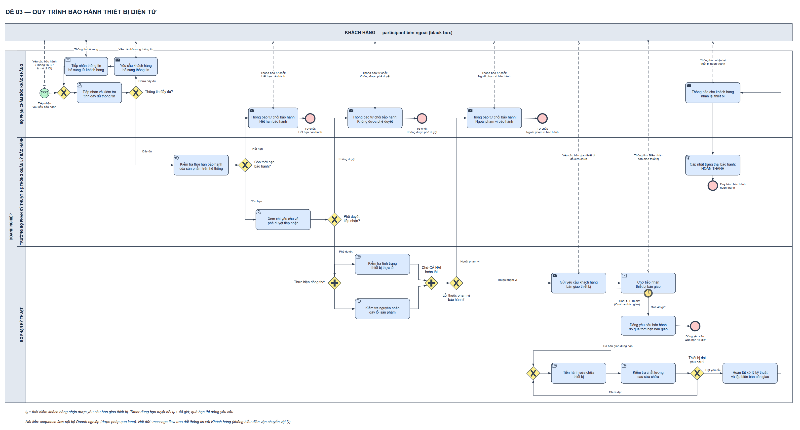

# Đề 03 — Bảo hành thiết bị điện tử (bản Gemini)

> Lời giải tham khảo cho *Đề thi giữa kỳ PTNVPM* (tài liệu của học phần, không đính kèm). Không phải đáp án chính thức: sơ đồ do AI agent dựng với skill bpmn-drawio theo hướng dẫn của tác giả và **chưa được giảng viên xác nhận**. Tên, mã sinh viên và bài nộp đã được lược bỏ; tài liệu giữ văn bản gốc, chữ “workspace” trong đó chỉ thư mục làm bài ban đầu. Tên file `BPMN_De_02` là tên lịch sử; nội dung là Đề 03.

| Bản | Nguồn chỉnh sửa | Ảnh |
|---|---|---|
| Thường | [BPMN_De_02.drawio](BPMN_De_02.drawio) | [BPMN_De_02.png](BPMN_De_02.png) · [BPMN_De_02.svg](BPMN_De_02.svg) |
| Màu | [BPMN_De_02_Co_mau.drawio](BPMN_De_02_Co_mau.drawio) | [BPMN_De_02_Co_mau.png](BPMN_De_02_Co_mau.png) · [BPMN_De_02_Co_mau.svg](BPMN_De_02_Co_mau.svg) |

## Tài liệu

- [GIAI_THICH_VA_DOI_CHIEU_DE_02.md](GIAI_THICH_VA_DOI_CHIEU_DE_02.md)
- [PHU_LUC_PHAN_TU_VA_LUONG.md](PHU_LUC_PHAN_TU_VA_LUONG.md)

Kiểm tra công cụ (22/10/2026, skill 1.0.0-rc.2): không lỗi cấu trúc/ký pháp được hỗ trợ, bản màu chỉ khác màu, không còn phát hiện bố cục. Đây không phải xác nhận nghiệp vụ.
