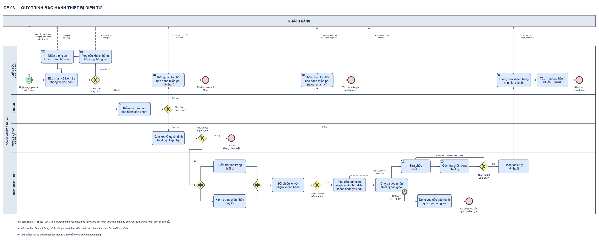
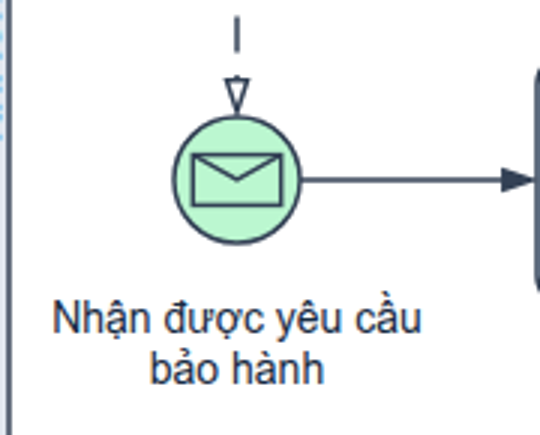

# Bài giải BPMN — Quy trình bảo hành thiết bị điện tử

**Bản cải tiến đã cập nhật:** [Kết quả đối chiếu chuẩn, bố cục và bản nộp](TU_RA_SOAT_THEO_CHUAN_BPMN.md). Luồng sửa chữa đọc sang phải, thông báo hoàn tất đi thẳng lên CSKH; SVG dùng chữ thuần. K4 giữ hợp đồng ghi nhận lúc khách nhận, để mốc 48 giờ có dữ liệu trước khi chờ bàn giao.

**Lưu ý định danh:** thư mục ban đầu do người dùng chỉ định tên `de-02` (nay đổi thành `de-03-bao-hanh-thiet-bi`); cả *Đề thi giữa kỳ PTNVPM* (tài liệu của học phần, không đính kèm) và *Đề thi giữa kỳ PTNVPM* (tài liệu của học phần, không đính kèm) ghi **ĐỀ 03 — QUY TRÌNH BẢO HÀNH THIẾT BỊ ĐIỆN TỬ**. Mẫu nộp đính kèm còn tiêu đề Đề 01 mua sắm và thông tin sinh viên minh họa. Bản sao nộp của bài này đã thay tiêu đề, đề số, mã sinh viên, họ tên và hình minh họa cho đúng bài bảo hành. Giữ nguyên các nguồn và mọi thành phần ngoài `by-gpt/`.

## 1. Kết quả và phạm vi

Một collaboration tổng thể thể hiện toàn bộ luồng xử lý của doanh nghiệp và các điểm tương tác với khách hàng. Có hai cách trình bày của **cùng một mô hình**: bình thường và có màu. Không chia quy trình thành các trang rời làm mất mối liên hệ giữa duyệt, chờ bàn giao và sửa chữa.

- [Draw.io bình thường](BPMN_De_03_Bao_hanh.drawio) · [Draw.io có màu](BPMN_De_03_Bao_hanh_Co_mau.drawio).

[Mở SVG cùng sơ đồ](BPMN_De_03_Bao_hanh_Co_mau.svg).

Điểm bắt đầu là doanh nghiệp nhận yêu cầu bảo hành từ khách hàng. Có năm kết quả kết thúc: từ chối miễn phí vì hết hạn, từ chối tiếp nhận do không phê duyệt, từ chối miễn phí vì ngoài phạm vi, đóng do quá hạn bàn giao, hoặc hoàn thành bảo hành sau khi đã thông báo khách nhận lại thiết bị.

**Hai điểm cần hiểu trước khi review:** đề đặt hai kiểm tra kỹ thuật trước việc yêu cầu bàn giao; bài giữ thứ tự đó và công khai giả định tại mục 7. Mốc 48 giờ là lúc **khách nhận yêu cầu bàn giao**, không phải lúc doanh nghiệp gửi hoặc lúc hồ sơ được duyệt; cách thể hiện nằm tại mục 6.

## 2. Pool, lane và trách nhiệm

| ID | Loại | Vai trò và phạm vi |
|---|---|---|
| KH | Pool black box | Khách hàng bên ngoài doanh nghiệp; gửi hồ sơ, bổ sung, nhận thông báo và thực hiện bàn giao |
| DN | Pool có process | Doanh nghiệp tiếp nhận và xử lý bảo hành |
| CS | Lane của DN | Chăm sóc khách hàng: tiếp nhận, yêu cầu bổ sung, từ chối có thông báo, thông báo nhận lại, cập nhật hoàn thành |
| HT | Lane của DN | Hệ thống tự động kiểm tra thời hạn bảo hành |
| TP | Lane của DN | Trưởng bộ phận kỹ thuật xem xét, quyết định phê duyệt tiếp nhận |
| KT | Lane của DN | Kiểm tra kỹ thuật, đối chiếu phạm vi, yêu cầu/tiếp nhận bàn giao, sửa và kiểm tra chất lượng, đóng quá hạn, hoàn tất xử lý kỹ thuật |

Các bộ phận và hệ thống cùng tham gia process của doanh nghiệp nên được đặt trong các lane, không tách thành những participant độc lập. Sequence flow được chuyển qua lane, kể cả lane trung gian. Chỉ các trao đổi giữa KH và DN mới là message flow.

Khách hàng dùng black box vì đề không yêu cầu phân rã hoạt động nội bộ của họ. Việc khách bàn giao được phản ánh bằng hoạt động tiếp nhận thực tế `WAIT` trong DN. Message gắn viền pool KH là hợp lệ; nó không mang token điều khiển sang DN. Bài không tuyên bố đã vẽ một process riêng chi tiết của khách hàng.

## 3. Đối chiếu từng yêu cầu

| Mục đề | Yêu cầu nghiệp vụ | Phần tử, điều kiện và kết quả |
|---|---|---|
| 1 | KH gửi thông tin sản phẩm và mô tả lỗi | M01 từ KH đến Message Start S; nhãn message ghi hai loại dữ liệu |
| 2 | CS kiểm tra đủ thông tin; thiếu thì yêu cầu bổ sung và kiểm tra lại | C1 → GI; Chưa đầy đủ → C2 gửi M02 → C3 chờ M03 → C1 |
| 3 | Thông tin hợp lệ mới kiểm tra thời hạn | GI nhánh Đầy đủ → SYS ở lane HT |
| 4 | Hết hạn: từ chối bảo hành miễn phí và thông báo KH | GW nhánh Hết hạn → C4 gửi M04 → E_EXP |
| 5 | Còn hạn mới chuyển trưởng kỹ thuật phê duyệt tiếp nhận | GW nhánh Còn hạn → T1 |
| 6 | Trưởng bộ phận quyết định không duyệt/duyệt | T1 → GA; Không → E_APP, Có → AND_S |
| 7 | Sau duyệt, kiểm tra tình trạng và nguyên nhân đồng thời | AND_S phân token vào K1 và K2; không áp thứ tự xong trước cố định |
| 8 | Chờ cả hai xong; ngoài phạm vi thì CS thông báo từ chối miễn phí | AND_J → K3 → GS; Không → C5 gửi M05 → E_SCOPE |
| 9 | Thuộc phạm vi mới yêu cầu KH bàn giao để sửa | GS nhánh Có → K4 gửi M06 |
| 10 | Bàn giao trong 48 giờ từ lúc KH nhận yêu cầu; quá hạn thì đóng | K4 → WAIT; B48 gắn WAIT với hạn t₀ + 48 giờ; timeout → CLOSE → E_TIME |
| 11 | Đã bàn giao đúng hạn mới sửa/kiểm tra; chưa đạt thì sửa lại; đạt thì hoàn tất kỹ thuật | WAIT → REPAIR → QA → GQ; Chưa đạt → REPAIR, Đạt → FIN |
| 12 | CS thông báo nhận lại, cập nhật hoàn thành, kết thúc | FIN → C6 gửi M07 → C7 → E_OK |

K3 là bước diễn đạt rõ việc đối chiếu kết quả hai kiểm tra với chính sách phạm vi bảo hành, được suy ra từ mục 8–9. K3 không thêm một lần phê duyệt của trưởng bộ phận. Nó tạo dữ liệu để GS định tuyến; gateway không tự làm việc kiểm tra hay ra quyết định thay người phụ trách.

Không thêm giá sửa có phí, thanh toán, hoàn tiền, chuyển nhà sản xuất, mua linh kiện, giới hạn số lần sửa, thời hạn bổ sung, hoặc yêu cầu KH xác nhận đã lấy máy. Đề chưa quy định các việc này.

## 4. Dữ liệu và các quyết định độc lập

| Gateway | Dữ liệu có trước khi quyết định | Hai nhánh loại trừ nhau |
|---|---|---|
| GI — Thông tin đầy đủ? | Kết quả C1 kiểm tra thông tin sản phẩm và mô tả lỗi | Đầy đủ / Chưa đầy đủ |
| GW — Còn hạn bảo hành? | Kết quả SYS tra thời hạn của đúng sản phẩm | Còn hạn / Hết hạn |
| GA — Phê duyệt tiếp nhận? | Quyết định trưởng bộ phận sau T1 | Có / Không |
| GS — Lỗi thuộc phạm vi bảo hành? | Kết quả K1, K2 đã đồng bộ, được đối chiếu tại K3 | Có / Không |
| GQ — Thiết bị đạt yêu cầu? | Kết quả kiểm tra chất lượng QA của lần sửa hiện tại | Đạt / Chưa đạt |

Hồ sơ đủ không đồng nghĩa còn bảo hành. Còn thời hạn không đồng nghĩa được phê duyệt. Được phê duyệt tiếp nhận cũng không đồng nghĩa lỗi chắc chắn thuộc phạm vi được bảo hành miễn phí. Đây là ba phân biệt quan trọng của đề.

Các tên `information_complete`, `warranty_active`, `approved`, `covered_fault`, `quality_ok` trong thuộc tính cạnh là biến nghiệp vụ mô tả kết quả trên. Chúng không phải các hàm phần mềm đã được cài đặt. Mỗi XOR dùng một điều kiện và phủ định của điều kiện ấy; không gắn điều kiện vào các đường ra AND.

## 5. Đi từng luồng

### 5.1. Thành công ngay lần sửa đầu

1. M01 làm phát sinh một trường hợp bảo hành tại S; CS tiếp nhận, kiểm tra C1.
2. GI chọn Đầy đủ. SYS kiểm tra thời hạn; GW chọn Còn hạn.
3. T1 xem xét và ghi quyết định. GA chọn Có.
4. AND_S kích hoạt K1 và K2. Một nhánh xong trước phải chờ nhánh còn lại tại AND_J.
5. K3 đối chiếu lỗi với phạm vi bảo hành. GS chọn Có.
6. K4 gửi yêu cầu bàn giao M06 và ghi nhận mốc khách nhận thực tế t₀ từ dữ liệu của kênh. K4 chỉ hoàn tất khi mốc này đã có; hạn tuyệt đối là t₀ + 48 giờ.
7. WAIT chờ và tiếp nhận thiết bị thực tế trong hạn. Chỉ khi bàn giao thực tế hoàn tất đúng hạn mới đi tiếp.
8. KT thực hiện REPAIR, rồi QA. GQ chọn Đạt, chuyển FIN hoàn tất xử lý kỹ thuật.
9. CS thực hiện C6 thông báo khách nhận lại thiết bị, sau đó C7 cập nhật trạng thái hoàn thành; tới E_OK.

### 5.2. Hồ sơ chưa đầy đủ

C1 → GI → C2 → C3 → C1. C2 gửi yêu cầu bổ sung; C3 đợi đúng thông tin bổ sung của yêu cầu hiện tại, rồi C1 kiểm tra lại. Có thể lặp nhiều lần. Không quay về S để tạo hồ sơ mới, không dùng một sequence flow xuyên từ KH sang DN.

Đề không cho hạn chờ bổ sung và không nói phải đóng nếu KH không phản hồi; vì vậy C3 có thể tiếp tục chờ. Không đem timer 48 giờ của bàn giao sang bước bổ sung.

### 5.3. Sản phẩm hết thời hạn

SYS → GW → C4 → E_EXP. C4 thông báo từ chối bảo hành miễn phí cho KH qua M04. Nhánh này không chuyển đến trưởng kỹ thuật, không bắt đầu kiểm tra song song và không sửa chữa.

Đề từ chối **bảo hành miễn phí**, không khẳng định mọi hình thức sửa có phí đều bị cấm. Bài kết thúc đúng phạm vi yêu cầu; không tự bổ sung quy trình dịch vụ có phí.

### 5.4. Không được phê duyệt tiếp nhận

T1 → GA → E_APP. Đây là kết quả từ chối độc lập với hết hạn và ngoài phạm vi. Đề không yêu cầu riêng bước thông báo ở nhánh này, nên không tự thêm thủ tục hay lý do từ chối ngoài quyết định trưởng bộ phận.

### 5.5. Lỗi nằm ngoài phạm vi

Cả K1 và K2 phải hoàn tất → AND_J → K3 → GS nhánh Không → C5 → E_SCOPE. CS gửi thông báo M05. Không yêu cầu khách bàn giao và không sửa chữa dưới yêu cầu miễn phí này.

K1 hoặc K2 xong trước đều chưa đủ để kết luận nhánh này. Không thay AND_J bằng XOR merge: XOR không chờ hai token, có thể làm xét lỗi hoặc gửi yêu cầu bàn giao quá sớm/lặp.

### 5.6. Quá hạn bàn giao

K4 → WAIT đang chờ → B48 → CLOSE → E_TIME. B48 ngắt WAIT. CLOSE cập nhật/đóng yêu cầu bảo hành vì quá hạn, rồi kết thúc. Đề không buộc thông báo đóng cho KH, nên không thêm một message đóng yêu cầu.

Nhánh này không sửa chữa, không chạy QA, không thông báo nhận lại và không cập nhật trạng thái thành “hoàn thành bảo hành”. **Đóng quá hạn** và **hoàn thành xử lý** là hai trạng thái khác nhau.

### 5.7. Đã hứa bàn giao nhưng chưa giao

Lời hứa qua điện thoại, tin nhắn “sẽ giao” hoặc xác nhận đã nhận yêu cầu không làm WAIT hoàn tất. Nếu hết hạn vẫn chưa bàn giao thực tế, B48 chuyển yêu cầu sang đóng. Không dùng Receive Task với phong bì “Nhận thiết bị” để thay vật phẩm thực tế bằng một tin nhắn.

### 5.8. Chất lượng chưa đạt

REPAIR → QA → GQ → REPAIR → QA → GQ. Sau mỗi lần sửa phải có kiểm tra chất lượng mới. Khi chưa đạt, không đi thẳng FIN hoặc C7, cũng không xin lại phê duyệt hay đếm lại hạn bàn giao.

Đề không giới hạn số lần sửa. Sơ đồ cho phép lặp nhiều lần và không đảm bảo mọi thiết bị chắc chắn sửa được trong một số bước hữu hạn. Các kịch bản kiểm thử kiểm tra một/hai lần chưa đạt, không chứng minh vòng lặp bất kỳ sẽ luôn dừng.

### 5.9. Đã thông báo nhưng khách chưa đến nhận lại

Sau FIN, C6 thông báo KH nhận lại; C7 cập nhật hoàn thành rồi E_OK. Điều kiện kết thúc của đề là thông báo và cập nhật trạng thái, **không phải đợi một xác nhận khách đã nhận lại máy**. Bài không nhập điều kiện hoàn thành của đề mua sắm trước đó vào bài bảo hành.

## 6. Mốc 48 giờ và việc bàn giao vật lý

Đặt `t₀ = thời điểm khách hàng nhận yêu cầu bàn giao M06`. Deadline là `t₀ + PT48H`. B48 dùng **hạn tuyệt đối**, không dùng một khoảng 48 giờ mới từ lúc WAIT được kích hoạt. Nhờ vậy mô hình không đổi điểm bắt đầu thời hạn sang lúc gửi, lúc duyệt hoặc lúc bắt đầu sửa.

**K4 là Task thường**, nhãn “Yêu cầu bàn giao và ghi nhận thời điểm khách nhận yêu cầu”. Hoạt động bao gồm gửi M06 và ghi nhận dữ liệu nhận thực tế từ kênh; nó chỉ hoàn tất khi `t_customer_received_request` đã có. Không dùng Send Task ở đây: theo OMG §10.3.3, trang in 157, Send Task hoàn tất khi gửi thông điệp, chưa chứng minh khách đã nhận. Activity thường vẫn được làm nguồn message flow theo §10.3. Không thêm một nhiệm vụ KH phải chấp thuận hay một message xác nhận riêng không được đề yêu cầu.

Khi khách chưa nhận yêu cầu, K4 vẫn chưa hoàn tất và chưa khởi động hạn 48 giờ. Khi đã có t₀, WAIT dùng hạn t₀ + 48 giờ, kể cả WAIT kích hoạt muộn hơn. Nếu thiết bị đã được bàn giao sớm trong quá trình ghi nhận mốc, thông tin tiếp nhận phải được giữ theo mã yêu cầu để WAIT nhận biết ngay; không đòi khách giao lại lần nữa.

WAIT là **Task thường** với hợp đồng chờ/tiếp nhận thực tế, không phải Receive Task. Task chỉ hoàn tất khi KT đã tiếp nhận việc bàn giao thiết bị đúng hạn. Đề không chỉ rõ ứng dụng, biên nhận điện tử hay cách tổ chức tiếp nhận nên không áp đặt marker User/Service cho bước này. Kỹ thuật hiện diện ở lane KT thể hiện trách nhiệm tiếp nhận.

**Giả định dữ liệu cần thiết:** kênh trao đổi có cách cung cấp thời điểm KH đã nhận yêu cầu cho K4 trước khi K4 kết thúc, và việc tiếp nhận có cách ghi nhận thời điểm bàn giao thực tế gắn với mã yêu cầu. Đây là dữ liệu phục vụ chính quy tắc trong đề, không phải một bước xác nhận chấp thuận được tự thêm vào. Không đồng nhất “gửi thành công” với “khách đã nhận”. Đề không chỉ định giao thức/công nghệ; bài không vẽ thêm API, biên nhận hay quy trình vận chuyển. Nếu kênh thực tế không cung cấp được mốc nhận, triển khai cần bổ sung phương thức ghi nhận; sơ đồ không tự tạo ra thông tin mà doanh nghiệp không biết.

`timeDate="t_customer_received_request + PT48H"` lưu trong draw.io là diễn đạt nghiệp vụ. Nó không phải timeDate thực thi đã gắn với đồng hồ. Nếu triển khai vào engine, biểu thức phải trả về ngày giờ ISO-8601 đúng yêu cầu OMG và phải xử lý nhất quán trạng thái chờ, bàn giao, đóng.

Nếu thông tin đến sớm, hệ thống thực tế cần giữ/tương quan đúng mã yêu cầu; nếu sự kiện bàn giao và timeout được xử lý đồng thời đúng thời khắc giới hạn, đề chưa đưa quy tắc ưu tiên. Bài không tự đặt một chính sách xử lý hòa. Bàn giao trễ không tự mở lại yêu cầu đã đóng; quy trình tiếp nhận lại nếu có nằm ngoài phạm vi đề.

## 7. Giả định về kiểm tra trước bàn giao

Mục 7–9 yêu cầu kiểm tra tình trạng/nguyên nhân trước khi yêu cầu khách bàn giao thiết bị để sửa. Đề không giải thích các kiểm tra đó được thực hiện bằng hồ sơ, trao đổi, tiếp cận thiết bị tại chỗ hay một cơ chế khác.

**Giả định tối thiểu để giữ đúng thứ tự đề:** KT có đủ thông tin/khả năng tiếp cận để thực hiện K1, K2 phục vụ đánh giá ban đầu trước khi khách chính thức bàn giao cho sửa chữa. Không ngầm hiểu doanh nghiệp đã giữ thiết bị từ đầu; không tự thêm bước khách gửi máy trước phê duyệt. Cũng không khẳng định đề bắt buộc chẩn đoán từ xa, ảnh hoặc video.

Nếu giảng viên hiểu hai kiểm tra ban đầu bắt buộc phải tháo máy tại trung tâm sau bàn giao, mô tả hiện tại cần làm rõ thứ tự nghiệp vụ. Bản này giữ nguyên thứ tự đã ghi và công khai giả định, thay vì âm thầm đảo bước 7 và bước 10. Đây là giới hạn thông tin của đề, không phải vấn đề có thể chứng minh bằng số test ký pháp.

## 8. Ký pháp BPMN, từng loại nét và marker

| Thành phần | Ký pháp đã dùng | Lý do |
|---|---|---|
| S | Message Start, một vòng mảnh, phong bì nhận không tô | Bắt đầu bằng yêu cầu từ participant KH |
| Năm end | None End, một vòng đậm, không marker kết quả | Nhãn phân biệt kết thúc; không có outgoing sequence |
| B48 | Boundary timer ngắt, hai vòng liền, đồng hồ, bám viền WAIT | Đóng khi quá hạn phải ngừng chờ bàn giao của yêu cầu đó |
| GI/GW/GA/GS/GQ | XOR, hình thoi dấu X | Mỗi lần chọn đúng một nhánh theo dữ liệu kiểm tra/quyết định |
| AND_S/AND_J | Parallel gateway, hình thoi dấu cộng | Kích hoạt hai việc và chờ đủ hai kết quả |
| SYS | Service Task, bánh răng | Đề nói hệ thống thực hiện kiểm tra thời hạn |
| C2/C4/C5/C6 | Send Task, phong bì tô tối | Gửi thông tin sang KH |
| K4 | Task thường, không phong bì Send | Gửi yêu cầu và ghi nhận mốc KH nhận; công việc không hoàn tất chỉ vì đã gửi |
| C3 | Receive Task, phong bì rỗng | Chờ nhận thông tin bổ sung |
| REPAIR/QA | Manual Task, bàn tay | Công việc sửa/kiểm tra vật lý; không suy diễn tự động hóa bằng engine |
| Các task còn lại | Task thường | Đề chưa chỉ rõ loại hỗ trợ thực thi; nhãn và lane xác định việc/người chịu trách nhiệm |

**33 sequence flow:** nét liền, mũi tên đặc, ở trong pool DN. Tất cả điểm route đã kiểm tra nằm trong khung DN. Các cạnh đi qua lane trung gian vẫn là sequence. Đường cắt nhau không có nút nối không tạo token mới hoặc đồng bộ ngầm.

**7 message flow:** nét đứt, đầu gửi tròn rỗng, đầu nhận là mũi tên tam giác không tô. Message nối KH và DN, không nối hai lane trong DN, không gắn vào gateway. Nội dung:

| ID | Từ → đến | Thông tin |
|---|---|---|
| M01 | KH → S | Thông tin sản phẩm, mô tả lỗi |
| M02 | C2 → KH | Yêu cầu bổ sung |
| M03 | KH → C3 | Thông tin bổ sung |
| M04 | C4 → KH | Từ chối bảo hành miễn phí vì hết hạn |
| M05 | C5 → KH | Từ chối bảo hành miễn phí vì ngoài phạm vi |
| M06 | K4 → KH | Yêu cầu bàn giao thiết bị |
| M07 | C6 → KH | Thông báo nhận lại thiết bị |

Không có message “vận chuyển thiết bị” hoặc message vào WAIT để thay cho bàn giao vật lý. Việc hủy/đóng nghiệp vụ cũng không yêu cầu Cancel End Event: Cancel của BPMN áp dụng Transaction Sub-Process, không phải từ “đóng” trong nhãn. Không dùng Terminate End vì các nhánh song song đã đồng bộ trước đó, không có yêu cầu diệt mọi token khác.

Màu là profile trình bày cục bộ: start xanh; **mọi end đỏ**, kể cả hoàn thành; gateway/timer vàng; activity xanh dương. OMG không bắt buộc palette này. Nét, đầu mũi tên, marker gửi/nhận và độ đậm/vòng event phải giữ nguyên khi đổi màu.

Các ảnh dưới là phần phóng to trích từ PNG cuối do draw.io dựng, không phải các mô hình bổ sung:

## 9. Cách tự vẽ lại trong draw.io

1. Bật BPMN 2.0 Shapes. Tạo pool KH hộp đen phía trên, pool DN với bốn lane CS, Hệ thống, Trưởng bộ phận kỹ thuật, Kỹ thuật phía dưới.
2. Vẽ S loại Message Start và C1, GI ở lane CS. Nối nhánh thiếu tới Send C2, rồi Receive C3, rồi quay lại C1. Dùng hai message bổ sung riêng; sequence đi vào cạnh bên C2 và message đi từ cạnh trên để không chồng đầu nối.
3. Nối nhánh đủ xuống Service SYS, sau đó XOR GW ở lane Hệ thống. Hết hạn đi lên C4 và E_EXP; còn hạn chuyển T1 ở lane trưởng bộ phận.
4. Vẽ GA sau T1: Không tới E_APP; Có vào cạnh trái AND_S ở KT. Chừa riêng đường vào và hai đường ra của AND_S.
5. Đặt K1 và K2 hai hàng; sau đó nhập bằng AND_J. Nối K3 rồi GS; nhánh Không về C5 ở CS và E_SCOPE. Chỉ nhánh Có được tới K4.
6. K4 dùng Task thường cho gửi yêu cầu và ghi nhận mốc KH nhận; nối M06 sang KH. Chỉ sau khi t₀ được ghi nhận mới hoàn tất K4 và đi sang WAIT. Kéo boundary timer vào đúng viền WAIT, chọn loại interrupting và ghi deadline t₀ + 48 giờ. Nhánh boundary xuống CLOSE và E_TIME; nó không nhập lại luồng sửa.
7. Từ cạnh trên WAIT hoàn tất đúng hạn đi lên rồi sang phải tới REPAIR, QA, GQ. Nhánh chưa đạt đi vòng phía trên về REPAIR; nhánh đạt sang phải tới FIN. Vùng sửa chữa đọc từ trái sang phải; timer đi xuống nhánh đóng ở hàng dưới.
8. Từ FIN chuyển lên CS tới C6 rồi C7 và E_OK. Không thêm tác vụ chờ khách lấy lại máy vào điều kiện hoàn thành.
9. Vẽ bảy message với đúng đầu tròn rỗng, nét đứt, mũi tên rỗng. Không dùng message xuyên lane nội bộ và không gọi message là vận chuyển thiết bị.
10. Đặt nhãn tránh đường nối: câu hỏi GW ở bên phải; GI/GS/GQ ở dưới; GA ở trên. Hai AND dùng dấu cộng và cấu trúc hai nhánh để thể hiện tách/nhập. Đặt nhãn message trong khoảng giữa hai pool. Kiểm tra đầu mũi tên bám phần tử, chữ và event nằm trọn trong lane.
11. Lưu bản thường, tạo bản màu từ cùng mô hình. Xuất cả hai bằng renderer thực tế, xem lại start/end, đồng hồ, bánh răng, phong bì và mọi nhánh trước khi chèn mẫu nộp.

## 10. Những kiểm tra đã thực hiện

- Đọc và đối chiếu PDF/Markdown đề, kiểm tra template thực tế để nhận ra sai khác số đề 03 với tên thư mục de-02 và tiêu đề mẫu cũ.
- Dựng ảnh thực bằng viewer của clone draw.io, commit `17b367b91dbab91804f852645788d7ffb46dcb79`. Mỗi biến thể có manifest, SVG/PNG, dữ liệu hình học, hash nguồn và mxGraph roundtrip.
- Kiểm tra thường và kiểm tra màu gồm cấu trúc, pool/scope, đường nối, marker, viền, hình học, nét SVG và độ đầy của mũi tên/phong bì. Bản màu đạt palette; hai bản chỉ khác thuộc tính màu.
- Kiểm tra trình bày đo 102 dòng chữ trong mỗi SVG, xét nhãn–nhãn/hình/đường, tràn task, phần tử/caption trong lane và viewport; không còn `foreignObject`. Năm đối chứng phát hiện nhãn đè hình, chữ tràn task, nhãn đè đường, SVG phụ thuộc HTML và End vượt biên lane. Phép đo có dung sai font 1 px, vẫn được bổ sung bằng đọc ảnh thực tế.
- PDF theo mẫu giữ Letter ngang và trường thông tin của template; cả PDF Letter và A3 dùng chữ/đường vector từ SVG, được kiểm tra chữ nghiệp vụ trích xuất và không có ảnh raster. DOCX bàn giao giữ PNG để mở thuận tiện; bản DOCX tạm dùng SVG chỉ phục vụ xuất PDF và được dọn sau khi xuất.
- 28 kiểm tra riêng của bài gồm 14 kịch bản kết thúc, một trường hợp đang chờ khách nhận yêu cầu, 4 kiểm tra hợp đồng/message/hình học, 3 dữ liệu thời gian và 6 đối chứng. Các dữ liệu thời gian phân biệt mốc gửi, mốc khách nhận và lúc kích hoạt WAIT; không tự đặt ưu tiên tại đúng thời khắc deadline.
- Các đối chứng phát hiện bỏ qua bàn giao, bỏ thông báo nhận lại, bỏ kiểm tra chất lượng, đổi AND nhập thành XOR, tính hạn từ lúc gửi hoặc tự đếm lại 48 giờ lúc vào WAIT. Đây là biến đổi trong bộ nhớ để thử bộ kiểm tra; không phải sơ đồ nộp bài.
- Kiểm tra bản nộp xác nhận hai DOCX nhúng đúng ảnh, bốn PDF mỗi file một trang, mã/họ tên/đề số đúng, không còn tiêu đề Đề 01 hay mã mẫu. PDF A3 giữ hình vector; PDF theo mẫu giữ Letter ngang như mẫu gốc.
- Đã đọc ảnh sơ đồ và preview PDF; ghi nhận riêng trong rà soát trực quan. Kiểm tra hash giúp ràng buộc nhận xét vào phiên bản đã xem.
- Kiểm tra phạm vi đối chiếu trước/sau để xác nhận các thành phần bên ngoài by-gpt được giữ nguyên.

Kiểm tra token dùng cạnh thật của sơ đồ, nhưng điều kiện XOR và kết quả cuộc đua bàn giao/timeout được khai báo trong test. Các ví dụ ngày giờ bổ sung kiểm tra công thức deadline theo metadata, không chứng minh hoạt động của timer trong engine. Bộ này không chạy đồng hồ 48 giờ, vận chuyển thật hay kênh thông báo. Các giới hạn/giả định tại mục 6–7 vẫn cần đọc khi đánh giá nghiệp vụ.

Đây là sơ đồ draw.io cho bài phân tích nghiệp vụ, không phải chứng nhận đầy đủ mọi cấu trúc của OMG hoặc BPMN XML có thể triển khai engine. File `.roundtrip.xml` là XML mxGraph của draw.io.

## 11. Đối chiếu tài liệu chuẩn

[OMG BPMN 2.0.2](https://www.omg.org/spec/BPMN/2.0.2/PDF) là nguồn ký pháp chính; số trang PDF phần thân = trang in + 30.

| Mục đặc tả | Áp dụng |
|---|---|
| 7.5, trang in 39–40 | Màu, đường nét; màu không tự mang ý nghĩa bắt buộc |
| 8.4.13 | Sequence, điều kiện từ gateway và marker liên quan |
| 9.3, trang in 111 | Pool/black box; sequence qua lane, không qua pool; message gắn viền black box |
| 9.4 | Giao tiếp message giữa hai participant |
| 10.3.3–10.3.4 | Các loại task và lựa chọn marker |
| 10.5.2–10.5.4 | Start, end, boundary event |
| 10.5.5, bảng 10.101, trang in 273 | Timer timeDate và kết quả ISO-8601 khi thực thi |
| 10.5.6, trang in 276 | Boundary ngắt hoạt động gắn kèm và phát nhánh ngoại lệ |
| 10.6.2 | XOR quyết định một nhánh |
| 10.6.4, trang in 292–293 | Parallel split phát mọi nhánh; join chờ mọi incoming |
| 10.8 | Lane phân trách nhiệm |

Không phát hiện yêu cầu ký pháp riêng của giảng viên mâu thuẫn OMG trong đề đã cung cấp. Sự khác biệt số đề là khác biệt dữ liệu nguồn/template, đã xử lý ở bản sao nộp và ghi rõ tại đầu tài liệu.

## 12. Toàn bộ phần tử và cạnh

[PHU_LUC_PHAN_TU_VA_LUONG.md](PHU_LUC_PHAN_TU_VA_LUONG.md) được trích từ chính file draw.io, có ID, loại, nhãn, parent, nguồn/đích và điều kiện của tất cả cạnh. Mo_hinh.json ghi danh mục và tọa độ sinh sơ đồ. ID xem qua Edit Data của draw.io; không cần đưa toàn bộ ID lên ảnh nộp.
