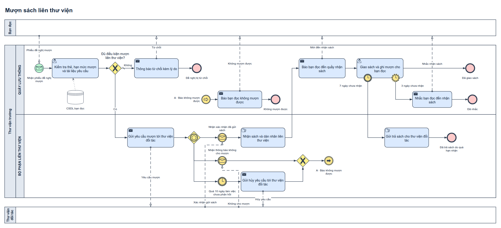

# Mượn sách liên thư viện — ví dụ BPMN

Đề tự đặt để minh họa đầu ra của skill [bpmn-drawio](../../../skills/bpmn-drawio/README.md). Đây là mô hình minh họa, **chưa được thủ thư hoặc chủ quy trình xác nhận**.

| Bản | Nguồn chỉnh sửa | Ảnh | PDF |
|---|---|---|---|
| Thường (`monochrome`) | [Lien_thu_vien.drawio](Lien_thu_vien.drawio) | [PNG](normal/01-muon-sach-lien-thu-vien.png) · [SVG](normal/01-muon-sach-lien-thu-vien.svg) | [PDF](normal/01-muon-sach-lien-thu-vien.pdf) |
| Màu (`bizagi-inspired`) | [Lien_thu_vien_Co_mau.drawio](Lien_thu_vien_Co_mau.drawio) | [PNG](color/01-muon-sach-lien-thu-vien.png) · [SVG](color/01-muon-sach-lien-thu-vien.svg) | [PDF](color/01-muon-sach-lien-thu-vien.pdf) |



## Đề tự đặt

Bạn đọc gửi phiếu đề nghị mượn một tài liệu thư viện trường không có. Quầy lưu thông kiểm tra thẻ, hạn mức và tài liệu; không đủ điều kiện thì báo từ chối kèm lý do. Đủ điều kiện thì bộ phận liên thư viện gửi yêu cầu cho thư viện đối tác và chờ một trong ba khả năng: đối tác xác nhận đã gửi sách, báo không cho mượn, hoặc quá 10 ngày làm việc không phản hồi (khi đó gửi hủy yêu cầu). Khi nhận sách, thư viện dán nhãn và mời bạn đọc đến nhận. Sau 3 ngày chưa đến thì nhắc một lần nhưng vẫn giữ sách; sau 7 ngày chưa nhận thì dừng chờ và gửi trả sách cho đối tác.

## Yêu cầu → phần tử

| Yêu cầu (F = dữ kiện đề, A = giả định) | Phần tử | Ghi chú |
|---|---|---|
| F: Bạn đọc gửi phiếu | Pool `Bạn đọc` (black-box), message → Message Start | Một phiếu tạo một lần xử lý |
| F: Kiểm tra thẻ, hạn mức, tài liệu | User task `T1`, data store `CSDL bạn đọc` | T1 tạo kết quả; XOR `G1` chỉ đọc kết quả |
| F: Không đủ → báo từ chối kèm lý do | Nhánh mặc định `Không` → send task → End `Đề nghị bị từ chối` | Slash mặc định |
| F: Gửi yêu cầu cho đối tác | Lane `BỘ PHẬN LIÊN THƯ VIỆN`, send task | Sequence đi qua lane trong cùng pool |
| F: Chờ một trong ba khả năng | Event-based gateway → catch Message, catch Message, catch Timer | Sự kiện đến trước thắng; không có điều kiện trên nhánh |
| F: Quá hạn thì hủy yêu cầu | Timer catch → send task hủy | A: 10 ngày làm việc tính từ khi gửi yêu cầu |
| F: Từ chối hoặc hết hạn đều báo bạn đọc | XOR gộp → Link throw → Link catch cùng tên → send task → End | Cặp Link tránh đường nối dài quay ngược |
| F: Nhận sách, dán nhãn, mời đến nhận | Manual task (vật lý) → send task | Nhận sách vật lý tách khỏi xác nhận thông tin |
| F: 3 ngày chưa đến thì nhắc, vẫn giữ sách | Boundary timer **không ngắt** (vòng đứt) → send task → End `Đã nhắc` | Task giao sách vẫn tiếp tục chờ |
| F: 7 ngày chưa nhận thì trả sách | Boundary timer **ngắt** (vòng liền) → manual task → End | Gửi trả là việc vật lý, không vẽ thành message flow |

Màu đỏ ở mọi End chỉ có nghĩa “kết thúc”, kể cả `Đã giao sách`.

## Giả định và câu hỏi mở

- Không mô tả việc bạn đọc làm sau khi nhận thông báo (pool black-box).
- Phản hồi của đối tác đến sau khi đã gửi hủy không được mô hình hóa; hệ thống thật cần quy tắc tương quan/hủy.
- Không có phí, đặt cọc, gia hạn — ngoài phạm vi đề tự đặt.

## Tạo lại và kiểm tra

```bash
python3 -B tao_so_do.py ĐƯỜNG_DẪN/skills/bpmn-drawio .
python3 -B ĐƯỜNG_DẪN/skills/bpmn-drawio/scripts/render_drawio.py Lien_thu_vien_Co_mau.drawio --drawio-root DRAWIO --output-dir color --text-mode plain --pdf
python3 -B ĐƯỜNG_DẪN/skills/bpmn-drawio/scripts/audit_drawio.py Lien_thu_vien_Co_mau.drawio --render-dir color --compare Lien_thu_vien.drawio --palette bizagi-inspired --strict-layout --require-supported --report check-color.json
```

Khi dựng bản này, audit hai bản không có lỗi cấu trúc/palette, `--strict-layout` và `--require-supported` đạt, so sánh chỉ khác màu đạt. Manual-review notes còn lại: association dữ liệu và event-based gateway. Ảnh đã được đọc lại bằng mắt. Bản nháp đầu bị chính checker bắt 5 lỗi bố cục có thật trước khi sửa.
